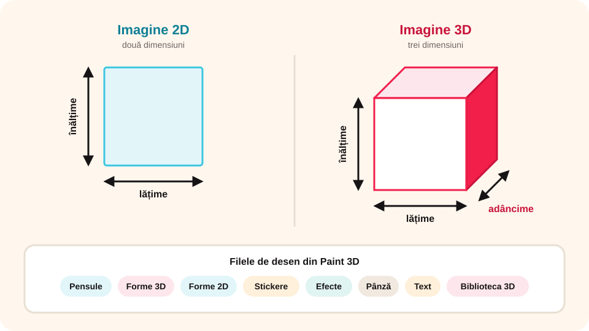

> **Competențe specifice (Anexa 15):** CS 1.2, CS 3.2

## Ce vei învăța azi

- diferența dintre o imagine **2D** și una **3D**;
- ce avantaje are **grafica 3D** și ce este o **animație grafică**;
- câteva **aplicații** pentru modelare 3D și animații;
- să recunoști **interfața Paint 3D** și meniurile sale.

## Să ne amintim

Anul trecut ai desenat în **Paint**: forme, culori, selecție, copiere, rotire, text. Toate aceste operații le vei regăsi și în 3D.

## Lecția pe scurt

### 2D și 3D



- O imagine **2D** are două dimensiuni: **lățime** și **înălțime**.
- O imagine **3D** are și a treia dimensiune: **adâncimea**.

### De ce grafică 3D?

- arată **foarte realist** și ilustrează mai bine subiectul;
- detaliile se văd ușor, iar **mărimea** obiectelor se înțelege mai bine;
- e folosită în **arhitectură** și **design**: vezi clădirea sau obiectul înainte să fie construit și găsești greșelile de proiectare;
- are **impact vizual** mare în reclame și promovare.

Dezavantaj: se lucrează mai **greu** și mai **mult**, iar tu ai nevoie de **vedere în spațiu**.

### Ce este o animație?

**Animația** este o **iluzie a mișcării**: imagini statice, fiecare cu o fază a mișcării, sunt derulate repede una după alta. Imaginile pot fi desenate de mână, fotografiate sau **generate pe calculator**. În ultimul caz vorbim de **animație grafică**.

### Aplicații pentru 3D și animații

Paint 3D, Tinkercad, Scratch, Toontastic, Alice, Pivot Animator, Unity, Autodesk 123 Design, Minecraft Education, Google Web Designer și altele. Unele se folosesc **online**, altele se **instalează**.

### Paint 3D

**Paint 3D** este un editor grafic de la Microsoft, apărut în 2017, în Windows 10. Cu el creezi grafică **2D** și **3D**, transformi imagini 2D în 3D și faci **animații 3D**.

> **Atenție:** Windows 11 nu mai include Paint 3D, iar din 2024 Microsoft nu îl mai oferă în Microsoft Store. Dacă nu îl ai deja pe calculator, poți folosi în loc **Tinkercad** (gratuit, online), unde găsești aceleași idei: forme 3D, mutare, rotire, redimensionare. Pentru un cont Tinkercad cere ajutorul profesorului.

**Pornire:** **Start → Toate aplicațiile → Paint 3D**, sau **Start**, scrii `Paint 3D` și apeși **Enter**.

**Ecranul de start:** **Nou** (proiect nou), **Deschidere** (proiect existent), **Lipire** (proiect nou cu ce ai copiat în Clipboard).

**Fișierele** se pot salva ca:

- model 3D: **.glb**, **.3mf**;
- imagine: **.png**, **.jpeg**, **.bmp**, **.gif**, **.tiff**;
- video: **.mp4**, **.gif**.

### Fereastra Paint 3D

1. **Bara de titlu**: numele fișierului și butoanele ferestrei;
2. **Panglica**: meniurile (le numim tot **file**) și comenzile;
3. **Bara de comenzi**: alte comenzi, inclusiv **panoramarea** (zoom) și **Vizualizare 3D**;
4. **Panoul filei**: în **dreapta**, cu instrumentele filei alese;
5. **Pânza de desenare** (*Canvas*): spațiul pe care desenezi.

### Panglica

- **Meniu**: creare, deschidere, inserare, salvare, export, tipărire;
- **Lipire**, **Anulare**, **Refacere** și **Istoric** (poți exporta istoricul operațiilor ca film **.mp4**).

**Filele de desen:**

| Filă | Ce conține |
|---|---|
| **Pensule** | tipuri de pensule, culori, opacitate, grosime |
| **Forme 3D** | modele și forme 3D, culori, efecte |
| **Forme 2D** | linii, curbe și forme 2D |
| **Stickere** | imagini mici și **texturi** de pus pe obiecte; poți importa și stickere proprii |
| **Efecte** | filtre și iluminare |
| **Pânză** | vizibilă sau transparentă, dimensiune, rotire |
| **Text** | text 2D și 3D: font, mărime, aliniere, aldin, cursiv |
| **Biblioteca 3D** | modele 3D gata făcute, pe care le poți folosi |

**Știai că…?** Primul Paint a apărut în **1985**, în Windows 1.0.

## Exemplu rezolvat

**Sarcina:** vrei să pui o textură de lemn pe un cub.

1. Deschizi fila **Forme 3D** și desenezi un cub (ținând **Shift**).
2. Cu cubul selectat, deschizi fila **Stickere**.
3. Alegi din panoul din dreapta o **textură** de lemn.
4. Tragi textura peste cub și confirmi.
5. Apeși **Vizualizare 3D** pe bara de comenzi și rotești cubul ca să-l vezi din toate părțile.

## Aplicații interactive

```categorii
# 2D sau 3D?
2D: un desen în Paint, o fotografie, un afiș tipărit
3D: o sferă modelată în Paint 3D, un personaj din Biblioteca 3D, macheta unei clădiri pe calculator
```

```quiz
# Alege răspunsul corect.
Ce dimensiune are în plus o imagine 3D față de una 2D?
- greutatea
* adâncimea
- culoarea

Din ce filă adaugi o textură pe un obiect 3D?
- Efecte
* Stickere
- Pânză

Ce este Paint 3D?
* un editor grafic
- un sistem de operare
- o aplicație pentru gestionarea documentelor

Cu ce extensie salvezi un model 3D din Paint 3D?
* .glb
- .pptx
- .mp3
```

```adevarat-fals
F: Panglica Paint 3D are o filă numită Revizuire. | Revizuire este o filă din PowerPoint, nu din Paint 3D.
A: Când stai cu mouse-ul deasupra unui buton, apare o etichetă cu numele lui.
A: Dimensiunea pânzei de lucru poate fi modificată.
A: Animația este o iluzie a mișcării, creată din imagini statice derulate repede.
```

```cartonase
# Filele Paint 3D
Pensule = desen liber cu diferite tipuri de pensule
Forme 3D = modele și forme cu volum
Forme 2D = linii, curbe și forme plane
Stickere = imagini și texturi de pus pe obiecte
Pânză = dimensiunea și transparența spațiului de lucru
Biblioteca 3D = modele 3D gata făcute
```

## Exersează

1. Deschide Paint 3D și creează un proiect nou. Panoramează la **50%**, **100%**, apoi **200%**.
2. Apasă pe fiecare filă de pe panglică și descoperă ce conține.
3. Apasă de două ori **Vizualizare 3D**. Ce observi?
4. Apasă tasta **Alt**: apar litere peste butoane. Încearcă trei scurtături.
5. Fă o paralelă între **Paint** și **Paint 3D**: trei asemănări și trei deosebiri.
6. Se pot pune pe un obiect 3D stickere desenate de tine în Paint?
7. **Portofoliu:** poate Paint 3D să înlocuiască vechiul Paint? Scrie o compunere de cel mult 300 de cuvinte cu părerea ta.

## Verifică-te

- Care sunt cele trei dimensiuni ale unei imagini 3D?
- Poți numi patru file din Paint 3D și ce conțin?

## Pe scurt

O imagine **3D** are **lățime**, **înălțime** și **adâncime**, arată realist și are impact mare. **Animația** este o iluzie a mișcării, din imagini derulate repede. **Paint 3D** are panglica cu file (**Pensule**, **Forme 3D**, **Forme 2D**, **Stickere**, **Efecte**, **Pânză**, **Text**, **Biblioteca 3D**), panoul filei în dreapta și pânza de desenare.
