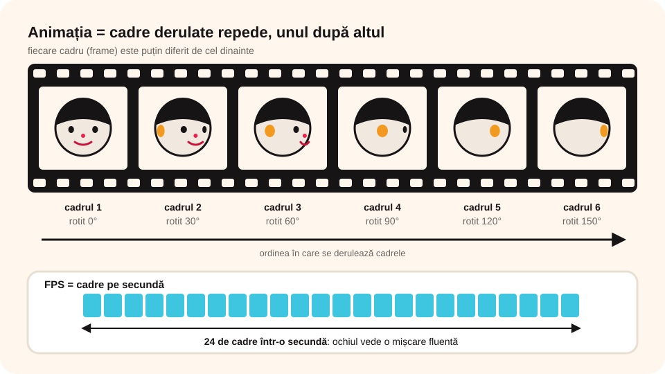

## Ce vei învăța azi

- de ce începi orice animație cu un **scenariu**;
- ce sunt **cadrele** (*frame-urile*) și ce înseamnă **FPS**;
- cum faci o animație în **Toontastic**: povești, decoruri, personaje, înregistrare;
- ce înseamnă **testarea** și **depanarea** unei animații.

## Să ne amintim

În Paint 3D ai salvat o animație cu mișcări **predefinite** (placă turnantă, legănare). Azi vei face animații cu mișcări alese de **tine**.

## Lecția pe scurt

### Scenariul

Orice animație începe cu un **scenariu**: ce se întâmplă, în ce ordine, ce **cadre** are, ce **decoruri** și **personaje** apar în fiecare cadru și ce își spun personajele.

### Cadre și FPS



O animație este o derulare rapidă a mai multor **cadre** (*frame-uri*): imagini statice, fiecare puțin diferită de cea dinainte. Împreună refac mișcarea.

**FPS** (*frames per second*, cadre pe secundă) arată câte cadre se succed într-o secundă. De el depind **viteza** și **calitatea** animației. La **24 de cadre pe secundă**, ochiul vede o mișcare **fluentă**.

**Exemplu:** rotirea capului unui personaj desenat în Paint 3D. Salvezi o imagine cu el din față, îl rotești cu **30°** și salvezi altă imagine, și tot așa, până ajunge iar cu fața la tine. Derulate repede, imaginile arată capul cum se rotește.

Unele programe lucrează cu **cadrele pregătite de tine** (de exemplu, **Scratch**). Altele **generează singure** cadrele (Paint 3D, Toontastic): tu vezi doar mișcarea finală.

### Toontastic

**Toontastic 3D** este o aplicație ușoară pentru animații 3D, pentru tablete și telefoane **Android** sau **Chromebook**. Mișcarea o generează aplicația: tu doar **tragi personajele** pe drumul dorit și **povestești**.

> Dacă nu ai Toontastic, poți face aceleași etape (scenariu, decor, personaje, înregistrare) în **Scratch**, cu personaje și costume.

**Trei tipuri de povești**, fiecare cu „harta” ei:

| Poveste | Părți |
|---|---|
| **Short Story** (poveste scurtă) | Început, Mijloc, Sfârșit |
| **Classic Story** (poveste clasică) | Configurare, Conflict, Încercare, Punct culminant, Rezoluție |
| **Science Report** (raport științific) | Întrebare, Ipoteză, Experiment, Rezultate, Concluzie |

Fiecare parte este un **cadru** (scenă) cu animația ei. Raportul științific este o alternativă amuzantă la o prezentare PowerPoint.

### Pașii unei animații în Toontastic

1. Apeși **+** și alegi tipul de poveste (de exemplu, **Short Story**). Cu **+** de jos poți **insera**, **muta** sau **șterge** cadre.
2. Alegi cadrul **Început** și un **decor** (sau îl desenezi cu **Draw your own**).
3. **Desenezi un personaj** cu paleta de culori, grosimea liniei, găletușa și guma. Personajul devine **3D**; îi reglezi **grosimea**, apeși **FINISH** și îi dai un nume.
4. Adaugi un personaj din **galerie**.
5. Editezi personajele: le **mărești/micșorezi** cu două degete, le **rotești**, le **poziționezi** trăgându-le.
6. Apeși **START**: muți personajele și povestești. Apeși **STOP**. Aplicația înregistrează **mișcarea** și **vocea**.
7. Alegi o **melodie** de fundal și volumul.
8. Dai un **nume** poveștii și o **exporți** ca fișier **.mp4** în galeria dispozitivului.

Animațiile făcute se pot **edita**, **exporta**, **șterge** sau **reda**. Un personaj din galerie îl poți colora altfel sau îi poți pune **fața ta**, cu camera dispozitivului (aplicația îți cere întâi **permisiunea**).

### Testare și depanare

- **Testarea**: rulezi animația și verifici, pas cu pas, dacă urmează scenariul.
- **Depanarea**: rezolvi problemele găsite la testare.

Le repeți până nu mai ai nicio observație.

## Exemplu rezolvat: scenariu pentru o poveste scurtă

**Tema:** doi colegi în clasă; unul, în scaun cu rotile, este ajutat de prietenul lui să ajungă la tablă.

- **Început**: decorul este sala de clasă; apar cei doi colegi, care se salută.
- **Mijloc**: profesorul îl cheamă la tablă pe colegul în scaunul cu rotile; o bancă îi blochează drumul, iar prietenul o mută.
- **Sfârșit**: colegul rezolvă exercițiul, iar clasa aplaudă.

Pentru fiecare parte notezi: decorul, personajele, mișcările și replicile. Abia apoi deschizi aplicația.

## Aplicații interactive

```ordonare
# Pune în ordine părțile unei povești clasice (Classic Story).
Configurare: personajele și introducerea în poveste
Conflict: apare o problemă
Încercare: problema se complică
Punct culminant: personajele rezolvă problema
Rezoluție: arăți că problema s-a rezolvat
```

```quiz
# Alege răspunsul corect.
Ce înseamnă FPS?
- fișiere pe secundă
* cadre pe secundă (frames per second)
- forme pe scenă

Câte cadre pe secundă asigură o mișcare fluentă pentru ochiul omului?
- 2
* 24
- 1000

Ce faci înainte să deschizi aplicația de animație?
* scrii scenariul: acțiunea, cadrele, decorurile, personajele și replicile
- exporți animația
- alegi melodia de fundal

Câte părți are o poveste de tip Science Report?
- trei
* cinci
- șapte
```

```categorii
# Ce tip de poveste are aceste părți?
Short Story: Început, Mijloc, Sfârșit
Classic Story: Conflict, Punct culminant, Rezoluție
Science Report: Ipoteză, Experiment, Concluzie
```

```adevarat-fals
A: Scratch lucrează cu cadrele pregătite de tine, sub formă de costume.
F: O animație generată automat nu folosește cadre. | Aplicația creează singură cadrele, dar tu vezi doar mișcarea finală.
A: Testarea și depanarea se repetă până nu mai există nicio problemă.
A: Toontastic exportă animațiile ca fișiere .mp4.
```

## Exersează

1. Fă după pașii de mai sus o poveste scurtă în Toontastic (sau în Scratch).
2. Creează o **poveste clasică**. Adaugă-i o parte nouă, **Încercare**, cu un scenariu al tău. Schimbă melodia unui cadru.
3. Adaugă două personaje „spectatori”. Mută unul în alt loc al scenei și șterge-l pe celălalt.
4. Fă un personaj 3D numit **Gogu**, cu o gură zâmbitoare și păr negru.
5. Realizează o **felicitare animată** pentru ziua bunicii.
6. **Portofoliu:** caută informații despre **Jules Verne** și fă o animație cu trei personaje (unul fiind Gogu), cu tema „Pe urmele lui Jules Verne”.

## Verifică-te

- Ce este un cadru (frame)?
- Care sunt cele trei tipuri de povești din Toontastic?
- Ce diferență este între testare și depanare?

## Pe scurt

O animație începe cu un **scenariu** și este o derulare rapidă de **cadre**. La **24 FPS** mișcarea pare fluentă. În **Toontastic** alegi tipul de poveste (**Short Story**, **Classic Story**, **Science Report**), decorul și personajele, apoi înregistrezi mișcarea și vocea și exporți **.mp4**. La final **testezi** și **depanezi**.
