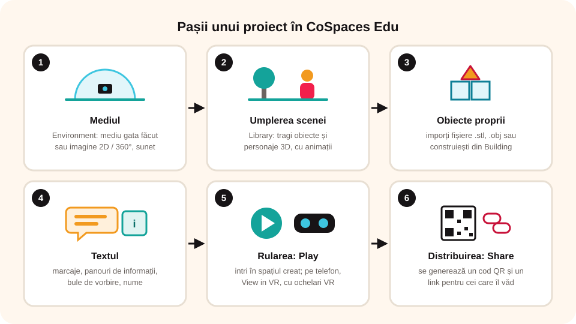

> **Competențe specifice (Anexa 15):** CS 1.2, CS 3.2

## Ce vei învăța azi

- ce este **realitatea virtuală** (VR) și unde se folosește;
- ce este un **infografic**;
- să creezi un proiect în **CoSpaces Edu**: mediu, obiecte, text;
- să **rulezi** și să **distribui** proiectul.

## Să ne amintim

Un obiect **3D** are lățime, înălțime și adâncime și îl poți privi din orice unghi. În realitatea virtuală, chiar tu „intri” în spațiul 3D.

## Lecția pe scurt

### Realitatea virtuală

**Realitatea virtuală** (în engleză, *Virtual Reality*, prescurtat **VR**) este un spațiu creat pe calculator, în care te poți uita în jur ca și cum ai fi acolo. Se folosește la jocuri, expoziții virtuale, povești, simulări de experimente sau fenomene, modelări de obiecte și infografice.

Programe pentru VR: **CoSpaces Edu**, Unity, Unreal Engine, Google VR SDK și altele.

Ca să vezi un proiect în VR ai nevoie de **ochelari VR**. Unii se fac chiar din **carton**, în care pui un telefon inteligent.

### Ce este un infografic?

**Infograficul** este un mod rapid și atractiv de a prezenta un subiect, fără pagini întregi de text. Numele vine din „**informație**” + „**grafic**”: o imagine plină de date, care arată pe scurt rezultatele unui studiu sau ale unei cercetări.

### CoSpaces Edu



Aplicația este online, la **cospaces.io**. Ai nevoie de un cont: **profesorul** îți trimite o **invitație** în clasa lui, iar tu intri direct.

**Pașii unui proiect:**

1. **Mediul înconjurător.** Începi într-un spațiu gol, cu o **cameră** în centru: ea stabilește din ce unghi va fi privit spațiul. Din fila **Environment** (Mediu) alegi un mediu gata făcut sau imporți o imagine **2D** ori **360°** și un sunet de fundal. **Grila** te ajută să aliniezi obiectele.
2. **Umplerea scenei.** Din **Library** (Bibliotecă) tragi în spațiu obiecte și personaje 3D. Personajelor le poți schimba culoarea pielii, a părului, a hainelor și le poți da **animații**.
3. **Obiecte proprii.** Poți importa obiecte făcute în alte programe (fișiere 3D **.stl** și **.obj**), imagini, imagini 360° și sunete. În secțiunea **Building** găsești forme simple, din care îți construiești singur obiectele.
4. **Textul.** La dublu clic pe un obiect îi poți adăuga **marcaje**, **panouri de informații**, **bule de vorbire** sau un **nume**. Marcajele și panourile își păstrează poziția din orice unghi te uiți.
5. **Rularea.** Apeși **Play** (dreapta sus) și intri în spațiul creat. Pe telefon ai și modul **View in VR**.
6. **Distribuirea.** Apeși **Share**: se generează un **cod QR** și un **link**, prin care și alții îți văd proiectul online.

**Sfat:** într-un infografic VR nu ascunde informații importante în spatele obiectelor. Verifică des cum arată în modul VR.

## Exemplu rezolvat: harta pădurilor României

**Sarcina:** un infografic care arată în ce regiuni ale țării sunt cele mai mari suprafețe de pădure.

1. **Environment**: imporți ca fundal o imagine cu **harta României**.
2. **Library**: tragi copaci 3D pe hartă: mai mulți în regiunile cu păduri mari, mai puțini unde sunt mici.
3. Pui un **panou de informații** lângă fiecare regiune, cu procentul de pădure găsit la documentare (și sursa datelor).
4. Apeși **Play** și verifici că niciun panou nu e ascuns de copaci.
5. Apeși **Share** și le trimiți colegilor **linkul**.

## Aplicații interactive

```ordonare
# Pașii unui proiect CoSpaces, în ordine
Alegi mediul înconjurător
Tragi obiecte și personaje din Bibliotecă
Adaugi texte și panouri de informații
Rulezi proiectul cu Play
Distribui proiectul cu Share
```

```quiz
# Alege răspunsul corect.
De unde vin inițialele VR?
- Very Real
* Virtual Reality
- View Right

Ce este un infografic?
* o imagine care prezintă rapid, cu date și grafică, un subiect
- un tabel cu foarte mult text
- un tip de virus informatic

Cum îți testezi proiectul CoSpaces?
* apeși butonul Play
- apeși butonul Load
- apeși butonul Verify

Ce generează butonul Share?
- o copie de rezervă pe stick
* un cod QR și un link pentru alții
- un fișier .pptx
```

```adevarat-fals
A: În CoSpaces poți importa obiecte 3D făcute în alte programe.
F: Ochelarii VR pot fi doar foarte scumpi. | Se pot face și din carton, cu un telefon inteligent.
A: Marcajele și panourile de informații își păstrează poziția din orice unghi le privești.
F: Într-un infografic VR e bine să ascunzi informațiile în spatele obiectelor. | Informațiile importante trebuie să se vadă clar.
```

```cartonase
# Termeni de reținut
Realitate virtuală (VR) = spațiu creat pe calculator, în care te poți uita în jur ca și cum ai fi acolo
Infografic = imagine care prezintă rapid un subiect, prin date și grafică
Environment = mediul înconjurător al proiectului CoSpaces
Library = biblioteca de obiecte și personaje 3D
Share = distribuirea proiectului prin cod QR sau link
```

## Exersează

1. Caută exemple de infografice. Imaginează-ți trei situații în care ți-ar folosi unul.
2. În CoSpaces, alege un mediu și pune personaje în diferite poziții. Din ce unghi se văd toate întregi?
3. Care crezi că e un avantaj al unui proiect de realitate virtuală?
4. Documentează-te și fă un infografic CoSpaces despre județele cu cele mai multe mașini mai vechi de zece ani. Notează sursa datelor.
5. **Portofoliu:** fă un colaj 3D cu un peisaj pe care l-ai pune într-un proiect CoSpaces: cel puțin **două clădiri** și **trei copaci**.

## Verifică-te

- De ce ai nevoie ca să vezi un proiect în modul VR?
- Care sunt cei șase pași ai unui proiect CoSpaces?

## Pe scurt

**Realitatea virtuală (VR)** îți permite să „intri” într-un spațiu 3D. Un **infografic** arată rapid un subiect prin date și imagini. În **CoSpaces Edu** alegi **mediul**, tragi obiecte din **bibliotecă**, adaugi **texte** și **panouri**, apoi **rulezi** cu **Play** și **distribui** cu **Share**.
