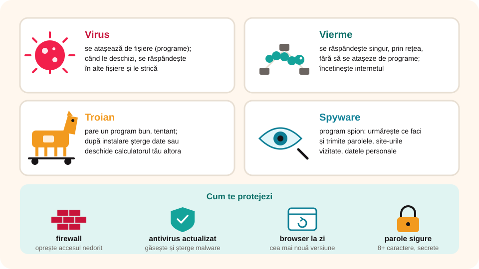

## Ce vei învăța azi

- ce este un program **malware** și cum ajunge pe calculator;
- care sunt tipurile de malware: **virus**, **vierme**, **troian**, **spyware**;
- cum îți alegi o **parolă sigură**;
- cum te protejezi: **firewall**, **antivirus**, actualizări.

## Să ne amintim

**Internetul** este o rețea mondială de rețele de calculatoare, care comunică după standardul **TCP/IP**. Servicii importante:

- **e-mail**: poșta electronică;
- **WWW** (*World Wide Web*): documente legate între ele;
- **FTP**: transferul fișierelor;
- **Telnet**: lucrul de la distanță pe alt calculator;
- **IRC**: mesaje în timp real (chat).

## Lecția pe scurt

### Ce este malware?

**Malware** vine din engleză, *malicious software*: „program răuvoitor”. Se instalează **fără permisiunea ta** și poate strica fișierele, calculatorul sau o rețea întreagă. Poate chiar să **trimită datele tale** celor care l-au creat: parole, date bancare. Așa se ajunge la **furt de identitate** și la furtul banilor din conturi.

**Cum ajunge pe calculator:**

- când **descarci** un fișier de pe internet;
- când deschizi un **fișier atașat** la un e-mail;
- când dai clic pe o **reclamă** sau pe un **link necunoscut**.

### Tipuri de malware



| Tip | Ce face |
|---|---|
| **Virus** | se atașează de fișiere (de obicei programe); când le deschizi, se răspândește și în alte fișiere și le strică |
| **Vierme** (*worm*) | se răspândește **singur**, prin rețea, fără să se atașeze de alte programe; încetinește internetul |
| **Troian** | se deghizează într-un program bun, tentant; după ce îl instalezi, șterge date sau deschide calculatorul pentru alții |
| **Spyware** | „program spion”: urmărește ce faci și trimite site-urile vizitate, parolele, datele personale |

Numele **troianului** vine din mitologia greacă: grecii au lăsat la porțile Troiei un cal uriaș de lemn, cu războinici ascunși în el. Troienii l-au crezut un dar și l-au dus în cetate. Noaptea, războinicii au ieșit și au cucerit Troia.

### Parolele

- Parolele sunt **personale** și **secrete**. Nu le spui nici celui mai bun prieten.
- O parolă bună are **cel puțin 8 caractere** și amestecă **litere mari**, **litere mici**, **cifre** și **caractere speciale**.
- **Nu** folosești în parolă numele tău, al familiei sau data nașterii: se ghicesc ușor.
- Te înscrii pe site-uri doar **cu acordul părinților sau al profesorului**.

### Măsuri de protecție

- **Firewall**: un sistem care oprește accesul nedorit la calculator;
- **browser actualizat** la cea mai nouă versiune;
- **antivirus**: program care găsește, izolează și șterge programele malware. Se **actualizează** des, ca să recunoască amenințările noi. Exemple: Bitdefender (românesc), Microsoft Defender, Kaspersky, Avast, Avira, ESET NOD32, McAfee.

## Exemplu rezolvat

Primești un e-mail de la o adresă necunoscută: „Ai câștigat o tabletă! Deschide fișierul atașat `premiu.exe`.” Ce faci?

1. Te uiți la **expeditor**: nu îl cunoști.
2. Te uiți la **atașament**: `.exe` este un **program**. Un program primit pe e-mail poate fi un **troian**.
3. **Nu** deschizi fișierul și **nu** dai clic pe linkuri.
4. Le spui **părinților** sau **profesorului**.
5. Ștergi mesajul sau îl marchezi ca **spam**.

## Aplicații interactive

```categorii
# Ce tip de malware este?
Virus: se atașează de fișiere și se răspândește când le deschizi
Vierme: se înmulțește singur prin rețea
Troian: pare un program bun, dar e dăunător
Spyware: te spionează și trimite datele tale
```

```quiz
# Alege răspunsul corect.
Ce înseamnă malware?
* program dăunător
- program care nu funcționează corect
- program pentru cei care nu se îmbracă asortat

Care parolă este cea mai sigură?
- ana2012
- 12345678
* T!gru_Verde7
Explicație: Are peste 8 caractere, litere mari și mici, cifre și caractere speciale, și nu conține date personale.

Ce site este potrivit vârstei tale?
- un site de știri despre dezastre
* un site cu jocuri educaționale, recomandat de profesor
- un site de socializare unde vorbești cu necunoscuți
```

```adevarat-fals
A: Un antivirus trebuie actualizat periodic.
F: Poți să-i spui parola celui mai bun prieten. | Parolele sunt personale și secrete.
A: Malware poate ajunge pe calculator dacă dai clic pe o reclamă necunoscută.
F: Firewall-ul este un tip de virus. | Firewall-ul te protejează de accesul nedorit.
```

```cartonase
# Termeni de reținut
Malware = program răuvoitor, instalat fără permisiunea ta
Furt de identitate = cineva îți fură datele și se folosește de ele în locul tău
Firewall = sistem care oprește accesul nedorit la calculator
Antivirus = program care găsește și șterge programele malware
Parolă sigură = cel puțin 8 caractere amestecate, fără date personale
```

## Exersează

1. Numește trei tipuri de malware și ce face fiecare.
2. Argumentează de ce un antivirus te protejează.
3. Caută informații despre **Bitdefender**: cine l-a creat și din ce țară este?
4. Intră pe **oradenet.ro**, proiectul organizației Salvați Copiii despre siguranța online. Notează două sfaturi care ți se par importante.
5. **Lucru în perechi:** alegeți fiecare un antivirus și încercați să vă convingeți colegul să-l instaleze.
6. **Dezbatere:** „Un cont de utilizator pe internet: oportunitate sau amenințare?”
7. **Portofoliu:** fă un **poster** cu măsurile de protecție împotriva malware.

## Verifică-te

- Pe ce trei căi ajunge cel mai des malware pe calculator?
- Ce reguli respecți când îți alegi o parolă?

## Pe scurt

**Malware** înseamnă programe răuvoitoare: **virus**, **vierme**, **troian**, **spyware**. Ajung pe calculator prin descărcări, atașamente și linkuri necunoscute. Te protejezi cu **parole sigure** și secrete, **firewall**, **antivirus** actualizat și un browser la zi. Te înscrii pe site-uri doar cu acordul părinților sau al profesorului.
