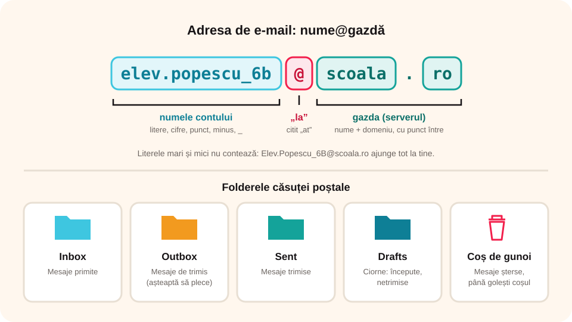

## Ce vei învăța azi

- ce este **poșta electronică** și la ce folosește;
- ce **avantaje** are față de poșta clasică;
- diferența dintre un **client de e-mail** și **webmail**;
- din ce e formată o **adresă de e-mail**;
- ce **foldere** are o căsuță poștală.

## Să ne amintim

**E-mailul** este unul dintre principalele servicii ale internetului, alături de WWW, FTP, Telnet și IRC.

## Lecția pe scurt

### Ce este poșta electronică?

Poșta electronică (**e-mailul**) trimite o scrisoare **în formă electronică**, cu un calculator, o tabletă sau un telefon, nu pe hârtie, în plic, cu timbru. Mesajul trimis se numește tot **e-mail**.

**Scopul:** mesajul ajunge într-o **căsuță poștală virtuală**, de unde destinatarul îl citește când vrea.

### Avantaje

- **preț mic**: plătești doar accesul la internet, pe care oricum îl ai;
- **viteză**: ajunge în câteva **secunde**, oriunde în lume (scrisoarea clasică face zile);
- **comoditate**: nu mergi la poștă, nu cumperi timbru; scrii și apeși **Trimite**.

**Dezavantaj:** un e-mail poate avea atașat un fișier **virusat**.

### Ce îți trebuie

- **conexiune** la internet;
- un **dispozitiv**: calculator, tabletă sau telefon;
- un **cont de e-mail** la un furnizor;
- un **browser** sau un **program de e-mail**.

### Client de e-mail sau webmail?

1. **Clientul de e-mail** este un program instalat pe dispozitiv: **Outlook** (Microsoft Office), Windows Mail, Mozilla Thunderbird, eM Client și altele.
2. **Webmail** înseamnă că intri în căsuța poștală dintr-un **browser**, pe site-ul furnizorului (Gmail, Outlook.com, Yahoo! Mail).

| Client de e-mail | Webmail (în browser) |
|---|---|
| mesajele se descarcă pe dispozitiv; le citești și **fără internet** | mesajele stau pe **serverul** furnizorului; ai nevoie de **internet** |
| le vezi doar pe dispozitivul pe care e instalat programul | intri de **oriunde**, de pe orice dispozitiv, cu numele de utilizator și parola |
| spațiul depinde de memoria dispozitivului | spațiul e stabilit de furnizor (de obicei suficient) |

### Adresa de e-mail



Are formatul **nume@gazdă**:

1. **numele contului**: litere, cifre, punct, minus, liniuță de subliniere (`_`). Literele mari și mici **nu contează**.
2. caracterul **@**, citit „**at**” sau „a rond”, înseamnă „**la**”;
3. **gazda**: serverul pe care e căsuța, cu un nume și un domeniu despărțite prin punct (de exemplu, `gmail.com`).

Exemple: `nume@gmail.com`, `nume@outlook.com`, `nume@yahoo.com`.

Furnizori populari: **Gmail** (Google), **Outlook** (Microsoft), **Yahoo! Mail**, **AOL Mail**.

**Știai că…?** În suedeză, @ se numește „a cu trompă de elefant”, iar în italiană, „melcușor”.

### Folderele căsuței poștale

| Folder | Ce găsești acolo |
|---|---|
| **Inbox** (Mesaje primite) | mesajele primite |
| **Outbox** (Mesaje de trimis) | mesajele scrise, care așteaptă să plece |
| **Sent** (Mesaje trimise) | mesajele trimise de tine |
| **Drafts** (Ciorne) | mesajele începute, netrimise |
| **Deleted Items** / **Coș de gunoi** | mesajele șterse, până golești coșul |

Poți crea și **foldere proprii** (de exemplu, pentru fiecare materie). În **Gmail** se folosesc **etichete**: un mesaj poate avea mai multe etichete deodată.

## Exemplu rezolvat

Desparte adresa `elev.popescu_6b@scoala.ro` în părți:

1. Cauți caracterul **@**.
2. Înaintea lui este **numele contului**: `elev.popescu_6b`. Conține litere, punct, liniuță de subliniere și cifre, toate permise.
3. După @ este **gazda**: `scoala.ro`. Are numele `scoala` și domeniul `ro`, despărțite prin punct.
4. Dacă cineva scrie `Elev.Popescu_6B@scoala.ro`, mesajul ajunge **tot la tine**: literele mari și mici nu contează.

## Aplicații interactive

```quiz
# Alege răspunsul corect.
Ce caracter conține obligatoriu orice adresă de e-mail?
* @
- #
- &

Ce este poșta electronică?
- un browser
* un serviciu al internetului
- un antivirus
- un editor de imagini

Care este un client de e-mail?
- Gmail
- Yahoo! Mail
* Microsoft Outlook
Explicație: Outlook se instalează pe calculator; Gmail și Yahoo! Mail se folosesc de obicei în browser.

Care este un dezavantaj al e-mailului?
- nu are costuri suplimentare
* poate avea atașat un fișier virusat
- poate fi trimis la mai multe persoane deodată
```

```categorii
# În ce folder ajunge mesajul?
Inbox: un mesaj primit de la profesor
Sent: un mesaj pe care l-ai trimis ieri
Drafts: un mesaj început și netrimis
Coș de gunoi: un mesaj pe care tocmai l-ai șters
```

```adevarat-fals
F: Poți folosi poșta electronică fără internet. | Ai nevoie de internet ca să trimiți și să primești mesaje.
A: Poți folosi e-mailul dintr-un browser.
A: Într-o adresă de e-mail nu contează literele mari și mici.
F: Cu webmail îți vezi mesajele doar pe un singur calculator. | Intri de oriunde, dacă ai internet.
```

```completare
# Completează.
O adresă de e-mail are formatul nume[@]gazdă. Caracterul @ înseamnă „[la]”. Mesajele primite ajung în folderul [Inbox|Mesaje primite].
```

## Exersează

1. Care sunt principalele avantaje ale poștei electronice?
2. Ce este un client de e-mail? Dă un exemplu.
3. Explică pe scurt ce este **Inbox**.
4. Caută informații despre doi furnizori de e-mail. Sunt gratuiți? Cât spațiu oferă?
5. **Portofoliu:** compară cum își trimiteau mesajele oamenii în secolul al XIX-lea cu felul în care le trimitem azi.

## Verifică-te

- Care sunt cele trei părți ale unei adrese de e-mail?
- Ce diferență este între un client de e-mail și webmail?

## Pe scurt

**E-mailul** trimite mesaje electronice într-o căsuță poștală virtuală: **ieftin**, **rapid**, **comod**. Îl folosești cu un **client de e-mail** (Outlook) sau prin **webmail**, în browser (Gmail). Adresa are forma **nume@gazdă**. Căsuța are foldere: **Inbox**, **Sent**, **Drafts**, **Coș de gunoi**.
