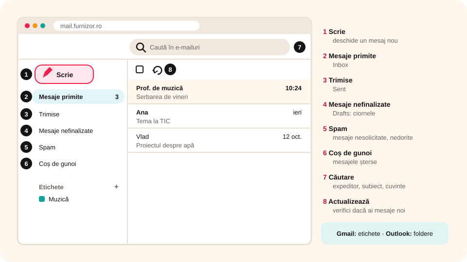

> **Competențe specifice (Anexa 15):** CS 1.3

## Ce vei învăța azi

- ce pași are **crearea unui cont** de e-mail și de ce ai nevoie de **acordul părinților**;
- cum intri în **căsuța poștală**;
- care sunt elementele **interfeței Gmail** și **Outlook**;
- cum creezi și ștergi **etichete** (Gmail) și **foldere** (Outlook).

## Să ne amintim

Poți folosi e-mailul printr-un **client de e-mail** (Outlook) sau prin **webmail** (Gmail, în browser). Căsuța are foldere: **Inbox**, **Sent**, **Drafts**, **Coș de gunoi**.

## Lecția pe scurt

### Contul de e-mail

> **Atenție!** Ca să-ți faci singur un cont Google, trebuie să ai vârsta minimă stabilită pentru țara ta: în România, **16 ani împliniți**. Până atunci, contul îl creează **părinții** pentru tine (cu aplicația Google Family Link) sau folosești contul de e-mail oferit de **școală**. La ore, profesorul îți spune ce cont folosești.

Pașii la crearea unui cont (asemănători la toți furnizorii):

1. Intri pe site-ul furnizorului (de exemplu, `google.com`) → **Conectare** → **Creează un cont**.
2. Completezi **prenumele**, **numele**, **numele de utilizator** (devine adresa ta) și **parola** (de cel puțin 8 caractere, scrisă de două ori). Dacă numele de utilizator e deja luat, alegi altul.
3. Data nașterii, genul (poți alege „Prefer să nu spun”), eventual un număr de telefon de recuperare.
4. Citești **condițiile de utilizare** și apeși **Sunt de acord** doar dacă ești de acord.

**Fii atent la casetele bifate deja**, care îți propun **oferte**. Debifează-le, altfel primești multe mesaje nedorite.

### Cum intri în căsuța Gmail

Deschizi browserul și scrii `mail.google.com` (sau mergi pe `google.com` → butonul cu pătrățele → **Gmail**). Introduci **numele de utilizator** și **parola**.

### Interfața Gmail



1. **Scrie** (*Compose*): deschide un mesaj nou;
2. **Mesaje primite** (*Inbox*);
3. **Trimise** (*Sent*);
4. **Mesaje nefinalizate** (*Drafts*): ciornele;
5. **Spam**: mesaje nesolicitate, nedorite;
6. **Coș de gunoi** (*Bin*): mesajele șterse, până golești coșul;
7. **Căutare**: găsești mesaje după expeditor, subiect sau cuvinte-cheie;
8. **Actualizează** (*Refresh*): verifici dacă au sosit mesaje noi.

Un mesaj îl deschizi cu un **clic** pe el.

**Etichetele în Gmail:**

- **creare**: sub lista de foldere, **Creează o etichetă nouă** → scrii numele → **Creează**;
- **ștergere**: clic pe butonul cu **trei puncte** de lângă etichetă → **Șterge eticheta**.

### Interfața Outlook

**Outlook** (din Microsoft Office) are aceleași elemente principale: buton pentru **mesaj nou**, foldere (**Inbox**, **Sent**, **Drafts**, **Mesaje șterse**), **căutare** și lista de mesaje.

- Selectezi un mesaj: îi vezi conținutul în **panoul de citire**;
- **dublu clic** pe el: se deschide într-o fereastră separată.

**Folderele în Outlook:**

- **creare**: clic dreapta pe folderul „părinte” → **Folder nou** → scrii numele → clic în afara casetei;
- **ștergere**: clic dreapta pe folder → **Ștergere folder**.

## Exemplu rezolvat

**Sarcina:** vrei să găsești repede mesajul primit de la profesorul de muzică despre serbare.

1. Dai clic în caseta **Căutare** (cea cu **lupa**).
2. Scrii un cuvânt-cheie: `serbare`.
3. Apeși **Enter**: apar doar mesajele care conțin cuvântul.
4. Ca să găsești ușor mesajele data viitoare, creezi eticheta **Muzică** și o pui pe mesaj.

## Aplicații interactive

```categorii
# Ce element al interfeței Gmail folosești?
Scrie: începi un mesaj nou
Căutare: găsești un mesaj vechi după un cuvânt
Spam: mesajele nedorite
Actualizează: verifici dacă au sosit mesaje noi
Mesaje nefinalizate: continui o ciornă
```

```quiz
# Alege răspunsul corect.
Câți ani trebuie să ai ca să-ți faci singur un cont Google?
- 10
* 16 (în România)
- 18
Explicație: În România, până la 16 ani, contul îl creează părinții sau folosești contul oferit de școală.

Ce faci cu casetele de oferte gata bifate dintr-un formular de înscriere?
* le debifezi, dacă nu vrei să primești oferte
- le lași bifate, ca să termini mai repede
- le bifezi de două ori

Cum creezi un folder nou în Outlook?
- dublu clic pe un mesaj
* clic dreapta pe folderul părinte → Folder nou
- fila Fișier → Tipărire
```

```adevarat-fals
F: Microsoft Outlook este o aplicație pentru vizualizarea imaginilor. | Outlook este un client de e-mail.
A: Orice client de e-mail are operația de ștergere a mesajelor.
A: În Gmail, un mesaj poate avea mai multe etichete.
A: Poți intra în contul tău Gmail de oriunde, dacă ai internet.
```

```ordonare
# Cum creezi o etichetă nouă în Gmail?
Deschizi căsuța Gmail în browser
Dai clic pe Creează o etichetă nouă
Scrii numele etichetei
Apeși Creează
```

## Exersează

1. Deschide căsuța de e-mail (contul dat de școală sau de părinți) și găsește toate elementele din lecție.
2. Descoperă ce opțiuni de **selectare** a mesajelor îți oferă butonul pătrățel de lângă **Actualizează**.
3. Caută un mesaj după un cuvânt din subiect.
4. Creează eticheta (sau folderul) **Informatică**.
5. Enumeră trei funcții de bază ale unui program de e-mail.
6. **Dezbatere:** „Client de e-mail sau webmail? Avantaje și dezavantaje.”
7. **Portofoliu:** scrie cel mult 100 de cuvinte cu trei asemănări și trei deosebiri între interfețele Outlook și Gmail.

## Verifică-te

- Ce faci dacă ai sub 16 ani și ai nevoie de e-mail?
- Unde găsești mesajele șterse? Dar ciornele?

## Pe scurt

La crearea unui cont alegi **numele de utilizator** și o **parolă sigură** și debifezi ofertele. Sub **16 ani**, contul îl fac **părinții** sau îl dă **școala**. Gmail și Outlook au aceleași elemente: **mesaj nou**, **Inbox**, **Sent**, **Drafts**, **Spam**, **Coș de gunoi**, **Căutare**. Gmail folosește **etichete**, Outlook **foldere**.
