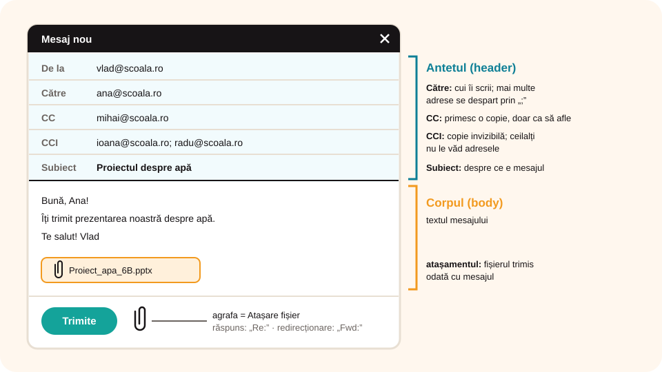
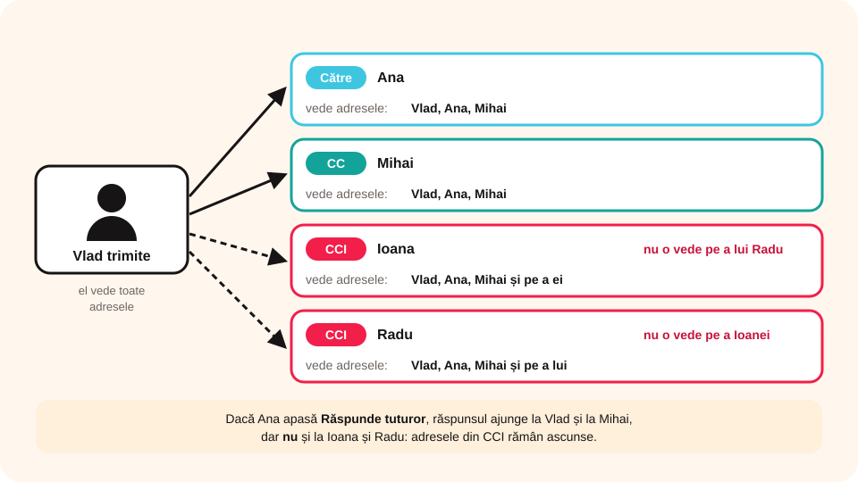

## Ce vei învăța azi

- să **compui** și să **trimiți** un e-mail, cu **atașamente**;
- ce înseamnă **Către**, **CC**, **CCI** și **Subiect**;
- să **deschizi**, să **răspunzi** și să **redirecționezi** un mesaj;
- să **salvezi** și să **ștergi** mesaje;
- să folosești **agenda de adrese**.

## Să ne amintim

În Gmail începi un mesaj cu **Scrie**, iar în Outlook cu **Mesaj de e-mail nou**. Mesajele primite sunt în **Inbox**.

## Lecția pe scurt

### A. Compunerea unui mesaj



Fereastra unui mesaj nou are două părți:

**1. Antetul** (*header*):

- **De la**: adresa ta (în Outlook);
- **Către**: adresa sau adresele destinatarilor, despărțite prin **punct și virgulă** (`;`). Le poți scrie sau le alegi din **agendă**;
- **CC** (*Carbon Copy*, copie la indigo): destinatarii care primesc **o copie**, doar ca să afle. Mesajul nu li se adresează direct;
- **CCI** / **BCC** (*Blind Carbon Copy*, copie invizibilă): destinatarii care primesc o copie, dar **ceilalți nu le văd adresele**;
- **Subiect**: câteva cuvinte care spun despre ce e mesajul.

**2. Corpul** (*body*): textul mesajului.

**Atașamentele:** apeși butonul cu **agrafa** (**Atașare fișier**), cauți fișierele, le selectezi și apeși **OK**.

La final apeși **Trimite** (**Trimitere** în Outlook).

### B. Deschiderea unui mesaj

Pentru fiecare mesaj vezi **expeditorul**, **subiectul**, **data** și **ora**. Un semn **!** roșu arată un mesaj **urgent**, iar o **agrafă** arată că are **atașamente**.

- **Gmail**: un clic pe mesaj;
- **Outlook**: dublu clic, se deschide într-o fereastră nouă.

Când citești un mesaj poți: să te întorci la listă, să-l raportezi ca **spam**, să-l **ștergi**, să-l **muți** în alt folder, să treci la mesajul următor sau anterior, să **răspunzi** sau să-l **redirecționezi**.

**Atașamentele** le salvezi pe calculator: în Gmail cu butonul **Descărcare**, în Outlook cu clic dreapta → **Salvare ca**.

### C. Răspuns și redirecționare

- **Răspunde** (*Reply*): se deschide un mesaj cu adresa expeditorului și subiectul deja completate. Înaintea subiectului apare **Re:**.
- **Redirecționează** (*Forward*): trimiți mesajul primit, așa cum este, altcuiva. Înaintea subiectului apare **Fw:** sau **Fwd:**.

### D. Salvare și ștergere

- În **Outlook** salvezi un mesaj pe calculator trăgându-l într-un folder sau din **Fișier → Salvare ca**.
- **Ștergerea**: unul câte unul, mai multe odată (le selectezi întâi) sau din fereastra mesajului, cu **Șterge**. Odată cu mesajul se șterg și atașamentele.
- Mesajele șterse ajung în **Mesaje șterse** / **Coș de gunoi**. De acolo le poți **recupera**. Dispar **definitiv** doar dacă le ștergi și din coș.

Fă ordine din când în când, ca să ai loc pentru mesaje noi.

### E. Agenda de adrese

**Agenda** (*Address Book*, *Contacte*) păstrează datele persoanelor cu care corespondezi.

- **Adăugare manuală**: în Gmail, **Creează contact**, completezi numele și adresa → **Salvează**; în Outlook, **Agendă → Fișier → Intrare nouă → Persoană de contact nouă**.
- **Adăugare automată**: din mesajul primit, clic (dreapta) pe adresa expeditorului → **Adaugă la contacte**.
- **Cel mai util**: când scrii un mesaj, apeși **Către** și alegi destinatarul din agendă. Adresa se completează **corect**, fără greșeli de tastare.

## Exemplu rezolvat

Vlad trimite un mesaj: la **Către** pune adresa lui **Ana**, la **CC** adresa lui **Mihai**, iar la **CCI** adresele lui **Ioana** și **Radu**. Cine ce vede?

| Destinatar | Vede adresele lui |
|---|---|
| Ana (Către) | Vlad, Ana, Mihai |
| Mihai (CC) | Vlad, Ana, Mihai |
| Ioana (CCI) | Vlad, Ana, Mihai (și pe a ei); nu vede adresa lui Radu |
| Radu (CCI) | Vlad, Ana, Mihai (și pe a lui); nu vede adresa Ioanei |

Nimeni nu vede adresele din **CCI**, în afară de Vlad. Dacă Ana apasă **Răspunde tuturor**, răspunsul ajunge la Vlad și la Mihai, dar **nu** la Ioana și Radu.



## Aplicații interactive

```categorii
# În ce câmp scrii?
Către: destinatarul principal al mesajului
CC: un coleg care trebuie doar să afle de mesaj
CCI: adresele care nu trebuie să fie văzute de ceilalți
Subiect: despre ce este mesajul
```

```quiz
# Alege răspunsul corect.
Ce particulă apare înaintea subiectului când răspunzi la un mesaj?
* Re:
- Fw:
- CC:

Cum se despart mai multe adrese în câmpul Către?
- prin @
* prin punct și virgulă (;)
- prin spațiu și linie

Poate fi recuperat un mesaj șters?
* da, din Mesaje șterse sau Coș de gunoi, până golești coșul
- nu, niciodată
- doar dacă era urgent

La ce folosește agenda de adrese?
- la programarea temelor
* la păstrarea datelor de contact și completarea corectă a adreselor
- la ștergerea mesajelor spam
```

```ordonare
# Cum trimiți un mesaj cu un atașament?
Apeși Scrie (sau Mesaj de e-mail nou)
Completezi Către și Subiect
Scrii textul mesajului
Apeși agrafa și alegi fișierul
Apeși Trimite
```

```adevarat-fals
A: Redirecționarea trimite un mesaj primit unei alte persoane.
F: Destinatarii din CC nu se văd între ei. | Adresele din CC sunt vizibile; doar cele din CCI sunt ascunse.
A: O agrafă lângă un mesaj arată că are atașamente.
A: Odată cu un mesaj șters se șterg și atașamentele lui.
```

## Exersează

1. Trimite un mesaj unui coleg, scriind manual adresa la **Către**.
2. Găsește mesajul în **Trimise** și **redirecționează-l** altui coleg. Ce s-a adăugat la subiect? Dar în corpul mesajului?
3. **Răspunde** la un mesaj din Inbox. Ce s-a schimbat la subiect?
4. Trimite-ți ție un mesaj cu un atașament mare și unul cu un atașament mic. Care ajunge mai repede?
5. Creează câte o etichetă sau un folder pentru fiecare materie din orar.
6. Adaugă un coleg în agendă și trimite-i un mesaj alegându-l din agendă.
7. **Portofoliu:** împreună cu 3–4 colegi, discutați pe e-mail o temă (de exemplu, „Cum să învăț eficient”). Folosiți **Răspunde tuturor** pentru anunțurile importante.

## Verifică-te

- Ce diferență este între **CC** și **CCI**?
- Ce diferență este între **Răspunde** și **Redirecționează**?

## Pe scurt

Un mesaj are **antet** (**Către**, **CC**, **CCI**, **Subiect**) și **corp**; fișierele se atașează cu **agrafa**. Poți **răspunde** (**Re:**), **redirecționa** (**Fwd:**), **salva** și **șterge** mesaje; cele șterse se pot recupera din **coș**. **Agenda** păstrează adresele și le completează corect.
