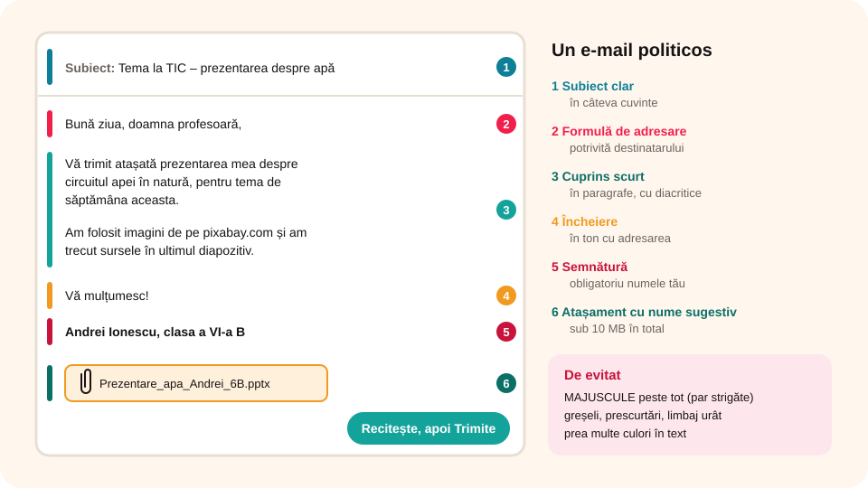

## Ce vei învăța azi

- ce este **neticheta**;
- cum arată un **e-mail bine scris**: subiect, adresare, cuprins, încheiere, semnătură;
- reguli pentru **atașamente**, **CCI** și **Răspunde tuturor**;
- de ce **verifici** mesajul înainte să-l trimiți.

## Să ne amintim

Un mesaj are **antet** (Către, CC, CCI, Subiect) și **corp**. Adresele din **CCI** nu le văd ceilalți destinatari.

## Lecția pe scurt

### Neticheta

**Neticheta** (engleză, *netiquette*) vine din „**net**” (internet) + „**etichetă**” (reguli de purtare). Sunt regulile de comportament politicos pe internet: pe e-mail, pe rețele sociale, pe grupurile de mesagerie.

**Știai că…?** Regulile de netichetă au fost scrise în **1995** de Sally Hambridge, de la compania Intel, și sunt valabile și azi.

### Reguli pentru e-mail



**Structura mesajului**

- Completezi mereu **Subiectul**: în câteva cuvinte, despre ce e mesajul.
- Începi cu o **formulă de adresare** potrivită destinatarului: „Bună ziua, doamna profesoară,”, „Dragă bunico,”, „Salut, Vlad!”.
- Mesajul are **introducere**, **cuprins** și **încheiere**.
- Închei cu o formulă potrivită, în ton cu adresarea: „Vă mulțumesc!”, „Cu respect,”, „Te salut!”, „O zi bună!”.
- La final pui **semnătura**: obligatoriu **numele** tău. Un număr de telefon dai doar persoanelor de **încredere**.

**Scrierea**

- **fără greșeli** de ortografie, cu **diacritice**;
- textele lungi le împarți în **paragrafe**;
- **fără** multe culori sau combinații care obosesc ochii;
- **fără MAJUSCULE** peste tot: par că **strigi**;
- **fără prescurtări** (nu e elegant);
- **fără limbaj urât**.

**Atașamentele**

- le dai **nume sugestive** (`Proiect_apa_6B.pptx`, nu `doc1.pptx`);
- fișierele mari le **arhivezi** (de exemplu, `.zip`);
- nu trimiți atașamente de peste **10 MB** în total; pentru fișiere mari folosești un serviciu de transfer și trimiți doar **linkul**.

**Destinatarii**

- verifici că ai scris **corect** adresa;
- nu arăți adresele prietenilor unor persoane pe care ei nu le cunosc: le pui la **CCI**;
- **Răspunde tuturor** (*Reply All*) folosești doar când toți cei din discuție trebuie să vadă răspunsul.

**Înainte să apeși Trimite**

„**Măsoară de trei ori și taie o dată**.” **Recitești** mesajul. După ce l-ai trimis, nu-l mai poți întoarce sau corecta.

## Exemplu rezolvat: un e-mail către profesoară

**Subiect:** Tema la TIC – prezentarea despre apă

> Bună ziua, doamna profesoară,
>
> Vă trimit atașată prezentarea mea despre circuitul apei în natură, pentru tema de săptămâna aceasta.
>
> Am folosit imagini de pe pixabay.com și am trecut sursele în ultimul diapozitiv.
>
> Vă mulțumesc!
> Andrei Ionescu, clasa a VI-a B

Ce reguli respectă: subiect clar, adresare politicoasă, cuprins scurt, încheiere, semnătură cu nume, atașament cu nume sugestiv (`Prezentare_apa_Andrei_6B.pptx`).

## Aplicații interactive

```categorii
# Respectă sau nu neticheta?
Respectă: subiect clar, formulă de adresare, semnătură cu numele, recitești înainte de trimitere, atașament cu nume sugestiv
Nu respectă: TOT TEXTUL CU MAJUSCULE, mesaj fără subiect, prescurtări peste tot, limbaj urât, atașament de 50 MB
```

```quiz
# Alege răspunsul corect.
De unde vine cuvântul „netichetă”?
* net (internet) + etichetă (reguli de purtare)
- net (plasă) + etichetă de preț
- numele inventatorului

De ce eviți textul scris doar cu majuscule?
- se citește mai repede
* dă impresia că strigi
- consumă mai mult internet

Trimiți un mesaj lui Alex (Către), la trei prieteni (CC) și la doi cunoscuți (CCI). Alex apasă Răspunde tuturor. Primesc răspunsul cei doi din CCI?
- da, toți primesc răspunsul
* nu, adresele din CCI nu sunt văzute, deci nu sunt incluse în răspuns
- doar unul dintre ei
```

```adevarat-fals
F: Poți atașa la un e-mail o poză de 10 MB, plus alte trei de același fel. | Totalul atașamentelor trebuie să rămână sub 10 MB.
F: Poți începe un e-mail cu „Ți-am spus să mă suni!”. | Începi cu o formulă de adresare politicoasă.
A: Poți încheia un e-mail cu „Îți mulțumesc, Vlad”.
A: După ce apeși Trimite, nu mai poți corecta mesajul.
```

```ordonare
# Pune părțile unui e-mail în ordine.
Subiectul
Formula de adresare
Cuprinsul mesajului
Formula de încheiere
Semnătura
```

## Exersează

1. Fă o listă cu regulile de netichetă pe care le consideri cele mai importante pe un grup de mesagerie al clasei. Compară-le cu ce găsești pe internet.
2. Află care sunt formulele de adresare și de încheiere cele mai folosite de colegii tăi. Respectă neticheta?
3. **Joc de rol „Echipa perfectă”:** doi copii din România (unul în scaun cu rotile) se înțeleg pe e-mail cu copii din alte țări să strângă haine, jucării și cărți pentru copii dintr-o țară săracă. Fiecare trimite un singur mesaj.
4. **Portofoliu:** scrie un e-mail către un prieten, în care îi propui să mergeți împreună la cursul de automodele și să faceți echipă la concursul de la final. Respectă toate regulile de netichetă.

## Verifică-te

- Ce trebuie să conțină semnătura?
- Când folosești câmpul **CCI**?

## Pe scurt

**Neticheta** înseamnă reguli de purtare politicoasă pe internet. Un e-mail bun are **subiect**, **adresare**, **cuprins**, **încheiere** și **semnătură**, fără greșeli, majuscule sau limbaj urât. Atașamentele au nume sugestive și sub **10 MB**. Adresele altora le pui la **CCI**. **Recitești** înainte să trimiți.
