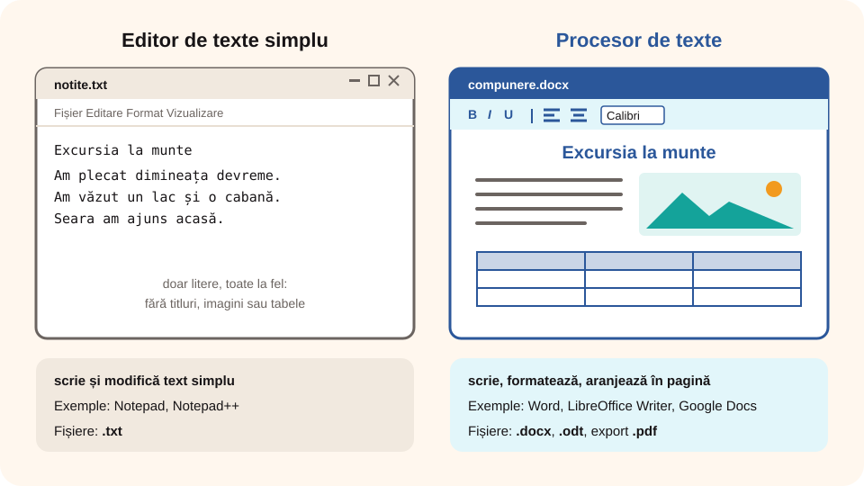

## Ce vei învăța azi

- ce înseamnă **editarea** și **tehnoredactarea** unui document;
- ce este un **editor de texte** și ce este un **procesor de texte**;
- câteva **aplicații** de editare a textelor;
- **regulile de bază** pentru scrierea corectă pe calculator.

## Să ne amintim

Anul trecut ai făcut prezentări în PowerPoint: ai scris text, l-ai formatat (font, mărime, culoare) și ai inserat imagini. În editorul de texte vei folosi multe dintre aceleași comenzi.

## Lecția pe scurt

### Editare și tehnoredactare

- **Editarea** înseamnă să **scrii** și să **modifici** textul: adaugi, ștergi, copiezi, muți, corectezi.
- **Tehnoredactarea** înseamnă să **aranjezi** textul în pagină, ca documentul să arate îngrijit și să fie ușor de citit: fonturi, titluri, paragrafe, liste, margini, imagini, tabele.

Un **document** este un fișier care conține text și, eventual, imagini, tabele sau desene: o compunere, o cerere, un referat, o invitație, un afiș.

### Editor de texte sau procesor de texte?

| | Editor de texte simplu | Procesor de texte |
|---|---|---|
| Ce face | scrie și modifică text simplu | scrie, formatează și aranjează în pagină |
| Exemple | Notepad, Notepad++ | Microsoft Word, LibreOffice Writer, Google Docs, WordPad |
| Fișiere | `.txt` | `.docx`, `.odt`, `.pdf` (la export) |

În limbajul obișnuit, programele ca Word se numesc tot **editoare de texte**. În această unitate lucrăm cu **Microsoft Word**; comenzile sunt foarte asemănătoare în **LibreOffice Writer** (gratuit) și în **Google Docs** (online).



### Reguli de bază pentru scrierea pe calculator

- **Diacriticele** se scriu mereu: ă, â, î, ș, ț. Activează tastatura românească.
- **Spațiul** se pune **după** semnele de punctuație (`,` `.` `;` `:` `!` `?`), **nu înainte**.
- **Parantezele și ghilimelele** se lipesc de cuvânt: „exemplu” (corect), „ exemplu ” (greșit).
- **Enter** apeși doar la sfârșitul unui **paragraf**, nu la sfârșitul fiecărui rând: editorul trece singur pe rândul următor.
- **Nu** folosești spații multiple ca să muți textul spre dreapta; folosești **alinierea** sau **indentarea**.
- Salvezi **des** (**Ctrl + S**).

## Exemplu rezolvat

Găsește greșelile de tehnoredactare din propoziția:

`Azi , la ora de TIC , am invatat despre editoare de texte( Word ,Writer ) .`

1. Spațiu înainte de virgulă: `Azi ,` → `Azi,`.
2. Lipsesc diacriticele: `invatat` → `învățat`.
3. Paranteza trebuie despărțită de cuvântul dinainte și lipită de conținut: `texte( Word` → `texte (Word`.
4. După virgulă trebuie spațiu: `Word ,Writer` → `Word, Writer`.
5. Fără spațiu înainte de punct: `) .` → `).`

Varianta corectă: `Azi, la ora de TIC, am învățat despre editoare de texte (Word, Writer).`

## Aplicații interactive

```categorii
# Editor simplu sau procesor de texte?
Editor de texte simplu: Notepad, Notepad++
Procesor de texte: Microsoft Word, LibreOffice Writer, Google Docs
```

```quiz
# Alege răspunsul corect.
Ce înseamnă tehnoredactarea?
- doar scrierea rapidă a textului
* aranjarea textului în pagină, ca documentul să fie îngrijit și ușor de citit
- tipărirea documentului

Când apeși Enter într-un document?
- la sfârșitul fiecărui rând
* la sfârșitul unui paragraf
- după fiecare cuvânt

Care este scrierea corectă?
- Bună , ziua !
* Bună, ziua!
- Bună ,ziua!
```

```adevarat-fals
A: LibreOffice Writer este un procesor de texte gratuit.
F: Pentru a muta un titlu în mijlocul rândului apeși de multe ori tasta Space. | Folosești alinierea la centru.
A: Diacriticele se scriu în toate documentele în limba română.
F: Spațiul se pune înaintea virgulei. | Spațiul se pune după virgulă, nu înainte.
```

```cartonase
# Termeni de reținut
Editare = scrierea și modificarea textului
Tehnoredactare = aranjarea textului în pagină
Document = fișier cu text, imagini, tabele
Paragraf = text care se termină cu Enter
.docx = extensia documentelor Word
```

## Exersează

1. Dă trei exemple de documente pe care le poți face cu un editor de texte, utile la școală sau acasă.
2. Corectează: `Mâine ,mergem în excursie la munte .Luăm :apă ,fructe și o hartă !`
3. Deschide Notepad și Word (sau Writer) și scrie aceeași propoziție. Ce poți face în Word și nu poți face în Notepad?
4. **Portofoliu:** scrie un paragraf de 5–6 rânduri despre cartea ta preferată, respectând toate regulile de scriere pe calculator.

## Verifică-te

- Care e diferența dintre editare și tehnoredactare?
- Poți numi trei procesoare de texte?

## Pe scurt

**Editarea** înseamnă scrierea și modificarea textului, iar **tehnoredactarea** aranjarea lui în pagină. **Procesoarele de texte** (Word, Writer, Google Docs) permit formatarea și aranjarea documentelor. Scrii cu **diacritice**, pui spațiul **după** punctuație și apeși **Enter** doar la sfârșitul paragrafului.
