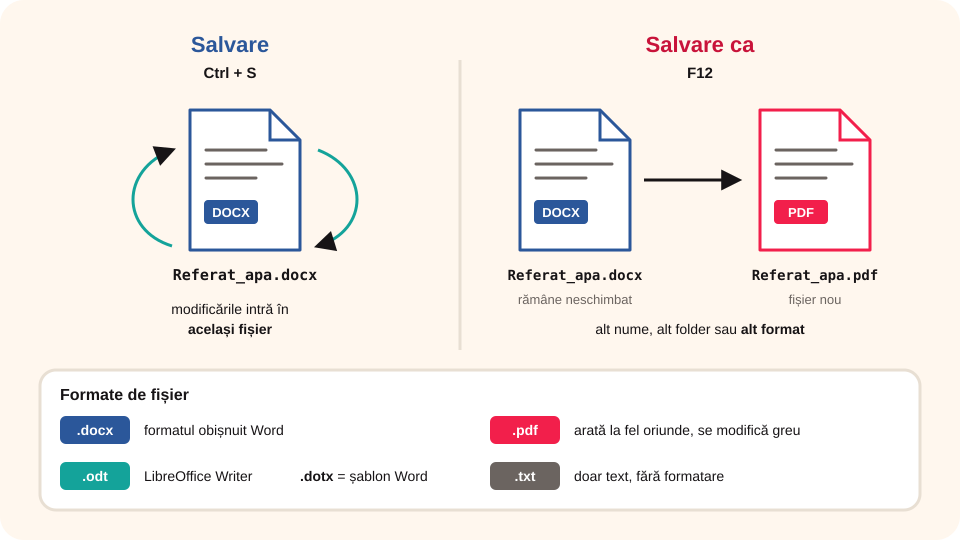

## Ce vei învăța azi

- să **creezi**, să **deschizi** și să **închizi** un document;
- diferența dintre **Salvare** și **Salvare ca**;
- să salvezi un document în **alt format** (PDF, ODT);
- să **tipărești** un document.

## Să ne amintim

Comenzile pentru fișiere sunt în fila **Fișier** (vizualizarea **Backstage**). La prima salvare alegi **numele** și **locul** fișierului.

## Lecția pe scurt

| Operație | Comandă | Taste |
|---|---|---|
| document nou | **Fișier → Nou → Document necompletat** | **Ctrl + N** |
| deschidere | **Fișier → Deschidere** | **Ctrl + O** |
| salvare | **Fișier → Salvare** | **Ctrl + S** |
| salvare cu alt nume, loc sau format | **Fișier → Salvare ca** | **F12** |
| tipărire | **Fișier → Imprimare** | **Ctrl + P** |
| închidere document | **Fișier → Închidere** | **Ctrl + W** |

### Salvare sau Salvare ca?

- **Salvare**: păstrează modificările în **același** fișier. La prima salvare se deschide fereastra în care alegi numele și locul.
- **Salvare ca**: creează un fișier **nou** (alt nume, alt folder sau alt format). Fișierul vechi rămâne neschimbat.

### Formate de fișier

- **.docx**: formatul obișnuit Word;
- **.pdf**: pentru trimis sau tipărit; arată la fel pe orice calculator, dar se modifică greu (**Fișier → Salvare ca → PDF** sau **Fișier → Export**);
- **.odt**: formatul LibreOffice Writer;
- **.txt**: doar text, fără formatare;
- **.dotx**: **șablon** Word, pentru documente care se repetă (de exemplu, o fișă).



### Salvarea automată și recuperarea

Word salvează automat, din câteva în câteva minute, o copie de siguranță. Dacă se închide brusc calculatorul, la repornire îți propune **documentele recuperate**. Dacă documentul e salvat în OneDrive, butonul **Salvare automată** din bara de titlu păstrează fiecare modificare.

### Tipărirea

În **Fișier → Imprimare** alegi imprimanta, **numărul de copii**, **paginile** (toate, pagina curentă sau, de exemplu, `1-3`), tipărirea pe o față sau pe ambele, orientarea. În dreapta vezi **previzualizarea**.

### Denumirea fișierelor

Folosește **nume sugestive**: `Referat_apa_Popescu_7B.docx`, nu `Document1.docx`. Păstrează documentele în foldere pe materii.

## Exemplu rezolvat

Ai scris un referat, `Referat_apa.docx`, și vrei să-l trimiți profesorului ca PDF, dar să-l poți modifica mai târziu.

1. Salvezi ultimele modificări cu **Ctrl + S** (rămâne `Referat_apa.docx`).
2. **Fișier → Salvare ca**, alegi folderul și, la **Tip fișier**, **PDF**.
3. Apeși **Salvare**: apare `Referat_apa.pdf`, pe care îl trimiți.
4. Când vrei să schimbi ceva, deschizi `Referat_apa.docx`, nu PDF-ul.

## Aplicații interactive

```cartonase
# Combinații de taste
Ctrl + N = Document nou
Ctrl + O = Deschidere
Ctrl + S = Salvare
F12 = Salvare ca
Ctrl + P = Imprimare
Ctrl + W = Închiderea documentului
```

```quiz
# Alege răspunsul corect.
Ce face Salvare ca?
- șterge documentul vechi
* creează un fișier nou cu alt nume, loc sau format
- tipărește documentul

În ce format trimiți un document care trebuie să arate la fel pe orice calculator?
- .txt
* .pdf
- .dotx

Cum tipărești doar paginile 2, 3 și 4?
* scrii 2-4 la Pagini, în fereastra Imprimare
- tipărești tot și arunci restul
- nu se poate
```

```categorii
# Ce tip de fișier este?
Document Word: Referat.docx, Compunere.docx
Document PDF: Diploma.pdf, Orar.pdf
Doar text: notite.txt
Șablon Word: Fisa_de_lucru.dotx
```

```adevarat-fals
A: La prima salvare alegi numele și locul fișierului.
F: Un fișier PDF se modifică la fel de ușor ca un fișier .docx. | PDF-ul se modifică greu; păstrează și varianta .docx.
A: Word poate recupera un document după o închidere bruscă.
```

## Exersează

1. Creează un document, scrie numele tău și salvează-l ca `Prezentare_personala.docx` în folderul `Lucru_clsVII`.
2. Salvează același document și ca **PDF**. Câte fișiere ai acum? Ce diferență vezi între ele?
3. Deschide documentul, adaugă un rând și salvează cu **Ctrl + S**. Apoi folosește **Salvare ca** cu numele `Prezentare_personala_v2.docx`.
4. Deschide fereastra **Imprimare** și setează 2 copii doar pentru pagina 1 (nu tipări).
5. **Portofoliu:** organizează documentele într-un folder `Portofoliu_TIC_7`, cu nume sugestive.

## Verifică-te

- Când folosești Salvare ca în loc de Salvare?
- De ce păstrezi și varianta .docx după ce ai salvat ca PDF?

## Pe scurt

Documentele se creează (**Ctrl + N**), se deschid (**Ctrl + O**), se salvează (**Ctrl + S**, **F12**), se tipăresc (**Ctrl + P**) și se închid (**Ctrl + W**). **Salvare ca** creează un fișier nou; **PDF** e bun pentru trimis și tipărit. Dă fișierelor **nume sugestive**.
