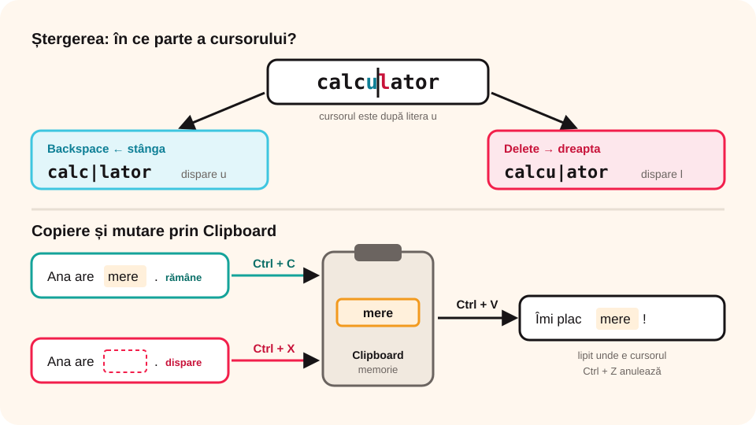

## Ce vei învăța azi

- să te **deplasezi** repede în text și să **selectezi**;
- să **ștergi**, să **copiezi** și să **muți** text;
- să folosești **Găsire și înlocuire** și **verificarea ortografiei**;
- să inserezi **simboluri**, **imagini** și **tabele**.

## Să ne amintim

În PowerPoint ai copiat cu **Ctrl + C**, ai lipit cu **Ctrl + V** și ai mutat cu **Ctrl + X**. În Word aceste comenzi funcționează la fel, dar pentru text.

## Lecția pe scurt

### Deplasarea în text

| Taste | Unde ajunge cursorul |
|---|---|
| **săgeți** | un caracter sau un rând |
| **Ctrl + săgeată stânga/dreapta** | un cuvânt |
| **Home / End** | începutul / sfârșitul rândului |
| **Ctrl + Home / Ctrl + End** | începutul / sfârșitul documentului |
| **Page Up / Page Down** | un ecran mai sus / mai jos |

### Selectarea

- **un cuvânt**: dublu clic pe el;
- **un paragraf**: triplu clic;
- **o porțiune**: ții apăsat butonul mouse-ului și tragi, sau **Shift + săgeți**;
- **tot documentul**: **Ctrl + A**.

### Ștergerea

- **Backspace** șterge caracterul din **stânga** cursorului;
- **Delete** șterge caracterul din **dreapta** cursorului;
- dacă ai selectat text, oricare dintre ele șterge **selecția**.

### Copiere, mutare, anulare

- **Copiere**: **Ctrl + C**, apoi **Ctrl + V** în locul nou;
- **Mutare**: **Ctrl + X**, apoi **Ctrl + V**, sau tragi selecția cu mouse-ul;
- **Anulare**: **Ctrl + Z**; **Refacere**: **Ctrl + Y**.



### Găsire și înlocuire

- **Ctrl + F** (**Pornire → Găsire**): caută un cuvânt; rezultatele apar în panoul **Navigare**.
- **Ctrl + H** (**Pornire → Înlocuire**): înlocuiește un cuvânt cu altul, o dată sau peste tot (**Înlocuire totală**).

### Ortografie și gramatică

Word subliniază cu **roșu** cuvintele scrise greșit și cu **albastru** posibilele greșeli de gramatică sau punctuație. Clic dreapta pe cuvânt arată **sugestii**. Verificarea completă: **Revizuire → Ortografie și gramatică** (**F7**). Atenție: Word nu cunoaște toate cuvintele, iar limba documentului trebuie setată pe **română**.

### Inserări

- **Simboluri** (©, €, °, →): **Inserare → Simbol**;
- **Imagini**: **Inserare → Imagini**. Clic pe imagine → **Opțiuni aspect**: *În linie cu textul*, *Pătrat*, *În spatele textului* etc.;
- **Tabel**: **Inserare → Tabel**, alegi numărul de coloane și rânduri. Te muți între celule cu **Tab**;
- **Forme** și **WordArt**: din fila **Inserare**.

## Exemplu rezolvat

În compunerea ta ai scris de 12 ori „Ionut” fără diacritice. Corectează-l peste tot.

1. Apeși **Ctrl + H**.
2. La **De găsit** scrii `Ionut`, la **Înlocuire cu** scrii `Ionuț`.
3. Bifezi (în **Mai multe**) **Potrivire cuvânt întreg**, ca să nu schimbi alte cuvinte care conțin acele litere.
4. Apeși **Înlocuire totală**: Word anunță că a făcut 12 înlocuiri.

## Aplicații interactive

```cartonase
# Comenzi rapide pentru editare
Ctrl + A = Selectarea întregului document
Ctrl + C = Copiere
Ctrl + X = Decupare (pentru mutare)
Ctrl + V = Lipire
Ctrl + Z = Anulare
Ctrl + F = Găsire
Ctrl + H = Înlocuire
F7 = Ortografie și gramatică
```

```quiz
# Alege răspunsul corect.
Cum selectezi un paragraf întreg?
- dublu clic
* triplu clic
- clic dreapta

Ce tastă șterge caracterul din stânga cursorului?
* Backspace
- Delete
- Home

Ce înseamnă un cuvânt subliniat cu roșu?
- că e foarte important
* că Word crede că e scris greșit
- că e un link
```

```ordonare
# Cum muți un paragraf la sfârșitul documentului?
Selectezi paragraful cu triplu clic
Apeși Ctrl + X
Apeși Ctrl + End
Apeși Ctrl + V
```

```adevarat-fals
A: Ctrl + Home duce cursorul la începutul documentului.
F: Înlocuire totală schimbă doar prima apariție a cuvântului. | Le schimbă pe toate.
A: Într-un tabel treci la celula următoare cu tasta Tab.
F: Word cunoaște toate cuvintele din limba română. | Unele cuvinte corecte pot fi subliniate; verifici tu.
```

## Exersează

1. Scrie un text de trei paragrafe. Mută al treilea paragraf la început.
2. Folosind **Ctrl + H**, înlocuiește un cuvânt care apare de mai multe ori.
3. Inserează simbolurile **©**, **°C** și **€** într-o propoziție.
4. Inserează o imagine și încearcă trei variante din **Opțiuni aspect**. Prin ce diferă?
5. Fă un tabel cu orarul tău pe o săptămână (6 coloane, 7 rânduri).
6. **Portofoliu:** scrie o scurtă descriere a orașului tău, cu o imagine aliniată **Pătrat** și verificată cu **F7**.

## Verifică-te

- Care e diferența dintre Backspace și Delete?
- Cum corectezi același cuvânt greșit în tot documentul, dintr-odată?

## Pe scurt

Te deplasezi cu săgeți, **Home/End** și **Ctrl + Home/End**; selectezi cu dublu sau triplu clic și **Ctrl + A**. Copiezi (**Ctrl + C**), muți (**Ctrl + X**), lipești (**Ctrl + V**), anulezi (**Ctrl + Z**). **Ctrl + H** înlocuiește peste tot, **F7** verifică ortografia, iar fila **Inserare** adaugă simboluri, imagini și tabele.
