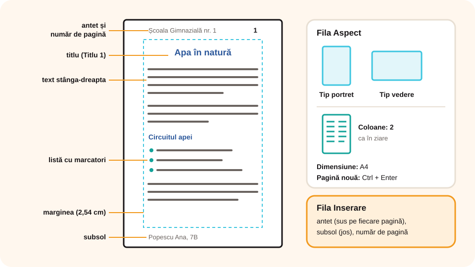

## Ce vei învăța azi

- să formatezi **caracterele**: font, mărime, stil, culoare;
- să formatezi **paragrafele**: aliniere, spațiere, indentare, liste;
- să folosești **stilurile** pentru titluri;
- să stabilești **aspectul paginii**: margini, orientare, coloane, antet, subsol, numere de pagină.

## Să ne amintim

Ca să formatezi un text, întâi îl **selectezi**, apoi alegi comanda. Formatarea din PowerPoint (aldin, cursiv, culoare) se face la fel în Word.

## Lecția pe scurt

### Formatarea caracterelor (Pornire → Font)

- **Fontul** (tipul literelor): Calibri, Times New Roman, Arial;
- **mărimea**: de obicei **11–12** pentru text, mai mare pentru titluri;
- **stilul**: **Aldin** (**Ctrl + B**), *Cursiv* (**Ctrl + I**), Subliniat (**Ctrl + U**);
- **culoarea** textului și **culoarea de evidențiere** (ca un marker);
- indice (H₂O) și exponent (m²).

### Formatarea paragrafelor (Pornire → Paragraf)

- **Aliniere**: la **stânga** (**Ctrl + L**), la **centru** (**Ctrl + E**), la **dreapta** (**Ctrl + R**), **stânga-dreapta** (**Ctrl + J**). Textul obișnuit se aliniază stânga sau stânga-dreapta; titlurile, adesea la centru;
- **Spațiere între rânduri**: 1; 1,15; 1,5; 2;
- **Spațiere înainte și după** paragraf;
- **Indentare**: retragerea primului rând sau a întregului paragraf față de margine;
- **Liste**: cu **marcatori** (•) sau **numerotate** (1, 2, 3).

### Stilurile

Din **Pornire → Stiluri** alegi **Titlu 1**, **Titlu 2**, **Normal**. Stilurile dau un aspect **unitar** documentului și permit inserarea automată a unui **cuprins** (**Referințe → Cuprins**).

**Descriptor de formate** (pensula din grupul Clipboard): copiază formatarea unui text pe alt text.

### Aspectul paginii (fila Aspect)

- **Margini**: distanța de la marginea foii până la text (Normale: 2,54 cm);
- **Orientare**: **Tip portret** (pe înălțime) sau **Tip vedere** (pe lățime);
- **Dimensiune**: de obicei **A4**;
- **Coloane**: textul împărțit în 2 sau 3 coloane, ca în ziare;
- **Întreruperi**: **pagină nouă** (**Ctrl + Enter**).

### Antet, subsol, numere de pagină (fila Inserare)

- **Antetul** apare sus pe fiecare pagină (de exemplu, numele școlii);
- **Subsolul** apare jos (de exemplu, numele tău);
- **Număr de pagină**: sus sau jos, numerotare automată.



### Chenar și culoarea paginii (fila Proiectare)

**Chenare de pagină** și **Culoare pagină**, potrivite pentru diplome sau invitații.

## Exemplu rezolvat: formatarea unui referat

1. Selectezi tot (**Ctrl + A**): **Times New Roman, 12**, spațiere **1,5**, aliniere **stânga-dreapta**.
2. Titlul referatului: stilul **Titlu**, aliniere **centru**.
3. Titlurile capitolelor: stilul **Titlu 1**.
4. Enumerările: **listă cu marcatori**.
5. **Aspect → Margini → Normale**, **Orientare → Tip portret**, **A4**.
6. **Inserare → Antet**: numele școlii; **Număr de pagină → Partea de jos a paginii**.
7. Pe ultima pagină, **Bibliografia**, cu sursele folosite.

## Aplicații interactive

```categorii
# Formatare de caracter sau de paragraf?
Formatare de caracter: font, mărime, aldin, culoarea textului
Formatare de paragraf: aliniere, spațiere între rânduri, indentare, listă numerotată
```

```quiz
# Alege răspunsul corect.
Ce combinație aliniază textul la centru?
- Ctrl + L
* Ctrl + E
- Ctrl + J

Ce orientare alegi pentru o diplomă pe lățime?
- Tip portret
* Tip vedere

Unde apare antetul?
* sus, pe fiecare pagină
- doar pe prima pagină, jos
- la sfârșitul documentului
```

```cartonase
# Formatare
Ctrl + B = Aldin
Ctrl + I = Cursiv
Ctrl + U = Subliniat
Ctrl + J = Aliniere stânga-dreapta
Ctrl + Enter = Pagină nouă
Descriptor de formate = copiază formatarea pe alt text
```

```adevarat-fals
A: Stilurile Titlu 1 și Titlu 2 permit crearea automată a cuprinsului.
F: Ca să treci pe o pagină nouă apeși Enter de multe ori. | Folosești Ctrl + Enter.
A: Formatul de hârtie obișnuit este A4.
```

## Exersează

1. Scrie un text despre un animal și aplică: titlu **Titlu 1**, text **12**, spațiere **1,15**, aliniere **stânga-dreapta**.
2. Fă o listă numerotată cu cinci lucruri pe care le iei în excursie.
3. Pune textul pe **două coloane** și adaugă un antet cu numele tău.
4. Creează o **diplomă**: orientare **Tip vedere**, chenar de pagină, titlu cu WordArt.
5. **Portofoliu:** un referat de două pagini, cu titlu, subtitluri, o listă, o imagine, numere de pagină și bibliografie.

## Verifică-te

- Ce diferență este între formatarea de caracter și cea de paragraf?
- De ce e mai bine să folosești stilurile pentru titluri?

## Pe scurt

Formatezi **caracterele** din grupul **Font** și **paragrafele** din grupul **Paragraf**. **Stilurile** dau unitate și permit cuprinsul. Din fila **Aspect** setezi **marginile**, **orientarea**, **dimensiunea** și **coloanele**, iar din **Inserare** adaugi **antet**, **subsol** și **numere de pagină**.
