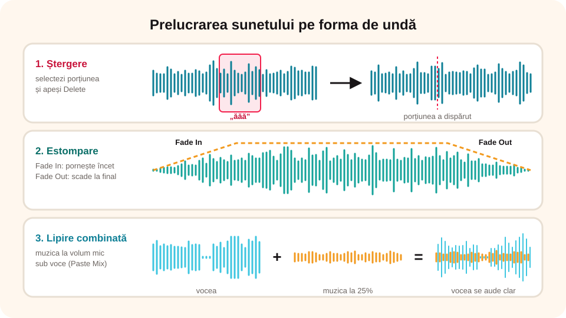

> **Competențe specifice (Anexa 15):** CS 1.2, CS 3.2

## Ce vei învăța azi

- să **selectezi**, să **tai**, să **copiezi** și să **lipești** porțiuni de sunet;
- să schimbi **volumul**: amplificare, normalizare, **estompare** la început și la sfârșit;
- să **cureți** sunetul: zgomot, liniște;
- să adaugi **efecte** și să **combini** mai multe **surse audio** (voce, muzică, efecte), pe piste separate;
- să **organizezi** secvențele audio după un plan.

## Să ne amintim

Pe **forma de undă**, zonele înalte sunt sunete puternice, iar cele plate sunt liniște. **Spațiu** pornește și oprește redarea.

## Lecția pe scurt

### Selectare și editare (fila Editare)

- **Selectarea**: tragi cu mouse-ul pe forma de undă; porțiunea aleasă se colorează.
- **Decupare** (**Ctrl + X**), **Copiere** (**Ctrl + C**), **Lipire** (**Ctrl + V**) în locul cursorului;
- **Ștergere** (**Delete**): elimini o tuse, o greșeală sau un „ăăă”;
- **Trunchiere** (*Trim*): păstrezi **doar** selecția.

### Volumul (fila Nivel)

- **Amplificare** (*Amplify*): faci sunetul mai tare sau mai încet, în procente sau decibeli (dB);
- **Normalizare** (*Normalize*): aduce sunetul la un volum maxim egal, fără să-l distorsioneze;
- **Estompare la intrare** (*Fade In*): sunetul pornește încet și crește;
- **Estompare la ieșire** (*Fade Out*): sunetul scade treptat la final.

### Curățare (fila Curățare)

- **Reducerea zgomotului** (*Noise Reduction*): scoate zumzetul de fond (ventilator, trafic);
- **Eliminarea liniștii** (*Auto Trim / Silence*): scurtează pauzele lungi.

### Efecte (fila Efecte)

**Ecou**, **reverberație** (sunet ca într-o sală mare), **schimbarea vitezei**, **schimbarea tonului** (vocea mai groasă sau mai subțire), **inversare** (sunetul de-a-ndoaselea), **egalizator** (mai multe sunete joase sau înalte).

### Combinarea a două sunete

Ca să pui muzică de fond sub voce: copiezi muzica și folosești **Editare → Lipire combinată** (*Paste Mix*) în locul dorit. Înainte, **micșorezi volumul muzicii** (de exemplu la 20–30%), ca vocea să se audă clar.

### Mai multe surse audio într-un singur material

Un podcast, un anunț sau o poveste sonoră folosește, de obicei, **mai multe surse**: vocea ta înregistrată la microfon, o melodie de fond, efecte sonore (aplauze, sonerie, pași), sunetul extras dintr-un film sau un interviu cu un coleg. Le poți combina în două feluri:

1. **Una după alta** (în succesiune): pui cursorul la locul dorit și lipești (**Ctrl + V**) sau inserezi alt fișier; sunetele se aud pe rând (intro muzical, apoi vocea, apoi efectul final).
2. **Una peste alta** (simultan): **Lipire combinată** (*Paste Mix*) suprapune sunetul copiat peste cel existent (de exemplu, muzica sub voce).

Pentru proiecte cu multe surse, folosești o aplicație **multipistă**: **Audacity** (gratuit) sau **MixPad** (aplicația multipistă a firmei care face WavePad). Acolo **fiecare sursă stă pe o pistă separată**, una sub alta:

- **Fișier → Import → Audio** aduce fiecare fișier pe o **pistă nouă**;
- **muți** fiecare bucată în timp (o tragi spre stânga sau spre dreapta), ca să înceapă exact când vrei;
- fiecare pistă are **volumul** ei (cursorul *Gain*), ca vocea să fie mai tare decât muzica, și butoanele **Mute** (amuțire) și **Solo** (asculți doar acea pistă);
- la **export** (**Fișier → Export → MP3**), toate pistele se **amestecă** într-un singur fișier.

**Organizează secvențele după cerință.** Înainte de montaj scrii un **plan** (scenariu audio): ce sursă se aude, când și cât timp. De exemplu, pentru un podcast de 1 minut:

| Timp | Pista 1: voce | Pista 2: muzică | Pista 3: efecte |
|---|---|---|---|
| 0–5 s | – | intro, volum normal, *Fade In* | – |
| 5–50 s | prezentarea temei | muzica la 20–25% | un clinchet la 30 s |
| 50–60 s | încheierea | muzica crește, *Fade Out* | aplauze |

Toate sursele trebuie să fie **ale tale** sau **libere de drepturi**, iar la final le menționezi.

**Ascultă după fiecare modificare.** Dacă nu-ți place, **Ctrl + Z**.



## Exemplu rezolvat: un anunț radio cu muzică de fond

1. Deschizi înregistrarea vocii tale, `Anunt.wav`.
2. Ștergi pauza de la început: selectezi porțiunea plată și apeși **Delete**.
3. **Curățare → Reducerea zgomotului**, ca să dispară zumzetul.
4. **Nivel → Normalizare**, ca vocea să aibă un volum bun.
5. Deschizi `Muzica.mp3` (liberă de drepturi), o amplifici la **25%** și o copiezi.
6. Te întorci la anunț, pui cursorul la început și alegi **Lipire combinată**.
7. Pe finalul muzicii aplici **Estompare la ieșire**.
8. Asculți tot și salvezi ca `Anunt_final.mp3`.

## Aplicații interactive

```categorii
# În ce filă găsești operația?
Editare: decupare, trunchiere, lipire combinată
Nivel: amplificare, normalizare, estompare la ieșire
Curățare: reducerea zgomotului, eliminarea liniștii
Efecte: ecou, schimbarea tonului, reverberație
```

```quiz
# Alege răspunsul corect.
Ce face Trunchierea?
- șterge porțiunea selectată
* păstrează doar porțiunea selectată
- dublează volumul

Cum faci ca muzica să se termine treptat, nu brusc?
- Amplificare la 200%
* Estompare la ieșire (Fade Out)
- Inversare

De ce micșorezi volumul muzicii înainte să o combini cu vocea?
* ca vocea să se audă clar peste muzică
- ca fișierul să fie mai mic
- nu e nevoie
```

```ordonare
# Cum scoți o greșeală din mijlocul înregistrării?
Asculți și găsești greșeala
Selectezi porțiunea pe forma de undă
Apeși Delete
Asculți din nou zona
```

```adevarat-fals
A: Normalizarea aduce sunetul la un volum maxim egal, fără distorsiuni.
F: După ce ai aplicat un efect, nu-l mai poți anula. | Ctrl + Z anulează ultima operație.
A: Reducerea zgomotului poate scoate zumzetul unui ventilator.
```

```categorii
# Sunetele se aud una după alta sau simultan?
Una după alta (succesiune): intro muzical urmat de voce, lipire cu Ctrl + V la cursor
Simultan (suprapunere): muzică de fond sub voce, Lipire combinată, piste diferite care cântă în același timp
```

```quiz
# Mai multe surse audio.
Într-o aplicație multipistă, unde stă fiecare sursă (voce, muzică, efecte)?
* pe o pistă separată
- toate pe aceeași pistă, una peste alta
- în fișiere care nu se mai pot combina
Explicație: Pe piste separate poți muta și regla volumul fiecărei surse independent.

Ce se întâmplă cu pistele la export în MP3?
- se salvează câte un fișier pentru fiecare pistă, obligatoriu
* se amestecă într-un singur fișier audio
- se pierde muzica
Explicație: Exportul combină toate pistele (cele neamuțite) într-un singur fișier.

Vrei să asculți doar vocea, fără muzică și efecte. Ce buton folosești pe pista vocii?
- Mute
* Solo
- Fade Out
```

```ordonare
# Ordonează pașii pentru un podcast cu trei surse
Scrii planul: ce se aude, când și cât timp
Înregistrezi vocea și o cureți de zgomot
Imporți vocea, muzica și efectele pe piste separate
Muți fiecare sursă la momentul potrivit
Reglezi volumul fiecărei piste
Asculți tot și exporți ca MP3
```

```eseu
# Nivel avansat: planul unui material audio din mai multe surse.
Ai de realizat un anunț radio de 30–45 de secunde pentru serbarea școlii. Scrie planul (scenariul audio): ce surse folosești (cel puțin trei: voce, muzică, efecte), în ce ordine și în ce momente se aud, ce volum are fiecare, ce efecte aplici (estompare, reducerea zgomotului etc.) și de unde iei muzica și efectele. Apoi realizează anunțul în WavePad, Audacity sau MixPad.
Cuvinte: 50-150
Barem: cel puțin trei surse diferite; ordinea și momentele fiecărei secvențe sunt precizate și se potrivesc cerinței (30–45 s); vocea se aude clar (muzica la volum mic sub voce); cel puțin două prelucrări potrivite (estompare, normalizare, reducerea zgomotului); surse proprii sau libere de drepturi, menționate.
```

## Exersează

1. Înregistrează o propoziție și șterge pauzele lungi dintre cuvinte.
2. Aplică pe aceeași înregistrare trei efecte (ecou, schimbarea tonului, inversare). Descrie ce se aude.
3. Taie o melodie liberă de drepturi la 30 de secunde, cu **Fade In** și **Fade Out**.
4. **Portofoliu:** un podcast de un minut despre o temă de la școală, cu muzică de fond încet, intro și încheiere.

## Verifică-te

- Care e diferența dintre Amplificare și Normalizare?
- Cum pui muzică sub voce?
- Ce avantaje are lucrul cu mai multe piste?

## Pe scurt

Selectezi pe forma de undă și folosești **Decupare**, **Copiere**, **Lipire**, **Ștergere**, **Trunchiere**. Reglezi volumul cu **Amplificare**, **Normalizare** și **Estompare**, cureți cu **Reducerea zgomotului** și adaugi **efecte**. Muzica de fond se pune cu **Lipire combinată**, la volum mic. Când ai **mai multe surse**, le pui pe **piste separate** într-o aplicație multipistă, le așezi după un **plan** și le exporți amestecate într-un singur fișier.
