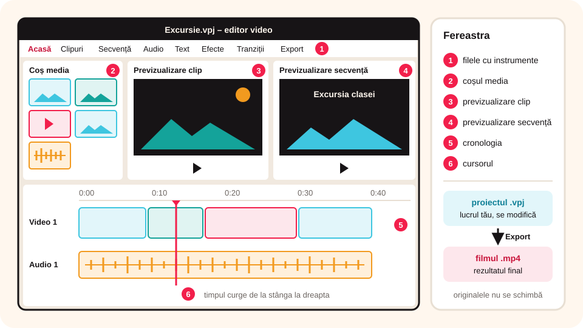

> **Competențe specifice (Anexa 15):** CS 1.2, CS 3.2

## Ce vei învăța azi

- ce face un program de **montaj video**;
- să recunoști **elementele ferestrei** VideoPad;
- diferența dintre **proiect** și **film exportat**;
- să **imporți** fișiere și să le pui pe **cronologie**.

## Să ne amintim

Un film este o succesiune de **cadre** cu **sunet**. Formatul video cel mai folosit este **MP4**. În WavePad ai lucrat cu forma de undă și cronologia sunetului.

## Lecția pe scurt

### Montajul video

**Montajul** înseamnă să alegi bucățile bune din filmări, să le pui în ordine, să adaugi **tranziții**, **text**, **muzică** și **efecte**, apoi să obții un singur film.

Programe: **VideoPad** (NCH Software, gratuit pentru uz necomercial), **Clipchamp** (inclus în Windows 11), **Shotcut** și **OpenShot** (gratuite), **CapCut** (telefon/online).

### Fereastra VideoPad

1. **Filele cu instrumente**: **Acasă**, **Clipuri**, **Secvență**, **Audio**, **Text**, **Efecte**, **Tranziții**, **Export**.
2. **Coșul media** (*Media List*, stânga sus): fișierele importate (video, imagini, audio).
3. **Previzualizare clip** (*Clip Preview*): vezi un fișier din coș, înainte să-l folosești.
4. **Previzualizare secvență** (*Sequence Preview*): vezi filmul tău, așa cum arată pe cronologie.
5. **Cronologia** (*Timeline*, jos): **pistele video** (deasupra) și **pistele audio** (dedesubt), cu timpul de la stânga la dreapta.
6. **Cursorul** de pe cronologie: momentul afișat în previzualizare.

> Unele versiuni arată un **storyboard** (scenariu cu căsuțe) în loc de cronologie. Comuți cu butonul **Cronologie / Storyboard**.



### Proiect sau film?

- **Proiectul** (`.vpj`) păstrează **lucrul tău**: ce clipuri ai folosit, unde, cu ce efecte. Îl poți deschide și modifica.
- **Filmul exportat** (`.mp4`) este rezultatul final, pe care îl vezi pe orice dispozitiv. Nu se mai modifică ușor.

Fișierele originale **nu se schimbă** în timpul montajului; proiectul doar le folosește.

### Importul și așezarea pe cronologie

1. **Adăugare fișiere** (*Add File(s)*) sau tragi fișierele în coșul media.
2. Tragi clipurile din coș pe **cronologie**, în ordinea dorită.
3. Imaginile primesc o durată (de exemplu, 5 secunde), pe care o poți schimba.
4. **Fișier → Salvare proiect** (**Ctrl + S**).

## Exemplu rezolvat: un film din fotografiile excursiei

1. Creezi un proiect nou și îl salvezi ca `Excursie.vpj`.
2. Imporți 6 fotografii și o melodie liberă de drepturi.
3. Tragi fotografiile pe pista video, în ordinea zilei.
4. Tragi melodia pe pista audio.
5. Apeși **Redare** în **Previzualizare secvență** și verifici ordinea.
6. Salvezi proiectul (exportul îl faci lecția următoare).

## Aplicații interactive

```categorii
# Ce element al ferestrei VideoPad este?
Coșul media: lista fișierelor importate
Previzualizare clip: vezi un fișier înainte să-l folosești
Previzualizare secvență: vezi filmul tău
Cronologia: pistele video și audio în timp
```

```quiz
# Alege răspunsul corect.
Ce păstrează fișierul de proiect (.vpj)?
* lucrul tău: clipurile folosite, ordinea și efectele
- doar filmul final
- doar muzica

Ce se întâmplă cu fișierele originale în timpul montajului?
- se șterg
* rămân neschimbate
- se micșorează

Unde pui melodia de fond?
- pe pista video
* pe o pistă audio
- în coșul de reciclare
```

```ordonare
# Pașii pentru începerea unui film
Creezi un proiect nou
Imporți fotografiile și muzica
Tragi fotografiile pe pista video
Tragi muzica pe pista audio
Verifici în Previzualizare secvență
Salvezi proiectul
```

```adevarat-fals
A: Clipchamp este un program de montaj video inclus în Windows 11.
F: Filmul exportat în MP4 se poate modifica la fel de ușor ca proiectul. | Pentru modificări deschizi proiectul.
A: Pe cronologie, pistele video stau deasupra celor audio.
```

## Exersează

1. Deschide VideoPad (sau Clipchamp) și găsește toate elementele ferestrei.
2. Importă 3 imagini și un clip video scurt; pune-le pe cronologie.
3. Schimbă durata unei imagini la 3 secunde.
4. Comută între **Cronologie** și **Storyboard**. Prin ce diferă?
5. **Portofoliu:** salvează proiectul `Primul_meu_film.vpj` în folderul `Portofoliu_TIC_7`.

## Verifică-te

- Care e diferența dintre previzualizarea clipului și a secvenței?
- De ce păstrezi proiectul și după ce ai exportat filmul?

## Pe scurt

Un program de **montaj** pune clipuri, imagini și sunete într-un singur film. VideoPad are **coșul media**, **previzualizarea clipului**, **previzualizarea secvenței** și **cronologia** cu piste video și audio. **Proiectul** (`.vpj`) păstrează lucrul, iar **filmul exportat** (`.mp4`) e rezultatul final.
