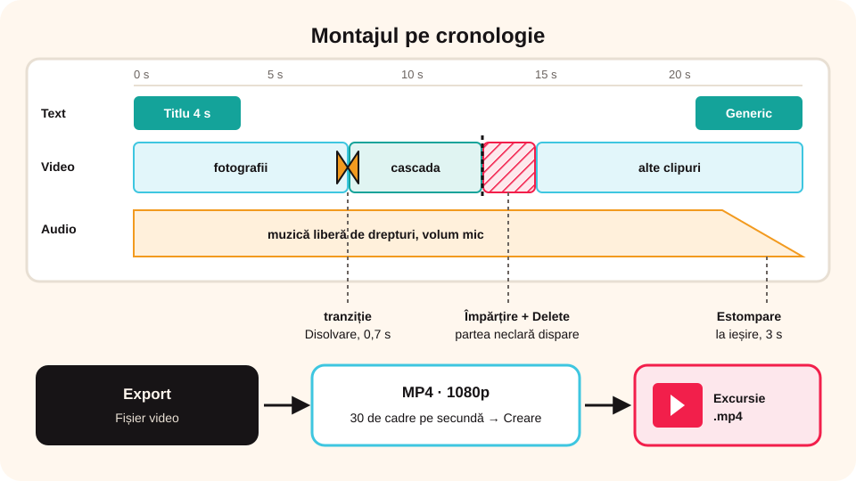

> **Competențe specifice (Anexa 15):** CS 1.2, CS 3.2

## Ce vei învăța azi

- să **scurtezi**, să **împarți** și să **ștergi** porțiuni din clipuri;
- să adaugi **tranziții** între clipuri;
- să adaugi **text** și **titluri**;
- să **exporți** filmul în format **MP4**.

## Să ne amintim

Clipurile se trag din **coșul media** pe **cronologie**. **Proiectul** păstrează lucrul, iar filmul **exportat** e rezultatul final.

## Lecția pe scurt

### Tăierea clipurilor

- **Scurtare la capete**: tragi de **marginea** clipului de pe cronologie, spre interior.
- **Puncte de început și sfârșit**: în **Previzualizare clip**, marchezi **începutul** și **sfârșitul** porțiunii bune, apoi o pui pe cronologie.
- **Împărțire** (*Split*): pui cursorul unde vrei să tai și apeși **Împărțire**; clipul devine două bucăți.
- **Ștergere**: selectezi bucata nedorită și apeși **Delete**. Spațiul rămas se poate închide automat.
- **Mutare**: tragi clipul în alt loc pe cronologie.

### Tranziții (fila Tranziții)

Tranziția face trecerea de la un clip la altul mai plăcută: **Estompare** (*Fade*), **Disolvare** (*Cross Fade*), **Ștergere** (*Wipe*), **Zoom**. O tragi **între** două clipuri și îi reglezi **durata** (de obicei 0,5–1 secundă). Ca la prezentări: **puține tranziții, simple**.

### Text și titluri (fila Text)

- **Titlu** la început (numele filmului, autorul);
- **subtitrări** sau explicații peste imagine;
- **genericul** de final (autor, surse, muzică folosită).

Alegi fontul, mărimea, culoarea și poziția; textul are propria **pistă** și propria **durată**. Textul trebuie să stea pe ecran destul cât să poată fi citit.

### Sunetul

- **Volumul** fiecărui clip se reglează separat;
- poți **dezactiva** sunetul original al unui clip (de exemplu, vântul din filmare);
- muzica de fond pe o pistă audio separată, cu **estompare** la final.

### Exportul (fila Export)

**Export → Fișier video**: alegi formatul **MP4**, rezoluția (**720p** sau **1080p**) și numărul de cadre pe secundă, apoi **Creare**. Exportul durează puțin, în funcție de lungimea filmului.



## Exemplu rezolvat: filmul excursiei, terminat

1. Deschizi `Excursie.vpj`.
2. Adaugi la început un **titlu**: „Excursia clasei a VII-a B”, 4 secunde.
3. Pui între fotografii tranziția **Disolvare**, 0,7 secunde.
4. Împarți clipul video cu cascada și ștergi partea neclară.
5. Reglezi muzica la volum mic și pui **Estompare la ieșire** pe ultimele 3 secunde.
6. La final, **genericul**: realizat de…, muzica: titlul și sursa.
7. **Export → Fișier video → MP4, 1080p** și salvezi ca `Excursie.mp4`.

## Aplicații interactive

```ordonare
# Cum scoți o porțiune din mijlocul unui clip?
Pui cursorul la începutul porțiunii
Apeși Împărțire
Pui cursorul la sfârșitul porțiunii
Apeși din nou Împărțire
Selectezi bucata din mijloc
Apeși Delete
```

```quiz
# Alege răspunsul corect.
Unde se pune o tranziție?
- la începutul fiecărui clip, pe pista audio
* între două clipuri, pe cronologie
- doar la finalul filmului

Ce conține genericul de final?
* autorul, sursele și muzica folosită
- primele imagini din film
- doar titlul filmului

Ce format alegi la export ca filmul să meargă pe aproape orice dispozitiv?
- .vpj
* .mp4
- .wav
```

```categorii
# Ce operație este?
Împărțire: tai un clip în două bucăți
Tranziție: trecerea de la un clip la altul
Text: titlul și genericul
Export: obții fișierul MP4
```

```adevarat-fals
A: Poți dezactiva sunetul original al unui clip video.
F: Cu cât folosești mai multe tranziții diferite, cu atât filmul e mai bun. | Puține tranziții, simple, ca la prezentări.
A: Textul de pe ecran trebuie să stea destul cât să poată fi citit.
```

## Exersează

1. Scurtează un clip la capete și împarte altul în trei bucăți.
2. Pune trei tranziții diferite și compară-le. Pe care ai păstra-o?
3. Adaugă un titlu, două subtitrări și un generic.
4. Exportă filmul la 720p și la 1080p. Compară mărimile fișierelor.
5. **Portofoliu:** un film de 1–2 minute, „O zi la școala mea”, cu titlu, tranziții, muzică liberă de drepturi și generic.

## Verifică-te

- Ce face comanda Împărțire?
- Ce trebuie să conțină genericul?

## Pe scurt

Pe cronologie **scurtezi**, **împarți**, **ștergi** și **muți** clipurile. Adaugi **tranziții** simple, **text** (titlu, subtitrări, generic) și reglezi **sunetul**. La final, **exporți** filmul ca **MP4**.
