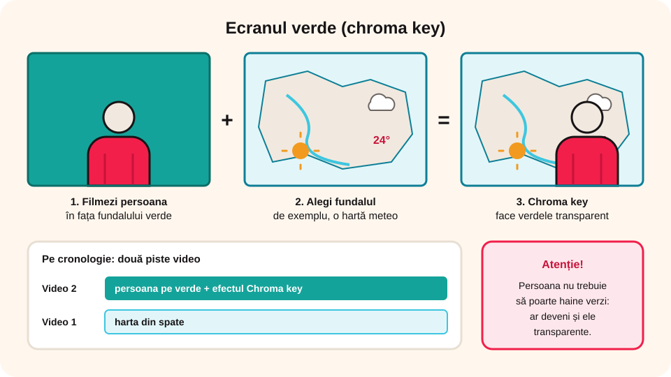

> **Competențe specifice (Anexa 15):** CS 1.2, CS 3.2

## Ce vei învăța azi

- să aplici **efecte video**: culoare, luminozitate, alb-negru, sepia;
- să schimbi **viteza** unui clip (încetinitor, accelerat);
- să **decupezi**, să **rotești** și să faci **imagine în imagine**;
- ce este **ecranul verde** (chroma key);
- să adaugi o **narațiune** și să planifici filmul cu un **scenariu**.

## Să ne amintim

Ai învățat să tai clipurile, să pui tranziții, text și muzică și să exporți ca MP4. Azi faci filmul mai interesant.

## Lecția pe scurt

### Efecte video (fila Efecte)

- **Corecție de culoare**: luminozitate, contrast, saturație (culori mai vii sau mai șterse);
- **Alb-negru**, **sepia** (aspect de fotografie veche), **estompare** (blur);
- **Decupare** (*Crop*): păstrezi doar o parte a imaginii;
- **Rotire** și **oglindire**: repari o filmare făcută cu telefonul întors;
- **Zoom și deplasare** (efectul *Ken Burns*): pe o fotografie, imaginea se apropie încet.

### Viteza

Din proprietățile clipului schimbi **viteza**: **50%** = **încetinitor** (de exemplu, o săritură), **200%** = **accelerat** (de exemplu, construcția unei machete). Sunetul se strică la viteze schimbate, așa că de obicei îl dezactivezi.

### Imagine în imagine

Pui un clip pe o **a doua pistă video**, deasupra, și îl micșorezi într-un colț. Așa apar, de exemplu, tu care explici, peste o imagine cu ecranul calculatorului.

### Ecranul verde (chroma key)

Filmezi o persoană în fața unui fundal **verde** uniform. Efectul **Chroma key** face verdele **transparent**, iar în spate pui altă imagine (de exemplu, o hartă, ca la știrile meteo). Persoana nu trebuie să poarte haine verzi!



### Narațiunea

Cu **Înregistrare → Narațiune**, vorbești la microfon în timp ce privești filmul; sunetul apare pe o pistă audio nouă. Poți folosi și o înregistrare curățată în WavePad.

### Planificarea: scenariul

Un film bun începe **pe hârtie**:

| Nr. | Cadru (ce se vede) | Text / narațiune | Durată |
|---|---|---|---|
| 1 | titlul pe fundal albastru | „Cum reciclăm la școală” | 4 s |
| 2 | coșurile colorate din curte | „Avem patru coșuri…” | 8 s |
| 3 | elevi care sortează | „Hârtia merge la albastru…” | 10 s |

## Exemplu rezolvat: un clip „înainte și după”

1. Pui pe cronologie filmarea curții, de 10 secunde.
2. O **împarți** în două; prima jumătate o faci **alb-negru** și îi adaugi textul „Înainte”.
3. A doua jumătate rămâne color, cu textul „După curățenie”.
4. Între ele, tranziția **Ștergere**.
5. Peste toată secvența înregistrezi o **narațiune** scurtă.
6. Exporți ca `Inainte_si_dupa.mp4`.

## Aplicații interactive

```categorii
# Ce efect folosești?
Încetinitor: vrei să se vadă bine o săritură
Rotire: telefonul a filmat întors
Chroma key: prezentatorul apare în fața unei hărți
Imagine în imagine: tu explici într-un colț al ecranului
Sepia: aspect de fotografie veche
```

```quiz
# Alege răspunsul corect.
Ce face efectul Chroma key?
* face transparentă o culoare uniformă, de obicei verdele, ca să pui altă imagine în spate
- schimbă viteza clipului
- adaugă muzică

Ce viteză alegi pentru un încetinitor?
* 50%
- 200%
- 100%

Ce faci înainte să filmezi?
- exporți filmul
* scrii scenariul: cadrele, textul și durata fiecăruia
- alegi tranzițiile
```

```adevarat-fals
A: Pentru imagine în imagine pui un clip pe o a doua pistă video, micșorat.
F: La ecranul verde, persoana filmată trebuie să poarte haine verzi. | Hainele verzi ar deveni și ele transparente.
A: Narațiunea apare pe o pistă audio separată.
```

```eseu
# Nivel avansat: proiectul unui film după cerință.
Cerința: un film de 60–90 de secunde, „Un obicei sănătos”, pentru colegii de clasa a V-a. Scrie scenariul pe cadre (ce se vede, textul sau narațiunea, durata fiecărui cadru), ce surse folosești (filmări, fotografii, muzică, narațiune), ce efecte și tranziții alegi și de ce, apoi cum verifici că filmul respectă durata și publicul cerut. Realizează filmul în VideoPad sau Clipchamp și exportă-l ca MP4.
Cuvinte: 60-180
Barem: scenariu cu cel puțin 5 cadre, fiecare cu imagine, text sau narațiune și durată, care însumează 60–90 s; surse variate (cel puțin video sau imagini, muzică și narațiune), proprii sau libere de drepturi, menționate în generic; efecte și tranziții puține, justificate prin mesaj și public; titlu, generic și export MP4; respectarea acordului persoanelor filmate.
```

## Exersează

1. Aplică pe același clip luminozitate, alb-negru și sepia. Ce efect se potrivește unui film despre trecut?
2. Fă un clip de 5 secunde cu încetinitor și unul cu accelerat.
3. Realizează o imagine în imagine: o fotografie mare și un clip mic în colț.
4. Scrie un scenariu de 6 cadre pentru un film de un minut despre un hobby.
5. **Portofoliu:** pe baza scenariului, realizează filmul, cu narațiune, un efect și generic.

## Verifică-te

- Cum funcționează ecranul verde?
- De ce scrii scenariul înainte să filmezi?

## Pe scurt

Efectele schimbă **culoarea**, **viteza**, **încadrarea** și **orientarea** clipurilor. **Imaginea în imagine** folosește două piste video, iar **chroma key** înlocuiește fundalul verde. **Narațiunea** se înregistrează peste film. Un film bun începe cu un **scenariu**.
