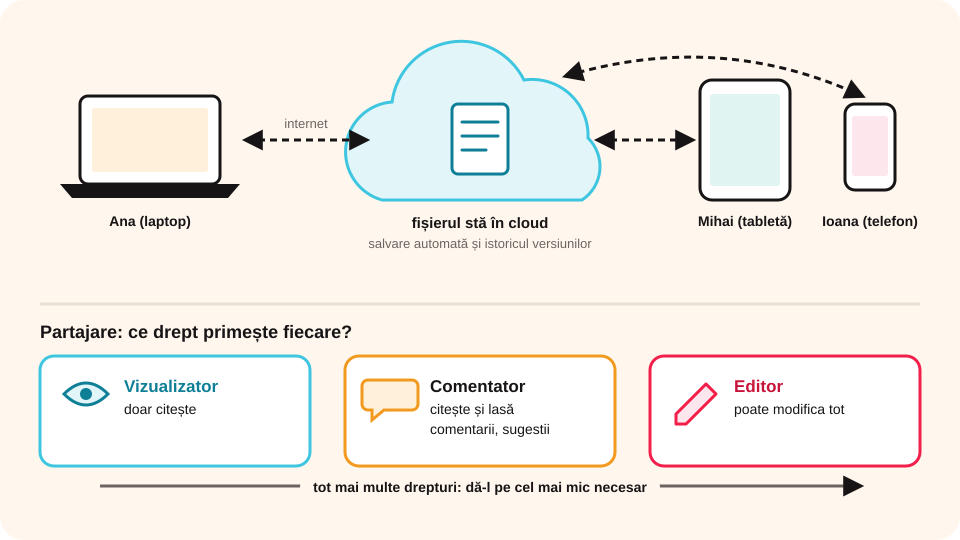

> **Competențe specifice (Anexa 15):** CS 1.3

## Ce vei învăța azi

- ce este o **aplicație colaborativă** și ce înseamnă **cloud**;
- să dai exemple de aplicații colaborative;
- ce **drepturi** poți da când **partajezi** un fișier;
- cum îți **protejezi** contul și documentele online;
- ce reguli de **etică** respecți când lucrezi într-o echipă online.

## Să ne amintim

În clasa a VI-a ai trimis fișiere ca **atașamente** la e-mail. Dacă trei colegi modifică același document și îl trimit înapoi, apar trei variante diferite. Aplicațiile colaborative rezolvă această problemă.

## Lecția pe scurt

### Ce este o aplicație colaborativă

O **aplicație colaborativă** permite **mai multor persoane** să lucreze **în același timp** la **același fișier**, de pe dispozitive diferite, prin internet. Fiecare vede imediat modificările celorlalți.

### Cloud-ul (stocarea în nori)

Fișierul nu stă pe calculatorul tău, ci pe **serverele** unei firme, „în nori” (*cloud*). Îl deschizi din **browser** sau dintr-o aplicație, de oriunde, cu **contul** tău.

| Stocare locală | Stocare în cloud |
|---|---|
| fișierul e pe hard disk sau stick | fișierul e pe un server, pe internet |
| îl folosești doar pe acel dispozitiv | îl deschizi de pe orice dispozitiv |
| se poate pierde dacă se strică discul | are copii de siguranță automate |
| nu ai nevoie de internet | ai nevoie de internet și de un cont |

Servicii de stocare: **Google Drive**, **OneDrive**, **Dropbox**, **iCloud**.

### Exemple de aplicații colaborative

- **documente**: Google Docs, Word online (Microsoft 365);
- **prezentări**: Google Slides, PowerPoint online, Canva;
- **foi de calcul**: Google Sheets, Excel online;
- **table albe și idei**: Padlet, Miro, Microsoft Whiteboard;
- **clase virtuale**: Google Classroom, Microsoft Teams;
- **hărți**: Google My Maps (lecția despre GIS).

### Partajarea și drepturile

Butonul **Partajare** (*Share*) trimite fișierul altor persoane. Pentru fiecare alegi un drept:

- **Vizualizator** (*Viewer*): doar citește;
- **Comentator** (*Commenter*): citește și lasă **comentarii** și **sugestii**;
- **Editor**: poate modifica tot.

Poți partaja cu **anumite persoane** (după adresa de e-mail) sau printr-un **link**. Linkul „oricine are linkul” e comod, dar oricine îl primește poate intra. Dă **cel mai mic drept** de care are nevoie fiecare.



### Istoricul versiunilor

Aplicația **salvează automat** și păstrează **istoricul versiunilor**: vezi cine ce a modificat și poți **reveni** la o variantă mai veche, dacă cineva a șters din greșeală o parte.

### Protecția în mediul online când lucrezi în echipă

**Protejează-ți contul:**

- o **parolă puternică** (cel puțin 12 caractere, litere mari și mici, cifre, simboluri), pe care **nu o spui** nimănui, nici celui mai bun prieten;
- activează **verificarea în doi pași** (un cod primit pe telefon), dacă școala sau părinții îți permit;
- pe un calculator al școlii sau al altcuiva, la final apeși **Deconectare** (*Sign out*) și **nu** bifezi „Ține-mă minte”;
- nu dai clic pe linkuri de „partajare” primite de la necunoscuți: pot fi **înșelătorii** (*phishing*) care îți cer parola.

**Protejează fișierul, cu permisiunile de partajare:**

- **Proprietarul** (*Owner*) este cel care a creat fișierul: doar el îl poate șterge definitiv și poate schimba orice drept;
- **Acces general**: alegi **Restricționat** (intră doar persoanele adăugate de tine) în loc de „Oricine are linkul”;
- dai **cel mai mic drept necesar**: părinții și publicul doar **vizualizează**, profesorul **comentează**, colegii din echipă **editează**;
- la vizualizatori și comentatori poți **dezactiva descărcarea, tipărirea și copierea** (din setările de partajare, rotița ⚙);
- la final de proiect **elimini accesul** celor care nu mai au nevoie de el sau le schimbi dreptul în **Vizualizator**;
- nu pui în documente comune **date personale**: adresa, numărul de telefon, parole, fotografii cu alte persoane fără acordul lor.

### Etica în lucrul colaborativ

- **Respecți munca altora**: nu ștergi și nu rescrii partea unui coleg fără acordul lui; propui schimbări prin **comentarii** sau în modul **Sugestii**.
- **Fiecare își face partea**: nu te bazezi pe munca celorlalți și nu îți asumi meritele lor. Istoricul versiunilor arată cine ce a scris.
- **Spui de unde ai luat informațiile**: nu copiezi texte de pe internet ca și cum ar fi ale tale (**plagiat**); scrii **sursa** textelor și a imaginilor și folosești imagini cu licență liberă.
- **Comunici politicos**: critici ideea, nu persoana; nu scrii jigniri și nu râzi de greșelile altora în comentarii (asta ar fi **hărțuire online**, *cyberbullying*).
- **Nu distribui mai departe** un fișier primit fără permisiunea proprietarului.
- **Spui unui adult** (profesor, părinte) dacă cineva strică intenționat documentul sau scrie mesaje urâte.

### Reguli de lucru în echipă

1. Împărțiți sarcinile: fiecare știe ce parte face.
2. **Nu ștergi** munca altuia; lași un **comentariu**.
3. Scrii politicos în comentarii (neticheta de la e-mail).
4. Nu partajezi date personale și nu dai linkul de editare persoanelor străine.
5. La final, citiți toți documentul și îl uniformizați.

> **Atenție la vârstă:** multe conturi (de exemplu, un cont Google personal) se pot crea singur doar de la o anumită vârstă (în România, de regulă **16 ani**). La școală folosești **contul școlii** sau, acasă, contul administrat de părinți.

## Exemplu rezolvat: un afiș al clasei, făcut în echipă

1. Ana creează în Google Drive documentul „Afiș excursie”.
2. Apasă **Partajare** și adaugă adresele școlare ale lui Mihai și Ioana, ca **Editori**, iar pe a dirigintelui ca **Comentator**.
3. Mihai scrie traseul, Ioana adaugă fotografiile, Ana scrie titlul și regulile.
4. Dirigintele lasă comentariul „Adăugați ora de plecare”. Ana o adaugă și marchează comentariul ca **rezolvat**.
5. Ioana șterge din greșeală un paragraf; Ana îl recuperează din **Istoricul versiunilor**.

## Aplicații interactive

```categorii
# Ce drept dai?
Vizualizator: părinții care doar citesc afișul
Comentator: profesorul care corectează și sugerează
Editor: colegul din echipă care scrie o parte
```

```quiz
# Alege răspunsul corect.
Ce este o aplicație colaborativă?
* o aplicație în care mai multe persoane lucrează în același timp la același fișier, prin internet
- o aplicație care merge doar fără internet
- un program de desen

Unde este păstrat un fișier din Google Drive?
- doar pe stickul tău
* pe serverele firmei, în cloud
- în coșul de reciclare

Un coleg a șters din greșeală jumătate din document. Ce faci?
- începi totul de la capăt
* revii la o variantă mai veche din Istoricul versiunilor
- ștergi și tu partea lui
```

```adevarat-fals
A: Aplicațiile colaborative salvează automat modificările.
F: E bine să partajezi linkul de editare pe o rețea de socializare. | Oricine ar putea modifica sau strica documentul.
A: Pentru a lucra în cloud ai nevoie de internet și de un cont.
F: Dacă nu ești de acord cu textul unui coleg, îl ștergi. | Lași un comentariu politicos.
```

```categorii
# Stocare locală sau în cloud?
Stocare locală: hard disk, stick USB, card de memorie
Stocare în cloud: Google Drive, OneDrive, Dropbox
```

```categorii
# Protejează sau pune în pericol documentul și contul?
Protejează: acces general Restricționat, Deconectare pe calculatorul școlii, verificarea în doi pași, eliminarea accesului la finalul proiectului
Pune în pericol: linkul de editare postat pe o rețea de socializare, parola spusă unui prieten, adresa de acasă scrisă în document, opțiunea Ține-mă minte pe un calculator străin
```

```categorii
# Comportament etic sau neetic în echipă?
Etic: lași un comentariu politicos, scrii sursa imaginii, folosești modul Sugestii pentru partea colegului
Neetic: ștergi textul unui coleg fără să-l întrebi, copiezi un text de pe internet fără sursă, scrii comentarii jignitoare, trimiți fișierul altora fără acordul proprietarului
```

```quiz
# Permisiuni de partajare.
Ai terminat proiectul și vrei ca părinții să-l poată citi, dar nu să-l modifice sau să-l descarce. Ce faci?
* îi adaugi ca Vizualizatori și dezactivezi descărcarea, tipărirea și copierea
- îi adaugi ca Editori
- postezi linkul de editare pe grupul clasei
Explicație: Dai cel mai mic drept necesar și poți opri descărcarea pentru vizualizatori și comentatori.

Cine poate șterge definitiv un document din Google Drive?
- orice vizualizator
- orice comentator
* proprietarul (cel care l-a creat)
Explicație: Proprietarul are toate drepturile asupra fișierului.

Un coleg din altă clasă îți cere linkul de editare al proiectului echipei. Ce faci?
- i-l dai imediat
* întrebi echipa și profesorul; dacă e nevoie, îi dai doar dreptul de vizualizare
- îi dai parola contului tău
Explicație: Fișierul echipei nu se distribuie fără acordul celorlalți, iar dreptul dat trebuie să fie cel mai mic necesar.
```

```eseu
# Nivel avansat: regulamentul echipei.
Echipa ta lucrează o lună la un document comun în Google Docs. Scrie un regulament cu cel puțin cinci reguli: cine primește ce drept (proprietar, editor, comentator, vizualizator) și de ce, cum vă protejați conturile și documentul, ce faceți dacă cineva șterge din greșeală sau intenționat o parte și ce reguli de etică respectați în comentarii și la folosirea surselor.
Cuvinte: 60-180
Barem: drepturi atribuite după principiul celui mai mic drept necesar, justificate; acces general Restricționat și cel puțin o măsură de protecție a contului (parolă, verificare în doi pași, deconectare); folosirea istoricului versiunilor pentru recuperare și anunțarea unui adult la probleme; cel puțin două reguli de etică (respectarea muncii altora, comentarii politicoase, citarea surselor, fără date personale).
```

```completare
# Completează.
Fișierele păstrate pe internet, pe serverele unei firme, sunt stocate în [cloud|nori]. Butonul care trimite fișierul altor persoane se numește [Partajare|Share]. Varianta veche a unui document o găsești în istoricul [versiunilor].
```

## Exersează

1. Scrie trei avantaje și două dezavantaje ale stocării în cloud.
2. Enumeră aplicațiile colaborative pe care le folosește deja clasa ta.
3. Pentru un proiect de grup, scrie pe cine ai adăuga ca editor, comentator și vizualizator.
4. Deschide contul școlii și găsește în Drive butonul **Nou** și folderul **Partajate cu mine**.
5. **Portofoliu:** creează în Drive folderul `Portofoliu_TIC_7_cloud` și încarcă în el un document din Unitatea 1.

## Verifică-te

- Care e diferența dintre un comentator și un editor?
- La ce folosește istoricul versiunilor?
- De ce alegi accesul Restricționat în loc de „Oricine are linkul”?
- Numește trei reguli de etică în lucrul colaborativ.

## Pe scurt

**Aplicațiile colaborative** permit mai multor persoane să lucreze simultan la același fișier, păstrat în **cloud**. La **partajare** alegi dreptul potrivit: **vizualizator**, **comentator** sau **editor**. Modificările se salvează automat, iar **istoricul versiunilor** permite revenirea. În echipă, comunici prin **comentarii politicoase** și nu ștergi munca altora. Îți protejezi **contul** (parolă, deconectare) și **fișierul** (acces **Restricționat**, cel mai mic drept necesar), citezi **sursele** și nu publici **date personale**.
