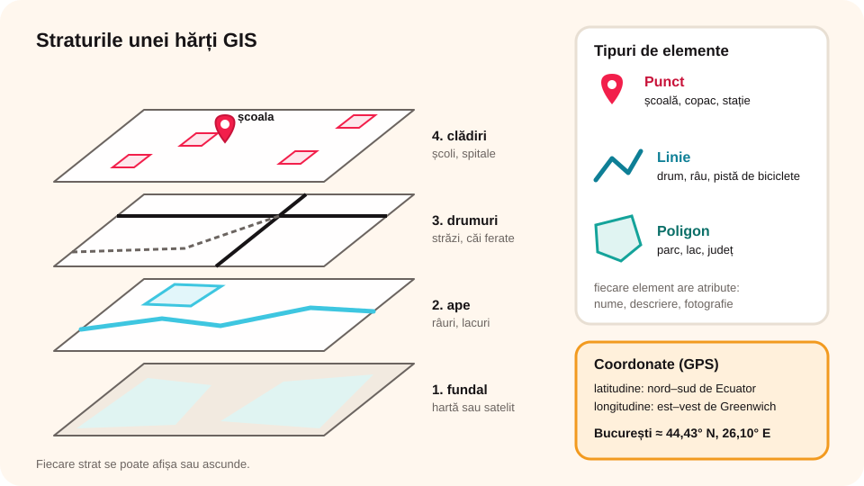

> **Competențe specifice (Anexa 15):** CS 1.3

## Ce vei învăța azi

- ce este un **GIS** (sistem informatic geografic);
- ce sunt **straturile** unei hărți digitale și **coordonatele** geografice;
- să deosebești **puncte**, **linii** și **poligoane**;
- unde se folosesc GIS-urile;
- să faci o **hartă colaborativă** în Google My Maps.

## Să ne amintim

La geografie folosești hărți cu **legendă**, **scară** și **puncte cardinale**. Pe telefon ai văzut, probabil, aplicații de hartă care arată unde ești și cum ajungi undeva.

## Lecția pe scurt

### Ce este un GIS

Un **GIS** (*Geographic Information System*, sistem informatic geografic) este un sistem care **adună**, **păstrează**, **analizează** și **afișează pe hartă** date legate de **locuri** de pe Pământ. Fiecare informație are o **poziție**: de exemplu, „școala” are o adresă și coordonate.

### Coordonatele și GPS-ul

Orice loc se poate descrie prin **latitudine** (nord–sud de Ecuator) și **longitudine** (est–vest de meridianul Greenwich). De exemplu, București: aproximativ **44,43° N** și **26,10° E**.

**GPS**-ul primește semnale de la **sateliți** și calculează coordonatele dispozitivului. Așa știe telefonul unde ești.

### Straturile

O hartă GIS este formată din **straturi** (*layers*) puse unul peste altul, ca niște foi transparente:

| Strat | Exemplu |
|---|---|
| imaginea de fundal | hartă sau fotografie din satelit |
| ape | râuri, lacuri |
| drumuri | străzi, căi ferate |
| clădiri | școli, spitale |
| date | populație, poluare, trafic |

Poți **ascunde** sau **afișa** fiecare strat, ca să vezi doar ce te interesează.

### Tipuri de elemente

- **Punct**: un loc mic (o școală, un copac, o stație de autobuz);
- **Linie**: un traseu (un drum, un râu, o pistă de biciclete);
- **Poligon**: o suprafață (un parc, un lac, un județ).

Fiecare element are **atribute**: nume, descriere, fotografie, an etc.



### Unde se folosește GIS

- **navigare**: Google Maps, Waze (traseul cel mai rapid);
- **urgențe**: ambulanța găsește cea mai apropiată stație și cel mai scurt drum;
- **mediu**: hărți ale pădurilor, ale inundațiilor sau ale poluării;
- **meteorologie**: hărți cu temperaturi și furtuni;
- **urbanism**: unde se construiește o școală nouă sau o pistă de biciclete;
- **agricultură**: ce zone ale câmpului au nevoie de apă;
- **istorie și turism**: hărți cu monumente.

Aplicații: **Google Earth**, **Google Maps**, **Google My Maps**, **OpenStreetMap** (hartă liberă, făcută de voluntari), **ArcGIS**, **QGIS** (gratuit).

### Google My Maps: o hartă colaborativă

1. În Google Drive: **+ Nou → Mai multe → Google My Maps** (sau mymaps.google.com).
2. Dai un **nume** hărții.
3. Cu **Adaugă marcaj** pui un **punct**; cu **Desenează o linie** faci un **traseu** sau un **poligon**.
4. Fiecărui element îi scrii **nume**, **descriere** și îi adaugi o **fotografie**.
5. **Adaugă strat** separă temele (de exemplu: „Monumente”, „Parcuri”).
6. **Distribuie** harta colegilor ca **Editori**: completați harta împreună.

> Nu pune pe hartă **adresa ta** sau a colegilor! Datele personale nu se publică.

## Exemplu rezolvat: harta „Locuri verzi din cartierul nostru”

1. Creezi o hartă nouă în **Google My Maps** și o numești „Locuri verzi”.
2. Stratul 1, „Parcuri”: desenezi **poligonul** parcului din apropiere.
3. Stratul 2, „Copaci deosebiți”: pui trei **marcaje** (puncte), fiecare cu o fotografie și specia copacului.
4. Stratul 3, „Traseu pe jos”: o **linie** de la școală până la parc. Harta arată și **distanța**.
5. Distribui harta colegilor; fiecare adaugă un loc verde.

## Aplicații interactive

```categorii
# Punct, linie sau poligon?
Punct: o stație de autobuz, un copac, o fântână
Linie: un râu, o stradă, o pistă de biciclete
Poligon: un parc, un lac, un județ
```

```quiz
# Alege răspunsul corect.
Ce înseamnă GIS?
* sistem informatic geografic
- sistem de imprimare a hărților
- joc pe calculator

Ce calculează GPS-ul?
- temperatura aerului
* coordonatele dispozitivului, cu ajutorul sateliților
- viteza internetului

Ce sunt straturile unei hărți GIS?
* seturi de date puse unul peste altul, care pot fi afișate sau ascunse
- foile tipărite ale unui atlas
- culorile legendei
```

```adevarat-fals
A: Latitudinea și longitudinea descriu poziția unui loc pe Pământ.
F: Pe o hartă colaborativă publică e bine să marchezi adresa ta. | Datele personale nu se publică.
A: OpenStreetMap este o hartă liberă, realizată de voluntari.
A: Ambulanțele folosesc GIS ca să găsească cel mai scurt drum.
```

```categorii
# La ce folosește GIS aici?
Navigare: Waze alege drumul fără aglomerație
Mediu: harta zonelor inundabile
Urbanism: locul pentru o școală nouă
Meteorologie: harta cu temperaturi de mâine
```

```completare
# Completează.
O hartă GIS este formată din [straturi] puse unul peste altul. Un parc se desenează ca [poligon], iar un drum ca o [linie]. Aplicația Google pentru hărți colaborative este Google My [Maps].
```

## Exersează

1. Găsește în Google Maps coordonatele școlii tale (clic dreapta pe hartă).
2. Deschide Google Earth și caută trei obiective din județul tău.
3. Dă câte un exemplu de punct, linie și poligon din localitatea ta.
4. Scrie două probleme ale localității tale care s-ar putea rezolva cu un GIS.
5. **Portofoliu:** în echipă, realizați în Google My Maps harta „Obiective turistice din județul nostru”, cu cel puțin 8 marcaje, un traseu și două straturi, fiecare marcaj cu descriere și fotografie.

## Verifică-te

- Ce este un strat într-un GIS?
- Dă trei exemple de domenii în care se folosește GIS.

## Pe scurt

Un **GIS** adună și afișează pe hartă date legate de locuri. Pozițiile se dau prin **coordonate** (latitudine, longitudine), aflate cu **GPS**. Harta are **straturi**, iar elementele sunt **puncte**, **linii** și **poligoane**, cu atribute. GIS se folosește la navigare, urgențe, mediu, meteo și urbanism. În **Google My Maps** se poate face o hartă **colaborativă**.
