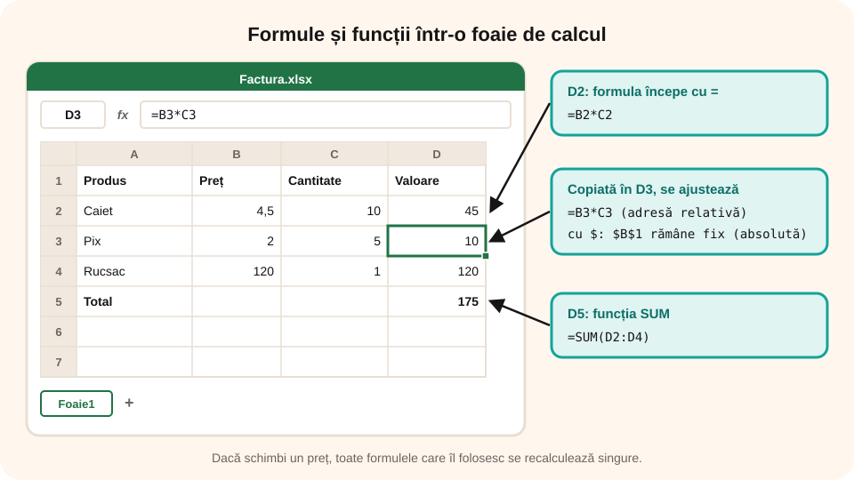

> **Competențe specifice (Anexa 15):** CS 1.1, CS 3.1

## Ce vei învăța azi

- ce sunt **registrul**, **foaia de calcul**, **celula** și **adresa** unei celule;
- cum scrii o **formulă** și cum o copiezi pe mai multe rânduri;
- cum folosești funcțiile **SUM**, **AVERAGE**, **MIN**, **MAX**;
- cum formatezi celulele (aldin, centrare, fundal, zecimale);
- ce **reguli de structurare și design** respecți ca un registru să fie ușor de citit.

## Foaia de calcul

O aplicație de **calcul tabelar** (Microsoft Excel, LibreOffice Calc, Google Sheets) organizează datele într-un tabel uriaș:

- **coloanele** au litere: A, B, C, …
- **rândurile** au numere: 1, 2, 3, …
- o **celulă** este intersecția unei coloane cu un rând; are o **adresă**: `B3` = coloana B, rândul 3;
- o **zonă** este un grup dreptunghiular de celule: `B2:B6` = de la B2 până la B6;
- fișierul se numește **registru** și poate avea mai multe **foi de calcul**.

## Formule

O formulă începe **întotdeauna** cu semnul `=`. Folosește adrese de celule, numere și operatori:

| Operator | Înseamnă | Exemplu |
|---|---|---|
| `+` `-` | adunare, scădere | `=B2+C2` |
| `*` `/` | înmulțire, împărțire | `=B2*C2` |
| `^` | putere | `=A1^2` |

Avantajul: dacă schimbi un număr dintr-o celulă, **toate formulele care îl folosesc se recalculează singure**.

**Copierea formulelor.** Dacă în `D2` ai `=B2*C2` și o copiezi în `D3`, devine `=B3*C3`: adresele se ajustează automat (adresare **relativă**). Cu `$` adresa rămâne fixă: `$B$1` (adresare **absolută**).



## Funcții

| Funcție | Ce calculează | Exemplu |
|---|---|---|
| `SUM` | suma | `=SUM(B2:B6)` |
| `AVERAGE` | media aritmetică | `=AVERAGE(B2:B6)` |
| `MIN` / `MAX` | cea mai mică / cea mai mare valoare | `=MAX(B2:B6)` |
| `COUNT` | câte numere sunt în zonă | `=COUNT(B2:B6)` |
| `IF` | alege între două rezultate | `=IF(B2>=5;"promovat";"nepromovat")` |

> În foaia de calcul din pagină poți folosi și `;` și `,` între argumente. Butonul **Σ** pune automat o sumă.

## Reguli de structurare și design

Un registru bun se înțelege dintr-o privire, chiar și de altcineva. Respectă aceste reguli:

**Structura**

- fiecare foaie are un **nume** sugestiv (Cheltuieli, Note), nu „Foaie1”;
- tabelul începe cu un **titlu**, apoi un singur rând de **cap de tabel**, cu câte un nume clar pentru fiecare coloană;
- **unitatea de măsură** stă în capul de tabel: „Preț (lei)”, „Distanța (km)”, nu în fiecare celulă;
- fiecare coloană conține **un singur tip de date** (doar numere sau doar text);
- **fără rânduri sau coloane goale** în interiorul tabelului (altfel sortarea și funcțiile iau doar o parte din date);
- **totalurile** și statisticile stau **sub** tabel sau într-o coloană separată, calculate cu **formule**, nu scrise de mână;
- datele care se folosesc de mai multe ori (cursul euro, TVA) stau într-o **singură celulă**, folosită cu adresă absolută.

**Design-ul**

- capul de tabel **iese în evidență**: aldin, centrat, cu fundal colorat;
- folosești **cel mult 2–3 culori**, cu contrast bun; culorile au un rost (de exemplu, totalul colorat);
- **textul** aliniat la stânga, **numerele** la dreapta, cu **același număr de zecimale** pe o coloană;
- **borduri** în jurul tabelului, ca să se vadă unde începe și unde se termină;
- coloane destul de **late** ca să nu apară `#####`, fonturi ușor de citit, cel mult două fonturi.

## Aplicații interactive

```categorii
# Respectă regulile de structurare și design?
Respectă: unitatea de măsură în capul de tabel, totalul calculat cu formulă sub tabel, aceeași culoare pentru tot capul de tabel
Încalcă: un rând gol în mijlocul tabelului, numere și texte amestecate în aceeași coloană, șapte culori diferite pe un tabel mic
```

```calcul-tabelar
# Sarcină avansată: „Excursia clasei”. Organizează registrul după specificații. 1) Inserează un rând deasupra rândului 4 și scrie în el: Muzeu; 25; 1. 2) Calculează costul pe persoană (preț × bucăți) în D2:D5. 3) Sortează cheltuielile alfabetic (A→Z) după denumire. 4) Calculează totalul în D6 și formatează: cap de tabel aldin, centrat, cu fundal albastru; costurile cu 2 zecimale.
Date:
Cheltuială;Preț (lei);Bucăți;Cost (lei)
Transport;60;1
Cazare;120;2
Masă;35;4
Cerințe:
- A2: Cazare | După sortare, pe rândul 2 este Cazare
- A3: Masă | Pe rândul 3 este Masă
- A4: Muzeu | Pe rândul 4 este Muzeu (rândul inserat)
- A5: Transport | Pe rândul 5 este Transport
- D2:D5: =B2*C2 | În D2:D5, costul fiecărei cheltuieli, cu formulă
- D6: =SUM(D2:D5) | În D6, totalul, cu funcția SUM (465 de lei)
- A1:D1: aldin | Capul de tabel este aldin
- A1:D1: centrat | Capul de tabel este centrat
- A1:D1: fundal albastru | Capul de tabel are fundal albastru
- D2:D6: 2 zecimale | Costurile au 2 zecimale
```

```calcul-tabelar
# Calculează totalul pentru fiecare produs și suma de plată.
Date:
Produs;Preț (lei);Cantitate;Total
Caiet;4,5;6
Pix;3;4
Creion;1,5;10
Riglă;5;1
Cerințe:
- D2:D5: =B2*C2 | În D2:D5, totalul fiecărui produs (preț × cantitate), cu formulă
- D6: =SUM(D2:D5) | În D6, suma de plată, cu funcția SUM
- A1:D1: aldin | Capul de tabel (A1:D1) este aldin
- A1:D1: fundal galben | Capul de tabel are fundal galben
```

```calcul-tabelar
# Notele lui Andrei. Calculează media, nota minimă și nota maximă.
Date:
Disciplina;Nota 1;Nota 2;Nota 3;Media
TIC;9;10;8
Matematică;7;8;10
Română;10;9;9
Cerințe:
- E2:E4: =AVERAGE(B2:D2) | În E2:E4, media fiecărei discipline, cu funcția AVERAGE
- E2:E4: 2 zecimale | Mediile se afișează cu 2 zecimale
- B6: =MIN(B2:D4) | În B6, cea mai mică notă, cu funcția MIN
- B7: =MAX(B2:D4) | În B7, cea mai mare notă, cu funcția MAX
```

```quiz
# Alege răspunsul corect.
Care este adresa celulei aflate pe coloana C și rândul 4?
- 4C
* C4
- C:4
Explicație: Întâi litera coloanei, apoi numărul rândului.

Cu ce semn începe o formulă?
- +
* =
- #
Explicație: Orice formulă începe cu semnul egal.

Formula `=B2*C2` din D2 este copiată în D3. Ce devine?
- =B2*C2
* =B3*C3
- =C2*D2
Explicație: Adresele relative se ajustează cu un rând mai jos.

Câte celule are zona B2:C4?
- 4
* 6
- 8
Explicație: 2 coloane (B, C) × 3 rânduri (2, 3, 4) = 6 celule.
```

```categorii
# Ce este fiecare?
Adresă de celulă: A1, C7, AB12
Zonă de celule: A1:A5, B2:D4, C3:C10
Formulă: =A1+B1, =SUM(A1:A5), =B2*2
```

```cartonase
SUM = Suma valorilor dintr-o zonă
AVERAGE = Media aritmetică
MIN = Cea mai mică valoare
MAX = Cea mai mare valoare
COUNT = Câte numere sunt într-o zonă
$B$1 = Adresă absolută (nu se schimbă la copiere)
```

```eseu
# Proiect: registrul tău, după reguli date
Alege o situație din viața ta (bugetul unei petreceri, antrenamentele dintr-o lună, cărțile citite). Descrie registrul pe care l-ai construi: ce foi are și cum se numesc, ce coloane are tabelul (cu unitățile de măsură), ce formule și funcții folosești, după ce coloană îl sortezi și de ce, și ce formatări aplici ca să respecte regulile de structurare și design.
Cuvinte: 60-200
Barem: nume sugestive pentru foi; cap de tabel cu coloane clare și unități de măsură; un singur tip de date pe coloană, fără rânduri goale; cel puțin o formulă cu operatori și o funcție (SUM, AVERAGE, MIN, MAX); sortarea, cu coloana-cheie și ordinea (crescător/descrescător) justificate; formatări: cap de tabel evidențiat, aliniere, zecimale, borduri, puține culori.
```

## Exersează liber

În **Laborator → Registru** ai o foaie goală în care poți face orice tabel, apoi îl poți descărca (.xlsx sau CSV) și deschide în Excel.
