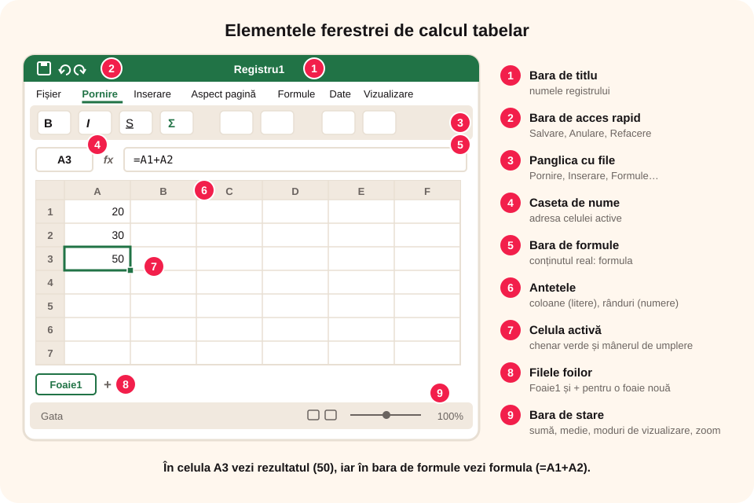

## Ce vei învăța azi

- să recunoști **elementele ferestrei** Excel;
- la ce folosesc **caseta de nume** și **bara de formule**;
- să te **deplasezi** în foaie și să **selectezi** celule;
- să schimbi **modul de vizualizare** și **zoomul**.

## Să ne amintim

Word și PowerPoint au **bara de titlu**, **panglica** cu **file** și **bara de stare**. Excel are aceleași elemente, plus câteva specifice calculului.

## Lecția pe scurt

### Fereastra Excel

1. **Bara de titlu**: numele registrului (de exemplu, `Registru1 – Excel`) și butonul **Salvare automată**.
2. **Bara de acces rapid**: Salvare, Anulare, Refacere.
3. **Panglica** cu **file**: **Fișier**, **Pornire**, **Inserare**, **Aspect pagină**, **Formule**, **Date**, **Revizuire**, **Vizualizare**.
4. **Caseta de nume** (stânga, deasupra foii): arată **adresa celulei active** (de exemplu, B3). Poți scrie o adresă acolo ca să sari direct la ea.
5. **Bara de formule** (lângă caseta de nume, cu simbolul **fx**): arată **conținutul real** al celulei active. Dacă celula are o formulă, în celulă vezi **rezultatul**, iar în bara de formule vezi **formula**.
6. **Antetele de coloane** (A, B, C…) și **de rânduri** (1, 2, 3…).
7. **Celula activă**: chenarul verde; colțul din dreapta jos este **mânerul de umplere**.
8. **Filele foilor** (jos): Foaie1, Foaie2 și butonul **+** pentru o foaie nouă.
9. **Bara de stare** (jos): pentru celulele selectate cu numere arată automat **Medie**, **Număr** și **Sumă**; în dreapta, modurile de vizualizare și **zoomul**.



### Filele cele mai folosite

| Fila | Ce găsești |
|---|---|
| Pornire | font, aliniere, formatul numerelor, stiluri, inserare/ștergere rânduri, sortare |
| Inserare | diagrame, imagini, tabele |
| Formule | biblioteca de funcții, AutoSum |
| Date | sortare, filtrare |
| Vizualizare | linii de grilă, înghețare panouri, zoom |

### Deplasarea și selectarea

- **săgețile**, **Enter** (în jos), **Tab** (la dreapta);
- **Ctrl + Home**: la celula **A1**;
- selectarea unei **zone**: tragi cu mouse-ul sau ții **Shift** și apeși săgețile;
- celule **neadiacente**: ții **Ctrl** și dai clic;
- o **coloană** întreagă: clic pe litera ei; un **rând**: clic pe numărul lui;
- toată foaia: **Ctrl + A** sau butonul din colțul stânga sus.

### Moduri de vizualizare

**Normal** (pentru lucru), **Aspect pagină** (vezi cum se tipărește) și **Examinare sfârșit de pagină**. Zoomul se reglează din bara de stare sau cu **Ctrl + rotița mouse-ului**.

## Exemplu rezolvat: unde e formula?

1. Scrii în **A1** valoarea 20 și în **A2** valoarea 30.
2. În **A3** scrii `=A1+A2` și apeși **Enter**.
3. În celula A3 apare **50**.
4. Selectezi A3: **caseta de nume** arată `A3`, iar **bara de formule** arată `=A1+A2`.
5. Selectezi A1:A2: **bara de stare** arată `Medie: 25  Număr: 2  Sumă: 50`.

## Aplicații interactive

```categorii
# Ce element al ferestrei Excel este?
Caseta de nume: arată adresa celulei active
Bara de formule: arată conținutul real al celulei
Filele foilor: Foaie1 și butonul +
Bara de stare: suma și media celulelor selectate
```

```quiz
# Alege răspunsul corect.
În celulă vezi 50, iar în bara de formule vezi =A1+A2. Ce conține celula?
* o formulă al cărei rezultat este 50
- numărul 50 scris de mână
- un text

Ce face combinația Ctrl + Home?
- închide Excel
* te duce la celula A1
- salvează registrul

Cum selectezi celulele A1 și C5 în același timp?
- cu Shift
* ții Ctrl și dai clic pe fiecare
- nu se poate
```

```ordonare
# Cum adaugi o foaie nouă și îi schimbi numele
Apeși butonul + de lângă filele foilor
Apare o foaie nouă
Dai dublu clic pe numele ei
Scrii numele nou
Apeși Enter
```

```adevarat-fals
A: Bara de stare poate afișa suma celulelor selectate fără nicio formulă.
F: Fila Inserare conține fontul și alinierea. | Acestea sunt în fila Pornire.
A: În caseta de nume poți scrie o adresă ca să sari direct la acea celulă.
A: Antetele coloanelor sunt literele de deasupra foii.
```

```completare
# Completează.
Adresa celulei active apare în caseta de [nume]. Formula unei celule se vede în bara de [formule]. Diagramele se găsesc în fila [Inserare].
```

## Exersează

1. Deschide Excel și găsește toate cele nouă elemente ale ferestrei.
2. Scrie în caseta de nume `M50` și apasă Enter. Unde ai ajuns?
3. Scrie cinci numere în coloana B și citește suma și media din bara de stare.
4. Adaugă două foi noi și redenumește-le „Septembrie” și „Octombrie”.
5. **Portofoliu:** în `Prima_foaie.xlsx`, adaugă foaia „Note”, cu notele tale la cinci materii; scrie în caiet ce arată bara de stare când le selectezi.

## Verifică-te

- Care e diferența dintre ce vezi în celulă și ce vezi în bara de formule?
- Cum selectezi o coloană întreagă?

## Pe scurt

Fereastra Excel are **panglica** cu file, **caseta de nume** (adresa celulei active), **bara de formule** (conținutul real), **antetele** de rânduri și coloane, **filele foilor** și **bara de stare** (sumă, medie, zoom). Selectezi zone cu **Shift**, celule separate cu **Ctrl**, iar **Ctrl + Home** te duce la A1.
