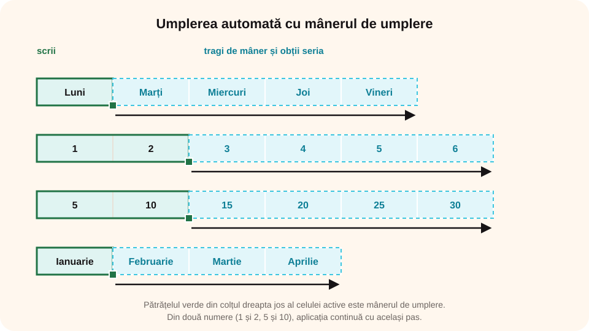

> **Competențe specifice (Anexa 15):** CS 1.1, CS 3.1

## Ce vei învăța azi

- să **creezi**, să **salvezi** și să **deschizi** un registru;
- să **introduci**, să **modifici** și să **ștergi** date;
- să **copiezi** și să **muți** celule și să folosești **umplerea automată**;
- să **inserezi** și să **ștergi** rânduri și coloane;
- să lucrezi cu **foile** și să **tipărești**.

## Să ne amintim

Un **registru** (`.xlsx`) are mai multe **foi**; fiecare foaie are **celule** cu adrese ca **B3**. Conținutul real al celulei se vede în **bara de formule**.

## Lecția pe scurt

### Crearea, salvarea și deschiderea

- **Fișier → Nou → Registru de lucru necompletat** (**Ctrl + N**);
- **Fișier → Salvare ca**: alegi folderul, numele și **tipul**:
  - **Registru de lucru Excel (.xlsx)**, formatul obișnuit;
  - **PDF**, pentru tipărit sau trimis, fără să poată fi modificat ușor;
  - **CSV** (valori separate prin virgulă sau punct și virgulă), un fișier text simplu, citit de multe programe; păstrează **doar** foaia curentă, fără formatare;
- **Ctrl + S** salvează modificările; **Fișier → Deschidere** (**Ctrl + O**) deschide un registru.

### Introducerea și modificarea datelor

- Selectezi celula, scrii și apeși **Enter** (sau Tab).
- Ca să **înlocuiești** conținutul, scrii direct peste.
- Ca să **modifici** doar o parte, dai **dublu clic** pe celulă sau apeși **F2** (ori modifici în bara de formule).
- **Delete** șterge conținutul; **Esc** renunță la ce ai început să scrii.
- Un text mai lung „curge” peste celula vecină doar dacă aceasta e goală. Lărgești coloana trăgând de **marginea** antetului sau cu **dublu clic** pe ea (potrivire automată).

### Copierea și mutarea

- **Copiere**: **Ctrl + C**, apoi **Ctrl + V** în celula de destinație;
- **Mutare**: **Ctrl + X**, apoi **Ctrl + V**, sau tragi de **marginea** selecției;
- după copiere, în jurul celulelor apare un **chenar punctat mișcător**; **Esc** îl oprește.

### Umplerea automată (mânerul de umplere)

Tragi de **pătrățelul** din colțul dreapta jos al celulei active:

| Scrii | Tragi și obții |
|---|---|
| Luni | Marți, Miercuri, Joi… |
| Ianuarie | Februarie, Martie… |
| 1 și 2 (în două celule, selectate) | 3, 4, 5… |
| 5 și 10 | 15, 20, 25… |
| Clasa 1 | Clasa 2, Clasa 3… |
| o formulă | aceeași formulă, adaptată fiecărui rând |



### Rânduri, coloane și foi

- **Inserare**: clic dreapta pe antetul rândului sau al coloanei → **Inserare** (sau **Pornire → Celule → Inserare**); rândul nou apare **deasupra** rândului selectat, coloana nouă la **stânga** coloanei selectate;
- **Ștergere**: clic dreapta pe antet → **Ștergere** (sau **Pornire → Celule → Ștergere**); dispare **tot** rândul (toată coloana), cu tot conținutul, iar celelalte se mută ca să umple golul;
- **Ștergere** nu e același lucru cu tasta **Delete**: Delete golește doar **conținutul** celulelor, rândul rămâne pe loc;
- **formulele se adaptează**: dacă inserezi un rând în interiorul zonei din `=SUM(B2:B5)`, formula devine singură `=SUM(B2:B6)`; dacă ștergi o celulă folosită într-o formulă, apare eroarea `#REF!`;
- **foaie nouă**: butonul **⊕** (Foaie nouă) de lângă filele foilor sau **Shift + F11**; **ștergerea unei foi**: clic dreapta pe filă → **Ștergere** (atenție, nu se poate anula cu Ctrl + Z!);
- foaia: clic dreapta pe filă → **Redenumire**, **Mutare sau copiere**, **Culoare filă**; o muți trăgând de filă.

> În foaia de calcul din platformă găsești butoanele în **Pornire → Celule**: **Rând** și **Coloană** (inserare deasupra / la stânga), **Șterge rând** și **Șterge col.**

### Tipărirea

**Fișier → Imprimare** (**Ctrl + P**): vezi examinarea, alegi imprimanta, numărul de copii, orientarea (**Tip portret** sau **Tip vedere**) și **Potrivire foaie pe o pagină**, ca tabelul să nu fie tăiat.

## Exemplu rezolvat: orarul clasei

1. **Ctrl + N** și salvezi registrul ca `Orar_8A.xlsx`.
2. Scrii **Luni** în B1 și tragi mânerul până la F1: apar zilele până vineri.
3. Scrii **1** în A2 și **2** în A3, le selectezi și tragi până la A8: orele 1–7.
4. Completezi materiile; lărgești coloanele cu dublu clic pe marginea antetelor.
5. Ai uitat o oră: clic dreapta pe rândul 5 → **Inserare**.
6. Redenumești foaia în „Orar” și salvezi și ca **PDF**, pentru avizier.

## Aplicații interactive

```calcul-tabelar
# Inventarul clasei. Ai uitat un produs și ai o coloană în plus. Selectează A4 și inserează un rând deasupra (Pornire → Celule → Rând); scrie în el Creion și prețul 1,5. Apoi selectează o celulă din coloana B și șterge coloana Cod (Șterge col.). La final calculează totalul.
Date:
Produs;Cod;Preț (lei)
Caiet;C01;4,5
Pix;P07;3
Riglă;R02;5
Cerințe:
- A4: Creion | Pe rândul 4 (inserat deasupra Riglei) este Creion
- A5: Riglă | Rigla a coborât pe rândul 5
- B1: Preț (lei) | Coloana Cod a fost ștearsă: în B1 este acum „Preț (lei)”
- B4: 1,5 | Prețul creionului (1,5) este în B4
- B6: =SUM(B2:B5) | În B6, totalul prețurilor, cu funcția SUM
- A1:B1: aldin | Capul de tabel este aldin
```

```ordonare
# Cum creezi seria 10, 20, 30 … 100 în coloana A
Scrii 10 în A1 și 20 în A2
Selectezi A1 și A2
Tragi de mânerul de umplere până la A10
Eliberezi butonul mouse-ului: seria se completează până la 100
```

```quiz
# Alege răspunsul corect.
Ce obții dacă scrii Ianuarie și tragi de mânerul de umplere?
* Februarie, Martie, Aprilie…
- Ianuarie, Ianuarie, Ianuarie…
- 1, 2, 3…

Ce tastă îți permite să modifici doar o parte din conținutul unei celule?
- Delete
* F2
- Esc

Ce format păstrează doar valorile foii curente, ca text simplu?
- .xlsx
- .pdf
* .csv
```

```categorii
# Ce combinație de taste folosești?
Ctrl + N: registru nou
Ctrl + S: salvare
Ctrl + P: imprimare
Ctrl + X: decupare (pentru mutare)
```

```adevarat-fals
A: Un rând nou se inserează deasupra rândului selectat.
F: Formatul CSV păstrează toate foile și formatarea. | Păstrează doar valorile foii curente.
A: Dublu clic pe marginea antetului potrivește automat lățimea coloanei.
A: O foaie se poate redenumi cu dublu clic pe fila ei.
F: Tasta Delete șterge tot rândul selectat. | Delete golește doar conținutul; rândul se șterge cu Ștergere.
A: Dacă inserezi un rând în interiorul zonei B2:B5, formula =SUM(B2:B5) devine =SUM(B2:B6).
A: O foaie nouă se inserează cu butonul ⊕ de lângă filele foilor sau cu Shift + F11.
```

```completare
# Completează.
Dacă scrii 3 și 6 în două celule, le selectezi și tragi de mânerul de umplere, următoarele valori sunt [9], 12 și [15]. Formatul obișnuit al registrelor Excel este [.xlsx|xlsx].
```

## Exersează

1. Creează seria zilelor săptămânii și seria lunilor anului, cu mânerul de umplere.
2. Creează seria numerelor impare de la 1 la 39.
3. Inserează o coloană între A și B, apoi șterge-o. Inserează o foaie nouă, redenumește-o „Ciornă”, apoi șterge-o.
4. Copiază foaia „Orar” și redenumește copia „Orar semestrul 2”.
5. Salvează același registru ca XLSX, PDF și CSV; deschide fișierul CSV cu Notepad. Ce observi?
6. **Portofoliu:** realizează `Orar_clasa_mea.xlsx`, cu orarul complet, potrivit pe o pagină, și salvează-l și ca PDF.

## Verifică-te

- Ce face mânerul de umplere?
- Când salvezi un registru ca PDF și când ca CSV?

## Pe scurt

Un registru se creează cu **Ctrl + N**, se salvează ca **.xlsx**, **PDF** sau **CSV** și se deschide cu **Ctrl + O**. Modifici o celulă cu **F2** sau dublu clic, copiezi și muți cu **Ctrl + C / X / V**. **Mânerul de umplere** continuă serii (zile, luni, numere). Rândurile și coloanele se inserează sau se șterg cu **clic dreapta** pe antet, iar foile se redenumesc, se mută și se copiază din fila lor.
