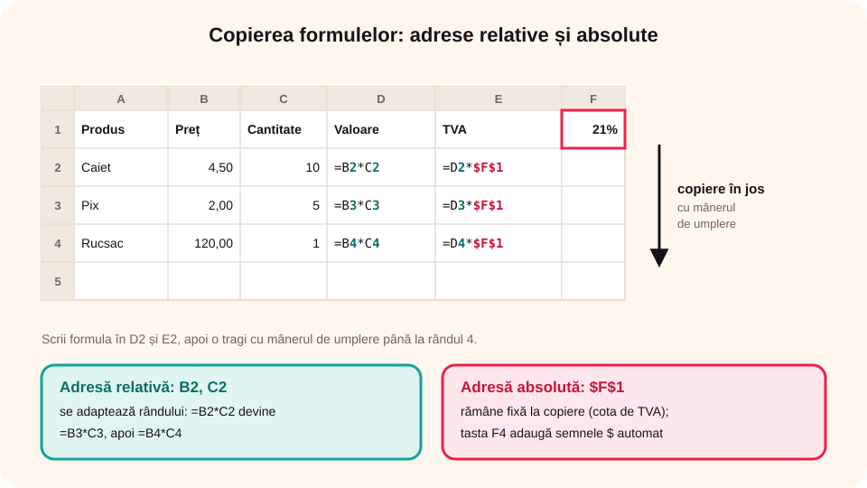

> **Competențe specifice (Anexa 15):** CS 1.1, CS 3.1

## Ce vei învăța azi

- ce **tipuri de date** poate conține o celulă;
- să **formatezi** celulele: font, aliniere, borduri, culori, format numeric;
- să scrii **formule** cu operatori;
- diferența dintre adresele **relative** și **absolute** ($);
- ce înseamnă **mesajele de eroare**.

## Să ne amintim

Bara de formule arată **conținutul real** al celulei. Mânerul de umplere copiază o formulă în celulele vecine. În Word ai formatat textul cu fila **Pornire**.

## Lecția pe scurt

### Tipuri de date

| Tip | Exemplu | Aliniere implicită |
|---|---|---|
| **Număr** | 125; 3,75 | dreapta |
| **Text** | Popescu Ana, Clasa 8A | stânga |
| **Dată / oră** | 16.10.2026, 08:30 | dreapta |
| **Procent** | 25% | dreapta |
| **Monedă** | 12,50 lei | dreapta |

Acestea sunt **tipurile implicite**: nu alegi tu tipul, ci aplicația îl **recunoaște singură** după ce scrii în celulă, iar alinierea îți arată ce a înțeles:

- **numerele** (inclusiv datele, procentele și sumele de bani) se aliniază la **dreapta** și se pot folosi în calcule;
- **textul** se aliniază la **stânga** și nu intră în calcule;
- o **dată** scrisă corect (16.10.2026 sau 16/10/2026) e păstrată de fapt ca un număr de zile, așa că poți face calcule cu ea: `=B2-A2` dă numărul de zile dintre două date.

În setările românești, separatorul zecimal este **virgula**: 3,75. Dacă un număr apare aliniat la **stânga**, Excel l-a luat drept text (de exemplu, ai scris 3.75 cu punct). Dacă vrei ca un număr să fie păstrat ca **text** (un număr de telefon care începe cu 0, de exemplu), scrii un apostrof în fața lui: `'0745123456`.

### Formatarea celulelor (fila Pornire)

- **Font**: tipul, mărimea, **B** *I* <u>S</u>, culoarea textului;
- **Aliniere**: stânga, centru, dreapta, sus/mijloc/jos, **Încadrare text** (textul trece pe mai multe rânduri), **Îmbinare și centrare** (unește celule, de exemplu pentru titlu);
- **Borduri** (chenare) și **culoare de umplere** (fundal);
- **Formatul numerelor**: General, Număr (câte zecimale), **Monedă**, **Dată**, **Procent**; butoanele **Mărire / Micșorare zecimale**;
- **Stiluri de celule** și **Formatare ca tabel**: aspect gata făcut;
- **Descriptor de formate** (pensula): copiază formatarea de la o celulă la alta.

Formatarea schimbă doar **aspectul**, nu valoarea: 0,25 formatat ca procent apare **25%**.

### Formule

O formulă începe **întotdeauna** cu **=**. Poate conține numere, **adrese de celule**, **operatori** și **funcții**.

- operatori: `+` `-` `*` (înmulțire) `/` (împărțire) `^` (putere);
- ordinea: întâi `^`, apoi `*` și `/`, apoi `+` și `-`; parantezele schimbă ordinea;
- exemple: `=B2*C2`, `=(B2+C2+D2)/3`, `=A1^2`.

Când scrii formula, poți **da clic** pe celule în loc să scrii adresele. Folosind adrese (nu numere), formula se **recalculează** dacă schimbi datele.

### Adrese relative și absolute

Când copiezi formula `=B2*C2` din D2 în D3, Excel o **adaptează**: devine `=B3*C3`. Acestea sunt adrese **relative**.

Uneori vrei ca o adresă să rămână **fixă** (de exemplu, cursul euro dintr-o singură celulă). Pui **$**: `$F$1` este o adresă **absolută**. Tasta **F4** adaugă semnele $ automat.



### Mesaje de eroare

| Eroare | Ce înseamnă |
|---|---|
| `#####` | coloana e prea îngustă pentru număr; o lărgești |
| `#DIV/0!` | împărțire la zero (sau la o celulă goală) |
| `#NAME?` | ai scris greșit numele unei funcții |
| `#VALUE!` | ai făcut un calcul cu un text |
| `#REF!` | formula se referă la o celulă ștearsă |

## Exemplu rezolvat: factura de la librărie

| | A | B | C | D |
|---|---|---|---|---|
| **1** | Produs | Preț | Cantitate | Valoare |
| **2** | Caiet | 4,50 | 10 | `=B2*C2` |
| **3** | Pix | 2,00 | 5 | `=B3*C3` |
| **4** | Rucsac | 120,00 | 1 | `=B4*C4` |

1. Scrii în D2 formula `=B2*C2` și o tragi cu mânerul până la D4: rezultatele sunt **45**, **10**, **120**.
2. Formatezi coloanele B și D ca **Monedă** (lei), cu 2 zecimale.
3. Titlul: inserezi un rând deasupra, scrii „Factura” în A1, selectezi A1:D1 și apeși **Îmbinare și centrare**.
4. Pui **Toate bordurile** pe tabel și o culoare de umplere pe capul de tabel.
5. După inserarea rândului de titlu, produsele sunt pe rândurile 3–5. Scrii cota de TVA (21%) în **F1**, apoi în E3 scrii `=D3*$F$1` și tragi în jos; adresa F1 rămâne fixă.

## Aplicații interactive

```quiz
# Alege răspunsul corect.
Cu ce caracter începe orice formulă?
- +
* =
- $

Ce rezultat dă formula =2+3*4?
- 20
* 14
- 24

Copiezi formula =B2*$F$1 din E2 în E3. Ce formulă obții?
* =B3*$F$1
- =B3*$F$2
- =B2*$F$1
```

```categorii
# Ce eroare apare?
Eroarea #DIV/0!: împărțire la zero
Eroarea #NAME?: numele unei funcții scris greșit (=SUMM)
Eroarea #####: coloana e prea îngustă
Eroarea #VALUE!: adunarea unui număr cu un text
```

```categorii
# Ce tip de date este?
Număr: 125, 48, -7
Text: Popescu Ana, Clasa 8A
Dată: 16.10.2026
Procent: 25%
```

```categorii
# Cum se aliniază implicit, după ce apeși Enter?
La dreapta (număr): 125, -7, 16.10.2026, 25%
La stânga (text): Clasa 8A, Popescu Ana, 3.75 scris cu punct
```

```calcul-tabelar
# Chioșcul școlii. Scrie formule cu operatori aritmetici (fără funcții) și formatează tabelul.
Date:
Produs;Preț (lei);Cantitate;Valoare;Cu reducere 10%
Suc;6;12
Covrig;2,5;30
Apă;3;20
Cerințe:
- D2:D4: =B2*C2 | În D2:D4, valoarea (preț × cantitate), cu formula =B2*C2
- E2:E4: =D2-D2*10/100 | În E2:E4, valoarea după o reducere de 10%: din valoare scazi 10% din ea, de exemplu =D2-D2*10/100
- D5: =D2+D3+D4 | În D5, totalul valorilor, adunând cu +
- E5: =E2+E3+E4 | În E5, totalul cu reducere
- D2:E5: 2 zecimale | Valorile din D2:E5 au 2 zecimale
- A1:E1: aldin | Capul de tabel este aldin
- A1:E1: centrat | Capul de tabel este centrat
```

```adevarat-fals
A: Formatarea ca procent schimbă doar aspectul: 0,25 apare ca 25%.
F: O formulă cu numere scrise direct se recalculează când schimbi datele din tabel. | Doar formulele cu adrese de celule se recalculează.
A: Tasta F4 adaugă semnele $ într-o adresă.
A: Îmbinare și centrare unește mai multe celule într-una singură.
A: Un număr aliniat la stânga a fost recunoscut ca text și nu intră în calcule.
F: Tipul de date al unei celule trebuie ales întotdeauna înainte de a scrie în ea. | Aplicația recunoaște singură tipul (tip implicit) după ce scrii.
```

```completare
# Completează.
Formula =(10+20)/2 are rezultatul [15]. Formula =3^2 are rezultatul [9]. O adresă care nu se schimbă la copiere se numește adresă [absolută|absoluta].
```

## Exersează

1. Scrie în celule un număr, un text, o dată și un procent; observă alinierea fiecăruia.
2. Calculează în Excel: `=15+5*2`, `=(15+5)*2`, `=2^10`, `=100/8`.
3. Refă factura de la librărie, cu cinci produse, formatare monedă, borduri și titlu îmbinat.
4. Fă un convertor lei – euro: cursul în F1, o listă de prețuri în lei în A2:A6 și, în B2:B6, prețurile în euro, cu adresă absolută.
5. Provoacă intenționat erorile `#DIV/0!` și `#####` și repară-le.
6. **Portofoliu:** `Buget_excursie.xlsx`, cu cheltuielile pe persoană și totalul pentru 25 de elevi (numărul elevilor într-o singură celulă, folosită cu adresă absolută).

## Verifică-te

- De ce e mai bine să scrii `=B2*C2` decât `=4,5*10`?
- Când folosești semnul $ într-o formulă?

## Pe scurt

O celulă poate conține **numere**, **text**, **date**, **procente** sau **monede**. **Formatarea** (font, aliniere, îmbinare, borduri, format numeric) schimbă doar aspectul. **Formulele** încep cu **=** și folosesc operatorii `+ - * / ^` și adrese de celule. La copiere, adresele **relative** se adaptează, iar cele **absolute** (`$F$1`) rămân fixe. Erorile `#` arată ce trebuie reparat.
