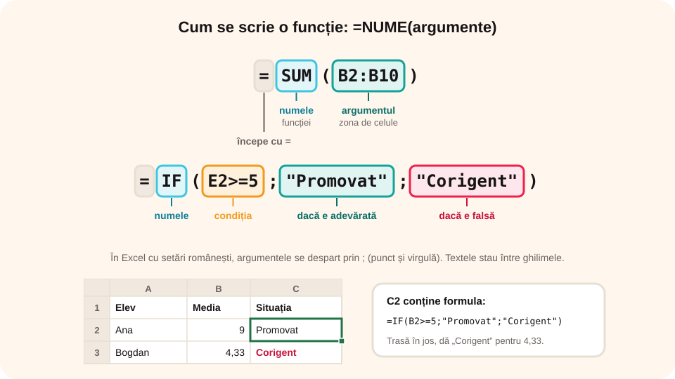

## Ce vei învăța azi

- ce este o **funcție** și cum se scrie;
- să folosești funcțiile **SUM**, **AVERAGE**, **MIN**, **MAX**, **COUNT**, **COUNTIF**, **IF** și **ROUND**;
- să folosești butonul **AutoSum**;
- să **sortezi** și să **filtrezi** datele.

## Să ne amintim

Formulele încep cu **=** și folosesc adrese de celule: `=B2+C2+D2`. O zonă se scrie cu două puncte: **B2:D2**. Adresele **absolute** au semnul **$**.

## Lecția pe scurt

### Ce este o funcție

O **funcție** este o formulă gata făcută, cu un **nume** și **argumente** între paranteze:

`=NUME(argumente)`

În loc de `=B2+B3+B4+B5+B6+B7+B8+B9+B10` scrii `=SUM(B2:B10)`.

> În Excel cu setări românești, argumentele se despart prin **punct și virgulă**: `=IF(B2>=5;"Promovat";"Corigent")`. În Google Sheets sau Excel în engleză se folosește virgula.

### Funcții de bază

| Funcție | Ce calculează | Exemplu |
|---|---|---|
| **SUM** | suma | `=SUM(B2:B10)` |
| **AVERAGE** | media aritmetică | `=AVERAGE(B2:D2)` |
| **MIN** | cea mai mică valoare | `=MIN(B2:B10)` |
| **MAX** | cea mai mare valoare | `=MAX(B2:B10)` |
| **COUNT** | câte celule conțin numere | `=COUNT(B2:B10)` |
| **COUNTIF** | câte celule respectă o condiție | `=COUNTIF(B2:B10;">=9")` |
| **ROUND** | rotunjirea la un număr de zecimale | `=ROUND(E2;2)` |

### Funcția IF (dacă)

`=IF(condiție; valoare_dacă_adevărat; valoare_dacă_fals)`

Exemplu: `=IF(E2>=5;"Promovat";"Corigent")`. Textele se scriu între **ghilimele**. Condiția folosește `=`, `<>` (diferit), `<`, `<=`, `>`, `>=`.



### Cum inserezi o funcție

- butonul **AutoSum** (Σ, **Însumare automată**, din **Pornire** sau **Formule**): Excel propune singur zona; săgeata de lângă el oferă **Medie**, **Contorizare numere**, **Max**, **Min**;
- butonul **fx** de lângă bara de formule: cauți funcția și completezi argumentele într-o fereastră;
- scrii direct `=` și primele litere: Excel îți arată o **listă** de funcții.

### Sortarea și filtrarea (fila Date)

- **Sortare**: selectezi tabelul → **Date → Sortare**, alegi coloana și ordinea (A → Z, crescător sau descrescător). Rândurile rămân întregi.
- **Filtrare**: **Date → Filtru**; în capul de tabel apar săgeți. Alegi ce să se vadă (de exemplu, doar elevii cu media peste 9). Celelalte rânduri sunt **ascunse**, nu șterse.

## Exemplu rezolvat: catalogul clasei

| | A | B | C | D | E | F |
|---|---|---|---|---|---|---|
| **1** | Elev | Nota 1 | Nota 2 | Nota 3 | Media | Situația |
| **2** | Ana | 9 | 10 | 8 | 9 | Promovat |
| **3** | Bogdan | 4 | 6 | 3 | … | … |
| **4** | Carla | 7 | 8 | 10 | … | … |

1. În **E2** scrii `=ROUND(AVERAGE(B2:D2);2)`, media rotunjită la două zecimale: **9** (Ana); tragi formula până la E4: Bogdan **4,33**, Carla **8,33**.
2. În **F2** scrii `=IF(E2>=5;"Promovat";"Corigent")` și tragi în jos: Bogdan apare **Corigent**.
3. Sub tabel: media clasei `=AVERAGE(E2:E4)`, cea mai mare medie `=MAX(E2:E4)`, numărul elevilor cu media cel puțin 8: `=COUNTIF(E2:E4;">=8")` → **2**.
4. **Date → Sortare** după Media, descrescător: Ana, Carla, Bogdan.

## Aplicații interactive

```categorii
# Ce funcție folosești?
SUM: totalul cheltuielilor
AVERAGE: media notelor
MAX: cea mai mare temperatură
COUNTIF: câți elevi au nota 10
IF: afișează Promovat sau Corigent
```

```quiz
# Alege răspunsul corect.
În B2:B5 sunt valorile 4, 8, 6, 2. Cât dă =AVERAGE(B2:B5)?
- 20
* 5
- 8

Ce afișează =IF(A1>10;"mare";"mic"), dacă A1 conține 10?
- mare
* mic
- 10

Ce face filtrarea?
* ascunde temporar rândurile care nu respectă condiția
- șterge definitiv rândurile
- sortează alfabetic
```

```ordonare
# Cum calculezi media lui Ana cu butonul fx
Selectezi celula E2
Apeși butonul fx de lângă bara de formule
Alegi funcția AVERAGE
Selectezi zona B2:D2
Apeși OK
```

```adevarat-fals
A: Funcția COUNT numără celulele care conțin numere.
F: Sortarea unei singure coloane din tabel păstrează legătura dintre nume și note. | Trebuie selectat tot tabelul, ca rândurile să rămână întregi.
A: În Excel cu setări românești, argumentele se despart prin punct și virgulă.
A: Textele dintr-o funcție IF se scriu între ghilimele.
```

```completare
# Completează.
În A1:A4 sunt 3, 9, 5 și 7. =SUM(A1:A4) dă [24], =MAX(A1:A4) dă [9], iar =COUNTIF(A1:A4;">5") dă [2].
```

## Exersează

1. Scrie temperaturile dintr-o săptămână și calculează media, minima, maxima și amplitudinea (`=MAX(...)-MIN(...)`).
2. Completează catalogul cu 10 elevi și 4 note și calculează mediile, situația și media clasei.
3. Numără câți elevi au media peste 9 și câți sunt corigenți, cu COUNTIF.
4. Sortează catalogul alfabetic, apoi după medie; filtrează doar elevii promovați.
5. Într-un buget lunar, afișează cu IF „Economie” dacă veniturile sunt mai mari decât cheltuielile, altfel „Deficit”.
6. **Portofoliu:** `Catalog_8.xlsx`, cu cel puțin 10 elevi, medii rotunjite, situația, statistici sub tabel și clasament.

## Verifică-te

- Ce argumente are funcția IF?
- Care e diferența dintre COUNT și COUNTIF?

## Pe scurt

**Funcțiile** sunt formule gata făcute: **SUM**, **AVERAGE**, **MIN**, **MAX**, **COUNT**, **COUNTIF**, **ROUND** și **IF** (care alege între două rezultate). Le inserezi cu **AutoSum**, cu **fx** sau scriindu-le. În Excel românesc, argumentele se despart prin **;**. Din fila **Date** poți **sorta** și **filtra** tabelul.
