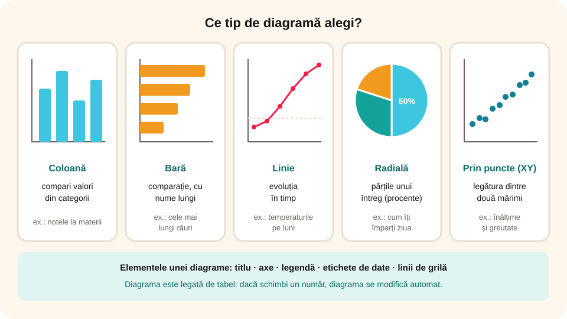

## Ce vei învăța azi

- de ce reprezentăm datele prin **diagrame**;
- ce **tipuri** de diagrame există și când îl alegi pe fiecare;
- să **inserezi** și să **modifici** o diagramă;
- să folosești **formatarea condiționată**.

## Să ne amintim

La matematică și la geografie ai citit **grafice** și **diagrame**: populația unei țări, temperaturile lunare. În Excel le poți face automat, din datele unui tabel.

## Lecția pe scurt

### De ce diagrame?

O **diagramă** (*grafic*) arată datele **vizual**: compari mai ușor valorile și vezi imediat ce crește, ce scade și ce e mai mare. Diagrama este **legată de date**: dacă schimbi un număr din tabel, diagrama se schimbă automat.

### Tipuri de diagrame

| Tip | Când îl folosești | Exemplu |
|---|---|---|
| **Coloană** (verticală) | compari valori din categorii diferite | notele la materii |
| **Bară** (orizontală) | aceeași idee, cu nume lungi | cele mai lungi râuri |
| **Linie** | evoluția în timp | temperaturile pe luni |
| **Radială** (*plăcintă*) | părțile unui întreg (procente) | cum îți împarți ziua |
| **Prin puncte** (XY) | legătura dintre două mărimi | înălțime și greutate |



### Inserarea unei diagrame

1. Selectezi datele, **împreună cu capul de tabel** (etichetele).
2. **Inserare → Diagrame recomandate** sau alegi direct tipul.
3. Diagrama apare peste foaie; o muți trăgând de margine și o redimensionezi din colțuri.

### Elementele unei diagrame

- **titlul diagramei**;
- **axele**: orizontală (categoriile) și verticală (valorile), cu **titluri de axe**;
- **legenda**: ce înseamnă fiecare culoare;
- **etichetele de date**: valorile scrise pe coloane sau pe felii;
- **liniile de grilă**.

Când selectezi diagrama, apare butonul **+** (elemente), **pensula** (stiluri și culori) și filele **Proiectare diagramă** și **Format**. Cu **Modificare tip diagramă** schimbi tipul, iar cu **Mutare diagramă** o muți pe o foaie separată.

### Formatarea condiționată

**Pornire → Formatare condiționată** colorează automat celulele după valoare:

- **Reguli de evidențiere**: de exemplu, notele mai mici decât 5 cu **roșu**;
- **Bare de date**: o bară colorată în fiecare celulă, proporțională cu valoarea;
- **Scale de culori**: de la verde (mare) la roșu (mic).

## Exemplu rezolvat: temperaturile din Cluj-Napoca

| Luna | Ian | Feb | Mar | Apr | Mai | Iun |
|---|---|---|---|---|---|---|
| Temperatura medie (°C) | -3 | -1 | 4 | 10 | 15 | 18 |

1. Scrii tabelul în Excel și îl selectezi cu tot cu etichete.
2. **Inserare → Linie cu marcaje**: se vede cum crește temperatura.
3. Titlul: „Temperaturi medii în Cluj-Napoca”; titlul axei verticale: „°C”.
4. Adaugi **etichete de date** din butonul **+**.
5. Pe celulele cu temperaturi aplici **Scale de culori**: lunile reci apar albastru, cele calde roșu.
6. Schimbi temperatura din iunie în 19: linia se modifică automat.

## Aplicații interactive

```categorii
# Ce tip de diagramă alegi?
Linie: evoluția populației din 1990 până azi
Radială: ce procent din buget merge pe mâncare
Coloană: numărul de elevi din fiecare clasă a școlii
Bară: cele mai lungi cinci fluvii ale lumii
```

```quiz
# Alege răspunsul corect.
Ce selectezi înainte să inserezi o diagramă?
* datele, împreună cu etichetele din capul de tabel
- doar titlul tabelului
- o celulă goală

Ce arată legenda unei diagrame?
- valoarea cea mai mare
* ce reprezintă fiecare culoare sau serie
- data de azi

Ce se întâmplă cu diagrama dacă modifici o valoare din tabel?
* se actualizează automat
- rămâne la fel
- se șterge
```

```ordonare
# Cum creezi o diagramă radială cu activitățile tale zilnice
Scrii activitățile și orele în două coloane
Selectezi tabelul cu tot cu etichete
Apeși Inserare și alegi diagrama radială
Adaugi titlul diagramei
Adaugi etichete de date cu procente
```

```adevarat-fals
A: Diagrama radială arată părțile unui întreg.
F: Pentru evoluția în timp, cea mai potrivită este diagrama radială. | Pentru evoluția în timp se folosește diagrama linie.
A: Formatarea condiționată poate colora cu roșu notele sub 5.
A: O diagramă poate fi mutată pe o foaie separată.
```

```completare
# Completează.
Diagrama care arată evoluția în timp este diagrama [linie]. Diagrama în formă de plăcintă se numește diagramă [radială|radiala]. Ce înseamnă fiecare culoare aflăm din [legendă|legenda].
```

## Exersează

1. Fă o diagramă cu coloane cu notele tale la cinci materii.
2. Fă o diagramă radială cu modul în care îți împarți cele 24 de ore ale unei zile.
3. Caută populația României la cinci recensăminte și fă o diagramă linie.
4. Aplică bare de date pe coloana cu populația și reguli de evidențiere pe notele sub 7.
5. Schimbă tipul unei diagrame din coloană în bară. Care se citește mai ușor?
6. **Portofoliu:** în `Catalog_8.xlsx`, adaugă o diagramă cu mediile elevilor și o foaie separată cu o diagramă radială a situației (promovați și corigenți).

## Verifică-te

- Când folosești diagrama linie și când diagrama radială?
- Care sunt elementele unei diagrame?

## Pe scurt

**Diagramele** arată datele vizual și se actualizează când schimbi tabelul. Alegi tipul după scop: **coloană/bară** pentru comparații, **linie** pentru evoluția în timp, **radială** pentru părțile unui întreg. O diagramă are **titlu**, **axe**, **legendă** și **etichete de date**. **Formatarea condiționată** colorează celulele după valoare.
