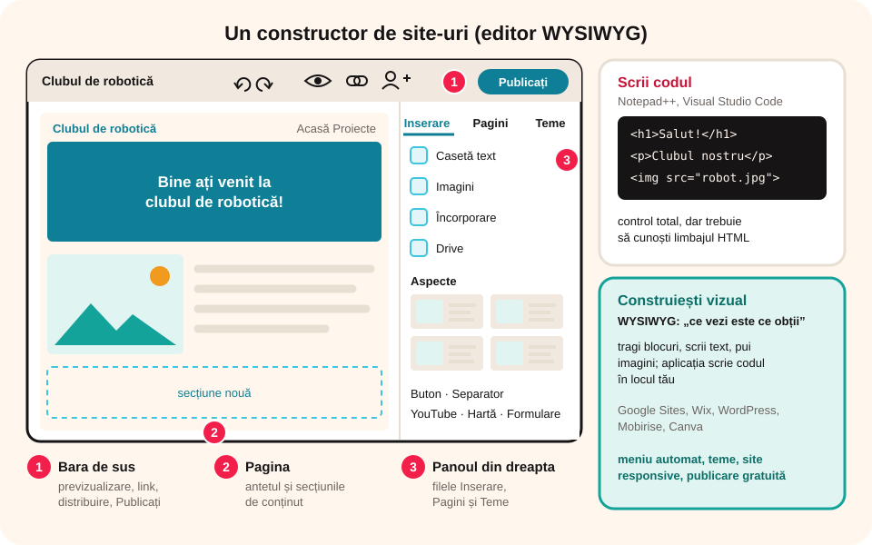

## Ce vei învăța azi

- ce tipuri de aplicații se folosesc pentru crearea **paginilor web**;
- ce înseamnă **WYSIWYG**;
- să recunoști elementele **interfeței Google Sites**;
- ce **facilități** oferă un constructor de site-uri.

## Să ne amintim

O pagină web este scrisă în **HTML**, cu etichete ca `<h1>`, `<p>`, `<a>`, ``. Pagina are **antet**, **meniu**, **conținut** și **subsol**.

## Lecția pe scurt

### Două feluri de a face o pagină

1. **Scrii codul** HTML și CSS într-un **editor de cod**: **Notepad** (simplu), **Notepad++**, **Visual Studio Code**. Salvezi fișierul cu extensia `.html` și îl deschizi în browser. Ai control total, dar trebuie să cunoști limbajul.
2. **Construiești vizual**, fără cod, într-un editor **WYSIWYG** (*What You See Is What You Get*, „ce vezi este ce obții”): tragi blocuri, scrii text, pui imagini, iar aplicația scrie codul pentru tine.

### Constructori de site-uri

| Aplicație | Caracteristici |
|---|---|
| **Google Sites** | gratuit, în browser, cu contul școlii; colaborativ; publicare cu un clic |
| **Wix**, **Weebly** | șabloane frumoase, online; versiune gratuită cu reclame |
| **WordPress** | foarte folosit pentru bloguri și site-uri mari |
| **Mobirise** | se instalează pe calculator; construiești din blocuri |
| **Canva** (site-uri) | pornești de la un design gata făcut |

### Interfața Google Sites

Intri în Google Drive → **+ Nou → Mai multe → Google Sites** (sau sites.google.com) și alegi **Site necompletat** sau un **șablon**.

1. **Bara de sus**: numele fișierului site-ului (în Drive), **Anulare / Refacere**, **Previzualizare** (ochiul), **Copiere link**, **Distribuiți cu alte persoane**, butonul **Publicați**.
2. **Pagina** (centru): **antetul** cu titlul paginii și imaginea de fundal, apoi **secțiunile** de conținut; sus, **numele site-ului** și sigla.
3. **Panoul din dreapta**, cu trei file:
   - **Inserare**: **Casetă text**, **Imagini**, **Încorporare** (cod sau adresa altui site), **Drive** (fișiere), **Aspecte** (machete gata făcute cu text și imagini), **Buton**, **Separator**, **YouTube**, **Calendar**, **Hartă**, **Documente / Prezentări / Foi de calcul / Formulare** Google;
   - **Pagini**: lista paginilor; butonul **+** adaugă o pagină nouă sau o subpagină;
   - **Teme**: culori și fonturi pentru tot site-ul.



### Facilități

- **șabloane** și **teme**: aspect unitar, profesionist;
- **meniu de navigare** creat automat din lista paginilor;
- site **responsive**: arată bine și pe telefon (verifici la Previzualizare);
- **încorporarea** de conținut: hărți, filme, prezentări, formulare;
- **lucru colaborativ**: mai mulți editori, ca la Google Docs;
- **salvare automată** și **istoric al versiunilor**;
- **publicare** gratuită, la o adresă de tipul `sites.google.com/view/numele-site-ului`.

## Exemplu rezolvat: explorăm Google Sites

1. Creezi **Site necompletat** și îl numești `Clubul de robotica`.
2. În antet scrii titlul paginii: „Bine ați venit la clubul de robotică!”.
3. Din **Inserare → Aspecte** alegi o machetă cu imagine și text.
4. Din **Teme** alegi tema „Simplu” și o culoare albastră.
5. Din **Pagini → +** adaugi pagina „Proiecte”: în antet apare automat meniul.
6. Apeși **Previzualizare** și treci pe vizualizarea de **telefon**.

## Aplicații interactive

```categorii
# Editor de cod sau constructor vizual?
Editor de cod: Notepad++, Visual Studio Code, Notepad
Constructor vizual: Google Sites, Wix, Mobirise
```

```quiz
# Alege răspunsul corect.
Ce înseamnă WYSIWYG?
* ce vezi este ce obții: construiești vizual, iar codul se scrie automat
- un limbaj de programare
- un tip de server

În ce filă din Google Sites adaugi o pagină nouă?
- Inserare
* Pagini
- Teme

Ce opțiune din fila Inserare folosești pentru o hartă sau un film?
- Separator
* Încorporare sau elementele Hartă și YouTube
- Teme
```

```categorii
# În ce filă din Google Sites găsești?
Inserare: Casetă text, Imagini, Buton, YouTube
Pagini: pagină nouă, subpagină
Teme: culorile și fonturile site-ului
```

```adevarat-fals
A: O pagină HTML se poate scrie și în Notepad.
F: În Google Sites trebuie să scrii codul HTML al fiecărei pagini. | Construiești vizual; codul se scrie automat.
A: Meniul de navigare din Google Sites se creează automat din lista paginilor.
A: Butonul Previzualizare arată cum se vede site-ul pe telefon, tabletă și calculator.
```

```completare
# Completează.
Un editor în care construiești vizual, fără cod, se numește [WYSIWYG]. Culorile și fonturile întregului site se aleg din fila [Teme]. Site-ul devine vizibil pe internet după ce apeși [Publicați|Publicare].
```

## Exersează

1. Compară Google Sites și Wix după trei criterii (preț, ușurință, șabloane).
2. Creează în Notepad o pagină HTML cu un titlu, un paragraf și o legătură; salveaz-o ca `pagina.html` și deschide-o în browser.
3. Deschide Google Sites și găsește toate elementele din cele trei file ale panoului din dreapta.
4. Încearcă trei teme diferite și alege-o pe cea mai potrivită pentru un site al clasei.
5. **Portofoliu:** creează site-ul `Portofoliul meu TIC` (nepublicat încă), cu pagina de start și două pagini goale: „Excel” și „Pagini web”.

## Verifică-te

- Care sunt avantajele unui constructor de site-uri față de un editor de cod?
- Ce găsești în fila Inserare din Google Sites?

## Pe scurt

Paginile web se pot face **scriind cod** (Notepad++, VS Code) sau **vizual**, în editoare **WYSIWYG** și constructori de site-uri (**Google Sites**, Wix, WordPress, Mobirise). **Google Sites** are bara de sus (previzualizare, distribuire, **Publicați**), pagina și panoul cu filele **Inserare**, **Pagini** și **Teme**. Facilități: șabloane, meniu automat, site responsive, încorporare, colaborare și publicare gratuită.
