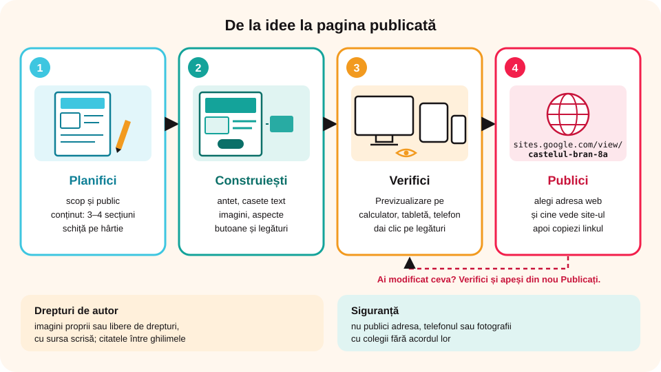

> **Competențe specifice (Anexa 15):** CS 1.2, CS 3.2

## Ce vei învăța azi

- să **planifici** o pagină web;
- să adaugi **text**, **imagini**, **legături** și **butoane** în Google Sites;
- să respecți **drepturile de autor** și regulile de **siguranță**;
- să **publici** un site de o pagină.

## Să ne amintim

În **Google Sites**, panoul din dreapta are filele **Inserare**, **Pagini** și **Teme**. Butonul **Previzualizare** arată site-ul pe diferite ecrane, iar **Publicați** îl pune pe internet.

## Lecția pe scurt

### 1. Planificarea

Înainte să deschizi aplicația, stabilești pe hârtie:

- **scopul** și **publicul** (cine va citi pagina?);
- **conținutul**: titlu, 3–4 secțiuni, imagini;
- o **schiță** a paginii: unde stau antetul, textul, imaginile, butonul.

### 2. Construirea în Google Sites

- **Antetul**: dai clic pe titlu și scrii; cu **Schimbați imaginea** pui un fundal; din **Tipul antetului** alegi mărimea (Copertă, Banner mare, Banner, Numai titlul).
- **Numele site-ului și sigla**: în colțul din stânga sus.
- **Text**: **Inserare → Casetă text**; alegi stilul (Titlu, Subtitlu, Text normal), **B** *I*, liste, aliniere, legături.
- **Imagini**: **Inserare → Imagini → Încărcați** (de pe calculator) sau **Selectați** (din Drive, căutare Google cu imagini libere). Clic pe imagine: o **decupezi**, îi pui **text alternativ** și o **legătură**.
- **Aspecte**: machete cu imagine + text, gata aranjate.
- **Buton**: **Inserare → Buton**, cu nume și adresă (de exemplu, „Vezi harta”).
- **Legătură** (hiperlink): selectezi textul și apeși iconița de lanț (**Ctrl + K**).
- **Secțiuni**: tragi de **mânerul** din stânga unei secțiuni ca s-o muți; din pictograma de paletă îi schimbi **fundalul**; o poți **duplica** sau **șterge**.

### 3. Drepturi de autor și siguranță

- folosești imagini **proprii** sau **libere de drepturi** (de exemplu, Pixabay, Unsplash, Wikimedia Commons) și scrii **sursa**;
- **nu** publici date personale: adresa, telefonul, fotografii cu colegii fără acordul lor;
- textul îl scrii tu; dacă citezi, pui ghilimele și autorul.

### 4. Verificarea și publicarea

1. **Previzualizare**: verifici pe calculator, tabletă și telefon; dai clic pe toate legăturile.
2. **Publicați** → alegi **adresa web**: `sites.google.com/view/` + un nume scurt, fără spații (de exemplu, `castelul-bran-8a`).
3. La **Cine poate vedea site-ul meu** alegi: doar cei din școală sau **Oricine**.
4. Apeși **Publicați**. Primești linkul prin **Copiere link**.
5. După orice modificare, apeși din nou **Publicați** ca modificările să apară online.



### Varianta în HTML

O pagină simplă scrisă de mână, salvată ca `index.html`, se poate publica gratuit pe servicii precum **GitHub Pages** sau **Netlify**. `index.html` este numele obișnuit al paginii de start.

Cum scrii codul unei astfel de pagini (corpul `body`, paragrafele `p`, imaginile `img` și formatările) afli în lecția **„Pagina web în HTML – corpul paginii, paragrafe, imagini și formatări”**.

## Exemplu rezolvat: pagina „Castelul Bran”

1. **Plan**: public – colegii; secțiuni – Istoria, Legenda, Vizitarea, Surse.
2. Antet de tip **Banner**, cu o fotografie liberă de drepturi a castelului și titlul „Castelul Bran”.
3. Secțiunea „Istoria”: un **Aspect** cu imagine în stânga și text în dreapta.
4. Secțiunea „Legenda”: casetă text cu o listă de trei curiozități.
5. Secțiunea „Vizitarea”: **Inserare → Hartă** cu locația și un **Buton** „Site-ul oficial”.
6. Subsol: „Surse: …” și „Realizat de clasa a VIII-a A”.
7. **Previzualizare** pe telefon, apoi **Publicați** la adresa `castelul-bran-8a`.

## Aplicații interactive

```ordonare
# Etapele realizării unei pagini web
Stabilești scopul și publicul
Desenezi schița paginii
Adaugi antetul și titlul
Adaugi textele, imaginile și butoanele
Verifici cu Previzualizare
Publici pagina
```

```quiz
# Alege răspunsul corect.
Ce imagini poți folosi pe pagina publicată?
* imagini proprii sau libere de drepturi, cu sursa menționată
- orice imagine găsită pe internet
- doar imagini cu colegii, fără acordul lor

Ai modificat un text după publicare. Ce faci ca modificarea să apară online?
- nimic, apare automat
* apeși din nou Publicați
- ștergi site-ul și îl faci din nou

Ce adresă web este corectă pentru site?
- castelul bran 8A
* castelul-bran-8a
- castelul/bran?8a
```

```categorii
# Ce element din Inserare folosești?
Casetă text: un paragraf despre istoria castelului
Imagini: fotografia castelului
Hartă: locația pe hartă
Buton: legătura către site-ul oficial
```

```adevarat-fals
A: Textul alternativ al unei imagini ajută persoanele cu deficiențe de vedere.
F: Pe un site public e bine să scrii adresa și telefonul tău. | Datele personale nu se publică.
A: index.html este numele obișnuit al paginii de start.
A: Ctrl + K adaugă o legătură la textul selectat.
```

```completare
# Completează.
Înainte de publicare verifici pagina cu [Previzualizare|Previzualizarea]. Imaginile luate de pe Pixabay sau Wikimedia Commons trebuie însoțite de [sursă|sursa]. Pagina de start a unui site scris în HTML se numește de obicei [index.html].
```

## Exersează

1. Fă schița unei pagini despre hobby-ul tău: antet, trei secțiuni, un buton.
2. Construiește pagina în Google Sites, cu cel puțin trei imagini libere de drepturi și sursele lor.
3. Adaugă o hartă, un film YouTube și o legătură către un site util.
4. Verifică pagina pe telefon și corectează ce nu arată bine.
5. **Portofoliu:** publică site-ul de o pagină „Un loc din România pe care vreau să-l vizitez” și trimite linkul profesorului.

## Verifică-te

- Ce verifici înainte să publici un site?
- Ce reguli respecți când alegi imaginile?

## Pe scurt

O pagină bună începe cu un **plan**: scop, public, conținut, schiță. În Google Sites adaugi **antetul**, **casete text**, **imagini**, **aspecte**, **butoane** și **legături**. Folosești imagini **libere de drepturi**, cu sursa, și **nu publici date personale**. Verifici cu **Previzualizare**, apoi **Publici** la o adresă de tipul `sites.google.com/view/nume`.
