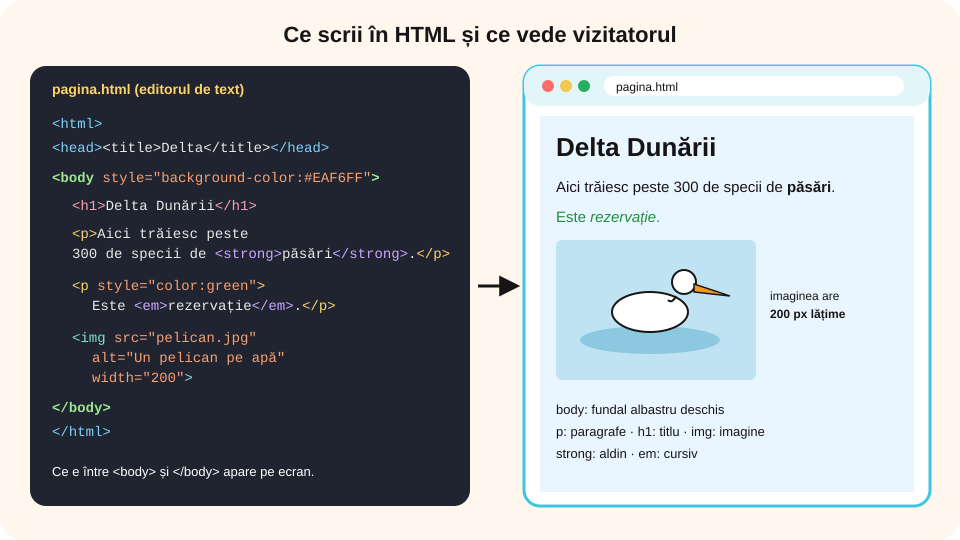

> **Competențe specifice (Anexa 15):** CS 1.2, CS 3.2

## Ce vei învăța azi

- ce rol au **antetul** (`head`) și **corpul** (`body`) unei pagini;
- să scrii **titluri** și **paragrafe** (`<p>`);
- să inserezi o **imagine** (``) cu atributele `src`, `alt` și `width`;
- să **inserezi**, să **modifici** și să **ștergi** elemente din pagină;
- să aplici **formatări de bază**: aldin, cursiv, culoare, aliniere, fundal.

## Să ne amintim

Paginile web sunt scrise în **HTML**, cu **etichete** între paranteze unghiulare: `<p>` … `</p>`. Browserul citește codul și **afișează** pagina. În Google Sites ai construit pagini fără să vezi codul; aplicația l-a scris în locul tău.

## Lecția pe scurt

### Unde scrii codul

Ai nevoie doar de un **editor de text** (Notepad, Notepad++, Visual Studio Code) și de un **browser**:

1. scrii codul în editor;
2. îl salvezi cu extensia **.html** (de exemplu `pagina.html`), cu codificarea **UTF-8**, ca diacriticele să apară corect;
3. dai **dublu clic** pe fișier: se deschide în browser;
4. după fiecare modificare **salvezi** (Ctrl + S) și **reîmprospătezi** pagina în browser (**F5**).

Există și **editoare vizuale** (Google Sites, editorul unui blog, BlueGriffon), în care formatezi ca în Word, iar aplicația scrie codul HTML.

### Scheletul paginii: head și body

```html
<!DOCTYPE html>
<html lang="ro">
  <head>
    <meta charset="UTF-8">
    <title>Delta Dunării</title>
  </head>
  <body>
    … tot ce se vede pe pagină …
  </body>
</html>
```

- `<html>` cuprinde **toată** pagina;
- `<head>` (antetul documentului) conține informații **despre** pagină: codificarea și **titlul** din fila browserului; **nu** se vede în pagină;
- `<body>` (**corpul paginii**) conține tot ce **apare pe ecran**: titluri, paragrafe, imagini, legături.

Etichetele se **închid în ordinea inversă** deschiderii: `<p><strong>text</strong></p>`, nu `<p><strong>text</p></strong>`.

### Titluri și paragrafe

- `<h1>` … `</h1>` este titlul principal; `<h2>` … `<h6>` sunt subtitluri, din ce în ce mai mici;
- `<p>` … `</p>` este un **paragraf**; browserul lasă automat un spațiu între paragrafe;
- `<br>` trece textul pe **rândul următor** în același paragraf (nu are etichetă de închidere);
- **atenție:** spațiile multiple și tasta Enter din cod **nu** se văd în pagină; un paragraf nou se face doar cu `<p>`.

```html
<h1>Delta Dunării</h1>
<p>Delta Dunării se află în sud-estul României.</p>
<p>Aici trăiesc peste 300 de specii de păsări.<br>Cea mai cunoscută este pelicanul.</p>
```

### Imaginea: eticheta img

```html

```

| Atribut | Ce înseamnă |
|---|---|
| `src` | **sursa**: numele (calea) fișierului imagine; dacă imaginea e în același folder cu pagina, scrii doar numele: `pelican.jpg`; dacă e în folderul `imagini`, scrii `imagini/pelican.jpg` |
| `alt` | **textul alternativ**: descrierea imaginii, citită de cititoarele de ecran și afișată dacă imaginea nu se încarcă |
| `width` / `height` | **lățimea** / înălțimea în pixeli; dacă scrii doar `width`, înălțimea se calculează singură și imaginea nu se deformează |

`` **nu** are etichetă de închidere. Numele fișierului trebuie scris **exact** (cu aceeași extensie: `.jpg`, `.png`), altfel apare doar textul alternativ.



### Formatări de bază

| Cod | Efect |
|---|---|
| `<strong>text</strong>` (sau `<b>`) | **aldin** (îngroșat) |
| `<em>text</em>` (sau `<i>`) | *cursiv* (înclinat) |
| `<u>text</u>` | subliniat |
| `<p style="color: blue;">` | textul paragrafului are culoarea albastră |
| `<p style="text-align: center;">` | paragraf **centrat** (sau `left`, `right`, `justify`) |
| `<p style="font-size: 20px;">` | mărimea literelor |
| `<p style="font-family: Arial;">` | fontul |
| `<body style="background-color: lightyellow;">` | **fundalul** întregii pagini |

Mai multe proprietăți se scriu în același `style`, despărțite prin **punct și virgulă**: `<p style="color: green; text-align: center;">`. Culorile se pot scrie cu numele în engleză (`red`, `green`, `blue`, `orange`) sau cu un cod, ca `#1E8E3E`.

### Editarea: inserare, modificare, ștergere

- **Inserezi** un paragraf nou: scrii o nouă pereche `<p>` … `</p>` în locul în care vrei să apară, **în interiorul** lui `<body>`.
- **Inserezi** o imagine: copiezi fișierul imagine lângă pagină și scrii eticheta `` acolo unde trebuie să apară.
- **Modifici**: schimbi textul dintre etichete sau valoarea unui atribut (de exemplu `width="300"` devine `width="150"`).
- **Ștergi** un element: ștergi **tot** elementul, de la `<` de la eticheta de deschidere până la `>` de la eticheta de închidere. Dacă ștergi doar `<p>` și lași `</p>`, codul devine greșit.
- **Muți** un element: îl decupezi (Ctrl + X) și îl lipești (Ctrl + V) în noul loc.

### Reguli de structurare și design

- un singur `<h1>` pe pagină, apoi subtitluri `<h2>` pentru fiecare secțiune;
- paragrafe scurte, cu câte o idee fiecare;
- fiecare imagine are `alt` și o lățime potrivită (nu mai lată decât ecranul);
- cel mult 2–3 culori, cu **contrast** bun între text și fundal;
- același font și aceeași aliniere pentru textele de același fel;
- imagini proprii sau libere de drepturi, cu **sursa** scrisă sub ele.

## Exemplu rezolvat: pagina „Delta Dunării”

Specificațiile: titlu, două paragrafe, o imagine de 250 px lățime, fundal galben-deschis, al doilea paragraf centrat și verde, cuvântul „pelicanul” aldin.

```html
<!DOCTYPE html>
<html lang="ro">
  <head>
    <meta charset="UTF-8">
    <title>Delta Dunării</title>
  </head>
  <body style="background-color: lightyellow;">
    <h1>Delta Dunării</h1>
    <p>Delta Dunării se află în sud-estul României și este o rezervație a biosferei.</p>
    <p style="color: green; text-align: center;">Cea mai cunoscută pasăre de aici este <strong>pelicanul</strong>.</p>
    
  </body>
</html>
```

Apoi profesorul cere modificări:

1. **Inserezi** un paragraf după imagine: `<p>Sursa imaginii: Wikimedia Commons</p>`.
2. **Modifici** lățimea imaginii: `width="250"` devine `width="400"`.
3. **Ștergi** primul paragraf: selectezi tot, de la `<p>` la `</p>`, și apeși Delete.
4. Salvezi (Ctrl + S) și reîmprospătezi browserul (F5).

## Aplicații interactive

```categorii
# Unde se scrie în pagină?
În head: titlul din fila browserului, codificarea UTF-8
În body: paragrafele, imaginile, titlul h1 afișat pe pagină
```

```quiz
# Alege răspunsul corect.
Ce parte a paginii conține tot ce se vede pe ecran?
- head
* body
- title
Explicație: Corpul paginii, între <body> și </body>, cuprinde conținutul afișat.

Care este scrierea corectă a unei imagini?
- pelican.jpg</img>
* 
- <image file="pelican.jpg">
Explicație: Eticheta img nu are închidere; fișierul se dă prin atributul src.

Ce face atributul alt al unei imagini?
* dă o descriere a imaginii, citită de cititoarele de ecran și afișată dacă imaginea lipsește
- schimbă lățimea imaginii
- adaugă un chenar

Ai scris două rânduri de text în cod, unul sub altul, în același paragraf. Cum apar în browser?
- pe două rânduri
* pe același rând, pentru că Enter din cod nu se vede
- browserul afișează o eroare

Cum centrezi un paragraf?
- <p align-center>
* <p style="text-align: center;">
- <center-p>
```

```categorii
# Ce etichetă folosești?
p: un paragraf de text
img: o fotografie
strong: un cuvânt scris aldin
em: un cuvânt scris cursiv
h1: titlul principal
br: trecerea pe rândul următor în același paragraf
```

```ordonare
# Ordonează liniile unei pagini HTML corecte
<html>
<head>
<title>Pagina mea</title>
</head>
<body>
<p>Bun venit pe pagina mea!</p>
</body>
</html>
```

```adevarat-fals
A: Eticheta img nu are etichetă de închidere.
F: Conținutul din head se afișează pe pagină. | În head sunt informații despre pagină, ca titlul din fila browserului.
A: Dacă scrii doar width, înălțimea imaginii se calculează singură, fără deformare.
F: Ca să ștergi un paragraf, e suficient să ștergi eticheta de deschidere p. | Ștergi tot elementul, de la <p> la </p>.
A: După ce modifici fișierul, îl salvezi și reîmprospătezi browserul cu F5.
A: Etichetele se închid în ordinea inversă deschiderii.
```

```completare
# Completează.
Tot ce se vede pe pagină se scrie între etichetele <body> și [</body>]. Un paragraf se scrie cu eticheta [p|<p>]. Numele fișierului imagine se dă în atributul [src], descrierea imaginii în atributul [alt], iar lățimea în atributul [width]. Fundalul întregii pagini se schimbă cu proprietatea [background-color].
```

```eseu
# Aplică: pagina ta, după specificații
Scrie codul HTML complet al unei pagini despre animalul tău preferat care respectă specificațiile: titlu h1; cel puțin două paragrafe; un cuvânt aldin și unul cursiv; o imagine cu src, alt și lățimea de 300 px; al doilea paragraf centrat și colorat; fundalul paginii colorat. Apoi explică, în două-trei propoziții, ce ai modifica pentru a șterge imaginea și pentru a insera un al treilea paragraf.
Cuvinte: 40-200
Barem: scheletul html, head (cu title), body; h1 și cel puțin două elemente p închise corect; strong (sau b) și em (sau i) în interiorul unui paragraf; img cu src, alt nevid și width="300", fără etichetă de închidere; style="text-align: center; color: …" pe al doilea paragraf; style="background-color: …" pe body; explicația: ștergi tot elementul img, de la < la >, și scrii o nouă pereche <p>…</p> în body.
```

## Exersează

1. Creează în Notepad fișierul `delta.html` din exemplul rezolvat și deschide-l în browser. Schimbă culoarea fundalului și reîmprospătează pagina.
2. Adaugă un al treilea paragraf în care două cuvinte sunt aldine și unul cursiv.
3. Pune o imagine proprie în același folder cu pagina și inserează-o cu lățimea de 200 px. Schimbă apoi lățimea la 400 px. Ce se întâmplă cu înălțimea?
4. Scrie greșit numele imaginii (de exemplu `pelikan.jpg`). Ce apare în locul ei? De ce e important atributul `alt`?
5. Șterge al doilea paragraf și verifică dacă pagina se afișează corect.
6. **Proiect (avansat):** realizează pagina `oras.html` despre orașul tău, după specificațiile: un titlu, trei secțiuni cu subtitlu `<h2>`, cel puțin patru paragrafe, două imagini cu `alt` și lățimi potrivite, sursele imaginilor, cel mult trei culori și text aliniat la fel în fiecare secțiune. Prezintă-i colegului pagina și cere-i să verifice fiecare specificație.

## Verifică-te

- Care e diferența dintre `<head>` și `<body>`?
- Ce atribute are eticheta `` și ce face fiecare?
- Cum ștergi corect un paragraf din cod?

## Pe scurt

O pagină HTML are un **antet** (`<head>`, cu titlul din fila browserului) și un **corp** (`<body>`), cu tot ce se vede. Textul se împarte în **titluri** (`<h1>`…`<h6>`) și **paragrafe** (`<p>`). Imaginile se inserează cu ``. Formatezi cu `<strong>`, `<em>`, `<u>` și cu atributul `style` (culoare, aliniere, mărime, font, fundal). Editezi inserând, modificând sau ștergând **elemente întregi**, apoi salvezi și reîmprospătezi browserul.
